# DevLens

**From AI coding sessions to verifiable engineering evidence.**

DevLens records a consented AI coding session as an event log: prompts, tool calls, edits, and test runs. It links those events with fixed rules, re-runs the final test in a separate sandbox, and syncs everything to a screen recording. A reviewer clicks a claim such as "the test passed" and sees the event, the diff, the test output, the independent re-run, and the moment in the video.


[Watch the demos](#watch-devlens-in-action) · [Quick start](#quick-start) · [Screenshots](#product-tour) · [How evidence works](#how-evidence-verification-works) · [Architecture](#architecture) · [Limits](#privacy-consent-and-limits)

---

## Why DevLens exists

AI coding agents now write much of the code in a change. A reviewer usually sees one of three things, and each one leaves a gap.

| What you review | What it shows | What it leaves out |
|---|---|---|
| The final commit or PR | The end state of the code | Which tests failed on the way, which edits were replaced, and what the developer asked for |
| The agent transcript | What the agent said and did | An independent check of the result, and a link from each claim to the moment it happened |
| A screen recording | What was on screen | Structured, searchable events. Claude Code also collapses tool output on screen, so a test result may not be visible |
| **DevLens** | Every event with an ID, rule edges that cite their evidence, a separate sandbox re-run, and a click that seeks the recording | Reasoning, the editor, and other terminals. The page lists these as not captured |

The core idea: **code review shows the artifact; DevLens makes the process inspectable.** Every link on the page names the rule that made it and the event IDs it rests on. The page says what is observed, what is inferred, and what is unknown. It never scores, ranks, or recommends anyone. The reviewer decides.

## Watch DevLens in action

Both videos are scripted demos with no audio. In each one, Claude played the developer and typed the answers. The captions in the videos say so.

### Full-stack development demo (5:04)

[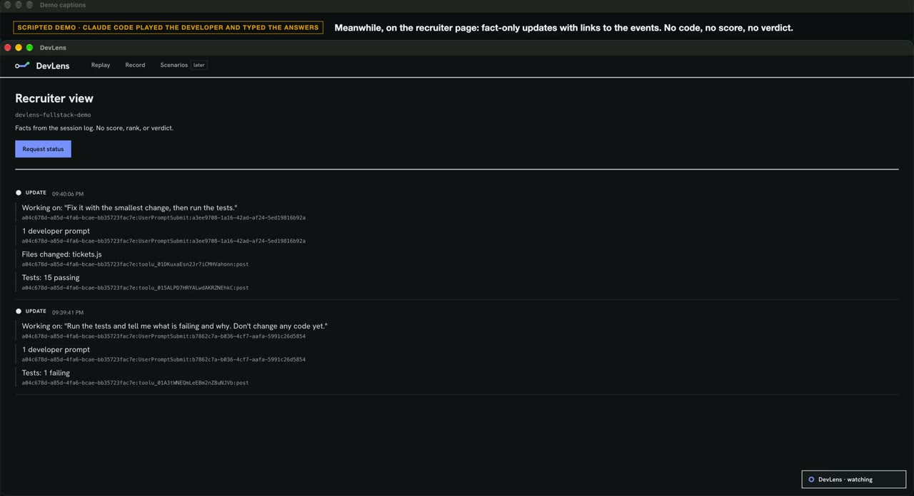](https://github.com/yeruvamaheswar/DevLens/releases/download/demo-videos-v1/devlens-fullstack-demo.mp4)

**[▶ Play the full-stack demo (MP4, 21 MB)](https://github.com/yeruvamaheswar/DevLens/releases/download/demo-videos-v1/devlens-fullstack-demo.mp4)**

Claude Code works through five prompts on a small full-stack ticket app. It diagnoses a failing test, fixes it, adds an assignee field, and adds API tests. DevLens hooks capture every prompt, edit, and test run. The opt-in question agent asks short questions in a desktop widget. A recruiter page receives fact-only updates with event IDs.

What to look for:

- **0:20–1:00:** Claude reports 1 of 15 tests failing and finds an off-by-one bug.
- **About 1:20:** The recruiter page shows "Tests: 1 failing", then "Tests: 15 passing". Each line carries the event ID it came from.
- **About 2:20:** The widget asks how blank assignee names should behave. The developer answers.
- **4:30–5:00:** "Request status" returns a summary: 5 developer prompts, tests 1 failing → 20 passing, and questions asked and answered.

This video shows live capture and the question agent. To see the replay and the evidence chain, use the [product tour](#product-tour) or the [quick start](#quick-start).

### T3 Code workflow demo (8:15)

[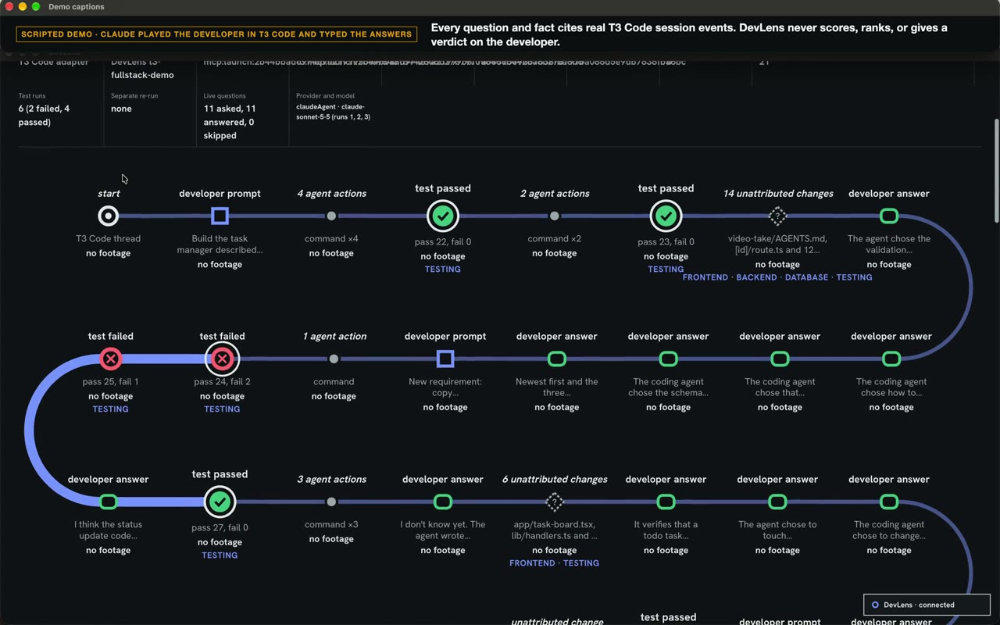](https://github.com/yeruvamaheswar/DevLens/releases/download/demo-videos-v1/devlens-t3-workflow-demo.mp4)

**[▶ Play the T3 Code workflow demo (MP4, 31 MB)](https://github.com/yeruvamaheswar/DevLens/releases/download/demo-videos-v1/devlens-t3-workflow-demo.mp4)**

In T3 Code, Claude Sonnet 5.5 builds a task manager over three prompts. The experimental DevLens T3 adapter reads T3's local session store, read-only. DevLens asks questions as runs finish. The recruiter page then draws the whole session as a journey line: passing tests, two failing tests for a new requirement, and the fix that makes 27 tests pass.

What to look for:

- **2:25–3:20:** The agent reports a real bug it found while checking the app: `node:sqlite` returns null-prototype rows.
- **About 2:40:** A DevLens question appears over T3 Code.
- **4:20–5:30:** A new requirement's tests fail first (pass 24, fail 2). The agent implements the rule and 27 tests pass.
- **About 8:00:** The journey line shows the red failed stations, then the green passed station. The test detail cites event IDs, and the page counts 11 questions asked and 11 answered.

This demo was recorded on a development branch of the experimental T3 adapter. Two items on screen are not on `main` yet: the live-question counts and the area tags (FRONTEND, BACKEND, and so on). Between about 0:25 and 2:15 the screen is mostly static while the agent works.

## What DevLens does

| Capability | What it does | Status |
|---|---|---|
| **Capture** | Claude Code hooks append one redacted JSON line per event to `.devlens/events.jsonl`. The hooks cover prompts, tool calls, edits, tests, and stops | Verified |
| **Redact** | Masks known secret patterns (API keys, bearer tokens, JWTs, `Authorization` headers) and the values of secret-looking environment variables before anything is written | Verified, with [limits](#privacy-consent-and-limits) |
| **Link** | Five fixed rules connect prompts, edits, and tests. Each edge names its rule, cites event IDs, and is labelled `observed` or `inferred`. No model is involved | Verified |
| **Re-run** | Copies the task to a temp folder and re-runs the test command under macOS `sandbox-exec`, with no network and no secrets. The result is stored as a separate event | Verified (macOS only) |
| **Record** | A browser recorder captures one window, or the whole desktop as a second opt-in. It never requests audio. The browser discards a take with audio or a camera, and the server checks the declared consent and track counts | Window mode: automated and upload checks passed, and the golden take was recorded with it. A full browser acceptance check is still open. Desktop mode: unit tested only |
| **Replay** | `/replay` syncs events to the video by media offset. A click on a station seeks the recording and opens its evidence | Verified |
| **Journey** | `/recruiter` draws the session as a line of stations (the "train line") with a seven-step failure-to-fix chain. Missing steps are stated, never filled in | Tested and reviewed |
| **Ask** | Three rule-based questions cite event IDs. An opt-in question agent can ask one question per stop | Rules: tested and reviewed. Agent: opt-in, off by default |
| **T3 Code adapter** | Reads T3 Code threads (Claude, Codex, or Cursor runs) from T3's local store, read-only | Experimental |

## The signature workflow

The repository ships one real, consented session: the **golden take** on the `broken-api` task. The author recorded their own Claude Code run. Here is what it contains, and what DevLens shows for each step.

1. **Prompt (0:19).** The developer asks Claude Code to run `npm test` and fix only the failure it prints.
2. **First failure (0:30).** The test fails: `wrong base URL: expected /api, received /v0`.
3. **First fix (0:53).** The agent edits `src/client.js` to change the base URL.
4. **Still failing (0:54).** The same command fails with a new assertion: `expected Authorization header`.
5. **Developer response (2:37).** The developer starts a second session with the same prompt. The test fails again (2:45).
6. **Revised code (2:57).** The agent edits `src/client.js` twice. DevLens marks the earlier edit as superseded.
7. **Pass (2:58).** `npm test` passes: pass 1, fail 0.
8. **Independent verification.** A separate sandbox worker re-runs `npm test` on a copy of the code and also passes. It is drawn as its own branch, outside the session, with no footage.
9. **The reviewer's click.** On `/replay`, click **Seek to the passing test at 177.9 seconds**. The video jumps to 2:58. The panel shows the test output, the separate re-run, and the rule `rule-5-later-pass-v1: this pass verifies the edit before it (observed)`.

Two facts the page states plainly: the git commits for the first and final fixes were made outside the recorded sessions, and pairing them with the hooked edits is an inference.

## Product tour

These screenshots come from `npm run demo -- --offline` on a clean checkout, except the recorder, which shows a configured local project.

### Home: the session as a line of events

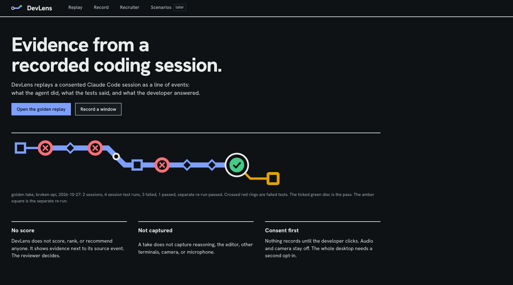

Red crossed rings are failed tests. The ticked green disc is the pass. The amber square is the separate re-run.

### Replay: failure to pass, with the counts behind it

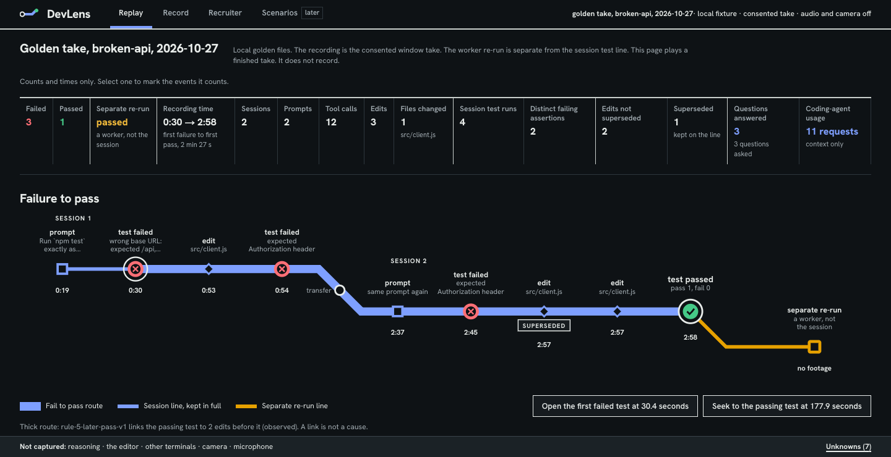

The summary band counts failures, passes, edits, and superseded edits. The thick route summarizes both sessions, from the first failure to the pass. The rule edge behind it, `rule-5-later-pass-v1`, links the second session's failure, the edits after it, and the pass. Rules run per session.

### Replay: the passing-test station, synced to the recording

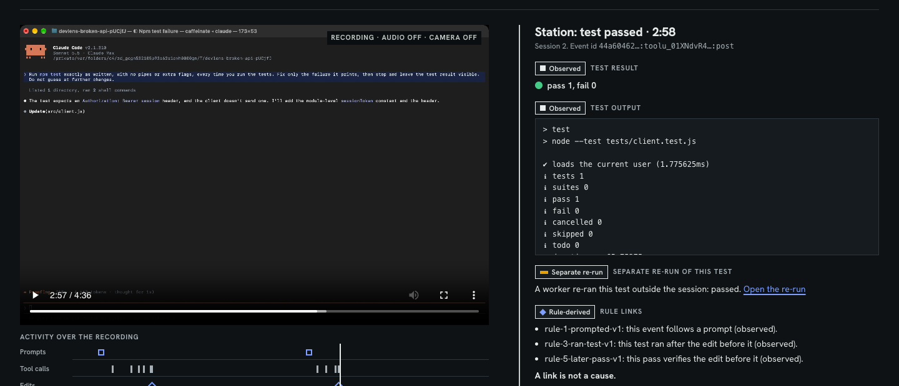

One click seeks the video and opens the evidence. Each block is labelled `Observed`, `Rule-derived`, or `Separate re-run`.

### Replay: commits, the separate re-run, and the rule edges

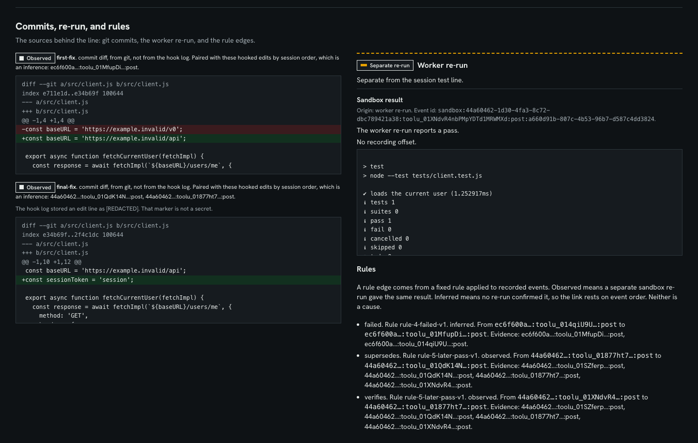

Commit diffs are labelled "from git, not from the hook log". The worker re-run has its own event ID and no recording offset. Each rule edge lists the event IDs it rests on.

### Recruiter view: the development journey (train line)

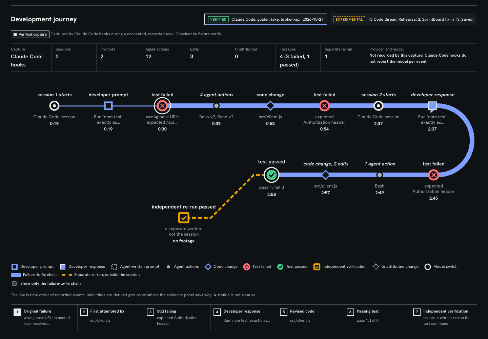

Every station is a recorded event or a labelled group of events. Italic titles are derived groups. The source picker labels each capture `Verified` or `Experimental`.

### Recruiter view: the failure-to-fix chain and its evidence

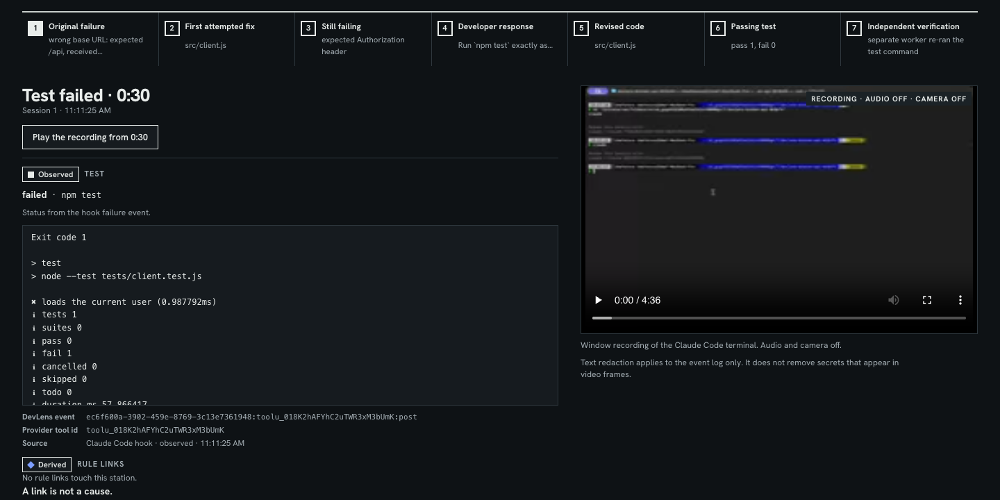

The seven steps run from the original failure to independent verification. The evidence panel shows the DevLens event ID, the provider's tool ID, and a button that plays the recording from that moment.

### Recruiter view: a T3 Code thread (experimental)

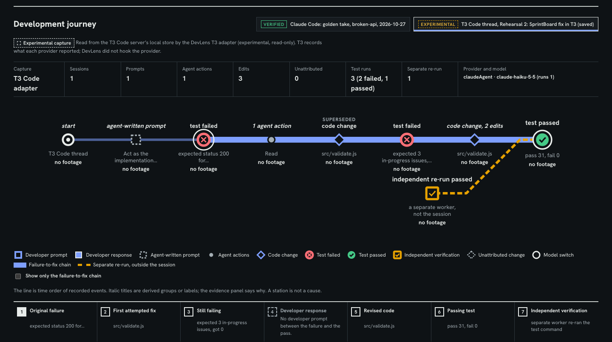

A saved T3 Code session on a separate app. Its prompt was written by an agent, so step 4 says "No developer prompt between the failure and the pass" instead of inventing one.

### Recorder: consent first, audio and camera off

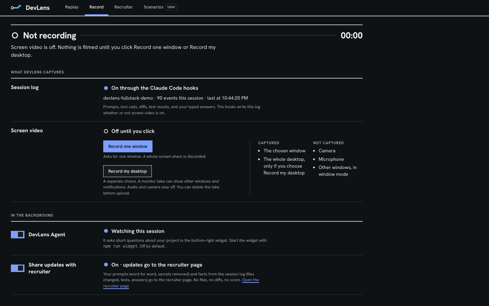

Nothing is filmed until the developer clicks. Window mode is the default. Desktop recording is a separate choice with its own warning.

## How evidence verification works

DevLens keeps four kinds of statement apart. The page labels each one.

| Kind | Where it comes from | Example |
|---|---|---|
| **Observed event** | A Claude Code hook (or the T3 adapter) recorded it. `provenance: "observed"` | `npm test` failed at 16:13:40 |
| **Rule-derived edge** | A fixed rule in [`packages/link/src/rules.ts`](packages/link/src/rules.ts) applied to event order. The edge names the rule and cites event IDs | `verifies` from the passing test to the last edit |
| **Inferred link** | A rule edge with no independent confirmation, or a pairing based only on order | A commit diff paired with hooked edits by session order |
| **Independent result** | A separate sandbox re-run, stored as its own event with `source: "sandbox"`. It is never merged into the session's test line | The re-run of `npm test` passed |

### The rules

| Rule | Edge | Labelled `observed` when | Otherwise |
|---|---|---|---|
| `rule-1-prompted-v1` | prompt → each tool call, edit, or test until the next stop | always | — |
| `rule-2-edited-v1` | edit → its tool call, or the enclosing prompt | the edit event itself was observed | `inferred` |
| `rule-3-ran-test-v1` | test → nearest earlier eligible edit | the test and the edit are inside the same prompt | `inferred` |
| `rule-4-failed-v1` | failed test → nearest earlier eligible edit | a matching sandbox re-run also failed | `inferred` |
| `rule-5-later-pass-v1` | `verifies` (pass → last edit) and `supersedes` (last edit → earlier edits), between a failure and a later pass of the same command | a matching sandbox re-run also passed | `inferred` |

An **eligible edit** is an attributed file edit inside the same prompt as the test, or one that touched a file the test names. A **matching re-run** is a sandbox event with `signal: "rerun"`, whose `rerun_of` is the session test's ID, with the same `command` and `status`. Rules run once per session. Rule 5 emits nothing when no edit sits between the failure and the pass. An `observed` label means the inputs were recorded or independently confirmed. It does not mean the edit caused the pass. The page says so on every rule block: **a link is not a cause.**

### A real citation chain

These lines come from the golden take ([`session.jsonl`](examples/broken-api/fixtures/golden/session.jsonl) and [`rerun.jsonl`](examples/broken-api/fixtures/golden/rerun.jsonl)), trimmed for width.

```jsonc
// Observed: the session's test fails (session 2)
{"id":"44a60462-…:toolu_01SZferpspmCBUArZU1oZvTA:post","type":"test","actor":"agent",
 "source":"claude_code_hook","provenance":"observed","ts":"2026-10-27T16:13:40.814Z",
 "payload":{"status":"failed","command":"npm test","signal":"hook_failure"}}

// Observed: the same command passes after two edits
{"id":"44a60462-…:toolu_01XNdvR4nbPMpYDTd1MRWMXd:post","type":"test","actor":"agent",
 "source":"claude_code_hook","provenance":"observed","ts":"2026-10-27T16:13:53.323Z",
 "payload":{"status":"passed","command":"npm test","signal":"output_parse"}}

// Independent: a separate sandbox worker re-ran that command
{"id":"sandbox:44a60462-…:toolu_01XNdvR4nbPMpYDTd1MRWMXd:post:a660d91b-…","type":"test",
 "actor":"ci","source":"sandbox","media_offset_ms":null,
 "payload":{"status":"passed","command":"npm test","signal":"rerun","isolation":"sandbox-exec",
            "rerun_of":"44a60462-…:toolu_01XNdvR4nbPMpYDTd1MRWMXd:post"}}
```

The linker derives this edge from those events. The offline replay recomputes it each time it loads:

```json
{"rel":"verifies","derived_by":"rule-5-later-pass-v1","provenance":"observed",
 "src":"…toolu_01XNdvR4nbPMpYDTd1MRWMXd:post","dst":"…toolu_01877ht7Hbx5n2EMvP6QCJza:post",
 "evidence_event_ids":["…toolu_01SZferpspmCBUArZU1oZvTA:post","…toolu_01QdK14NUELNYGU1wXAWV3DX:post",
                       "…toolu_01877ht7Hbx5n2EMvP6QCJza:post","…toolu_01XNdvR4nbPMpYDTd1MRWMXd:post"]}
```

It is `observed` because the re-run has `signal: "rerun"`, and its `rerun_of`, `status`, and `command` all match the session's passing test. Without the re-run, the same edge would be `inferred`.

### Questions without a model

The replay asks three questions. Each one comes from a fixed rule and cites the events that triggered it:

- `rule-q1-next-prompt-omits-error-v1`: a test failed, and the next prompt did not mention the error.
- `rule-q2-edit-untested-until-end-v1`: an agent edit was kept with no test until the last test.
- `rule-q3-unhooked-commit-v1`: git shows commits that no hooked event covers.

The opt-in question agent is separate and off by default. Its questions are stored with `provenance: "inferred"`. Each one must cite real event IDs, including at least one developer prompt, or it is dropped.

## Architecture

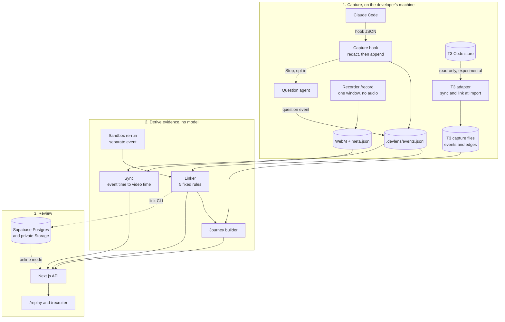

How the pieces fit:

- **Capture is append-only and local.** The hook stamps each event with an ID built from the session ID and the provider's tool-use ID. It assigns `seq` under a file lock and keeps the raw hook input in `payload.raw`. The API strips `payload.raw` before display.
- **Linking is pure code.** [`rules.ts`](packages/link/src/rules.ts) has no I/O and no model, so the same events always give the same edges. The offline replay recomputes edges from the fixture each time it loads. Online mode and T3 captures load stored edges instead. Online mode refuses to load unless every recomputed edge ID is present in the database.
- **Verification is a separate event.** The re-run never edits the session's test line. Rules only check whether a matching re-run exists.
- **Sync is arithmetic.** An event's video time is its timestamp, minus the recording's wall-clock start, minus any completed pauses. Events outside the recording get no offset and show "no footage".
- **Storage is optional.** Offline mode reads the committed fixture files. Online mode reads from Supabase with the server key. The `link` CLI writes one session atomically through the `replace_session` RPC. Recordings sit in a private bucket and are served through short-lived signed links. Row-level security gives the publishable key read-only access to one test fixture, and it cannot write.

## Quick start

**Prerequisites:** Node 24 (tested). macOS is needed only for the sandbox re-run. The offline demo needs no keys, no Supabase, and no network.

```bash
git clone https://github.com/yeruvamaheswar/DevLens.git
cd DevLens
npm install
npm run demo -- --offline
```

Open <http://localhost:3000>. If port 3000 is busy, Next.js picks another port and prints it. Stop any other `next dev` for this repo first, because a second one will not start. The replay header reads `local fixture` in this mode.

### Walk the evidence chain (2 minutes)

1. Open <http://localhost:3000/replay>.
2. Click **Open the first failed test at 30.4 seconds**. The video seeks to 0:30. The panel shows the assertion `wrong base URL: expected /api, received /v0` and the next agent edit.
3. Click **Seek to the passing test at 177.9 seconds**. Read the `Separate re-run` block and the `rule-5-later-pass-v1 … (observed)` rule link.
4. Scroll to **Commits, re-run, and rules** to see each edge with its evidence IDs.
5. Open <http://localhost:3000/recruiter?source=golden>. Click the steps of the failure-to-fix chain, then **Play the recording from 0:30**.
6. Open <http://localhost:3000/recruiter?source=t3-saved:sprintboard-rehearsal> to see a T3 Code session (experimental) through the same journey.

### Check it from the command line

```bash
npm run demo:smoke -- --offline      # fixture, edges, and WebM checks. Live checks print SKIPPED
npm run fixture:verify -- broken-api # the golden take: failure, then pass, inside the recording, consented, no audio
npm run scenario:verify -- --all-starters
```

### Capture your own Claude Code session

```bash
npx tsx packages/cli/src/init.ts <your-project-dir>
```

This prints a consent notice. It then writes project-local hooks to `<your-project-dir>/.claude/settings.local.json`, keeping any other hooks there. It refuses to write under `~/.claude`. Events go to `<your-project-dir>/.devlens/events.jsonl`. Set `DEVLENS_PROJECT_DIR` to that folder to see the session log, the question agent, and the recruiter feed on `/record` and `/recruiter`.

The Replay page and the Claude Code journey currently open the bundled golden take. A picker for your own captured sessions is [planned](#roadmap).

### Environment

Keys live in a repo-root `.env`, which Git ignores. None are needed for the offline demo.

| Variable | Used for |
|---|---|
| `NEXT_PUBLIC_SUPABASE_URL` | Supabase project URL (online mode) |
| `NEXT_PUBLIC_SUPABASE_PUBLISHABLE_KEY` | Browser key. Row-level security limits it to reading one test fixture |
| `SUPABASE_SECRET_KEY` | Server only. Reads sessions and signs short-lived media links. `npm run check:bundle` fails if its name reaches browser assets |
| `DEVLENS_OFFLINE` | Set by `npm run demo -- --offline`. `/replay?offline=1` forces it per request |
| `DEVLENS_RECORD_ENABLED` | Set to `1` to allow uploads to private storage. Off by default |
| `DEVLENS_PROJECT_DIR` | The folder Claude Code runs in. Enables the session log, question agent, and recruiter feed |
| `ANTHROPIC_API_KEY` | Optional. Routes the question agent to the Anthropic API instead of your Claude Code login |
| `DEVLENS_URL` | Optional. The page the macOS widget loads (default `http://localhost:3100/agent`) |

## Commands

| Command | What it does |
|---|---|
| `npm run demo -- --offline` | Start the app on the committed fixture. No keys |
| `npm run demo` | Start the app in online mode. Falls back to local files, with a warning, if Supabase is unavailable |
| `npm run check` | Type check |
| `npm run test:capture`, `test:link`, `test:rerun`, `test:sync`, `test:record`, `test:replay`, `test:journey` | Unit tests for capture, rules, re-run, sync, recorder, replay, and journey |
| `npm run test:agent`, `test:widget`, `test:recruiter`, `test:questions`, `test:t3`, `test:tracer` | Unit tests for the question agent, widget, recruiter feed, question rules, T3 adapter, and tracer fixture |
| `npm run demo:smoke [-- --offline]` | Fixture checks, plus live Supabase, row-level security, and signed-media checks when keys are set |
| `npm run fixture:verify -- broken-api` | Checks the golden take end to end |
| `npm run scenario:verify -- --all-starters` | Checks that every starter fails with a real assertion, in a temp copy |
| `npm run build && npm run check:bundle` | Production build, then confirms the server key name is absent from browser assets |
| `npm run agent:smoke` | One real question-agent call on a synthetic session. Uses your Claude Code login or `ANTHROPIC_API_KEY` |
| `npm run widget` | Build and open the macOS question widget (needs `swiftc`) |
| `npm run t3 -- <list\|import\|watch\|verify\|save\|publish>` | T3 Code adapter (experimental). See [packages/t3/README.md](packages/t3/README.md) |
| `npx tsx packages/cli/src/rerun.ts --dir <path> --command <cmd> --rerun-of <event-id> --session <id> --project <id>` | Re-run a test in the sandbox. Targets must be under `examples/` unless `--allowed-root` is given |
| `npx tsx packages/cli/src/link.ts <events.jsonl> [--recording <meta.json>] [--rerun <file>] [--dry-run]` | Link a session and write it to Supabase. Needs the server key. `--dry-run` only counts |

## Technology

- **TypeScript** throughout, run with `tsx` and tested with Vitest.
- **Next.js 16 and React 19** for the web app in `apps/web`.
- **Claude Code hooks** (`UserPromptSubmit`, `PreToolUse`, `PostToolUse`, `PostToolUseFailure`, `Stop`, `SessionEnd`) as the verified capture adapter.
- **Supabase** Postgres for events and edges, and private Storage buckets for recordings and published T3 captures, with row-level security.
- **Browser screen capture** (`getDisplayMedia`, WebM) for recording. Audio is never requested, and the server checks the declared track counts.
- **macOS `sandbox-exec`** for the independent re-run: no network, no writes outside a temp copy, secrets removed from the environment.
- **`node:sqlite`** (Node 24) for the read-only T3 Code store reader.
- **Swift** for the optional macOS question widget.
- **Claude** (`claude -p`, or the Anthropic Messages API) for the opt-in question agent only. Linking and the replay questions use no model.

## Example tasks

| Task | What fails |
|---|---|
| [`examples/broken-api`](examples/broken-api) | Wrong base URL, then a missing `Authorization` header. Holds the golden take in `fixtures/golden/` |
| [`examples/swapped-field`](examples/swapped-field) | Name and email are swapped |
| [`examples/missing-auth`](examples/missing-auth) | No `Authorization` header |
| [`examples/stale-cache`](examples/stale-cache) | The cache returns the old value after an update |
| [`examples/wrong-page`](examples/wrong-page) | Pagination asks for the wrong page |
| [`examples/bad-date`](examples/bad-date) | Date parsing gives the wrong day |
| [`examples/empty-list`](examples/empty-list) | An empty result crashes |

Each starter has one failing test. Run `npm test` inside its folder. To record your own take on `broken-api`, follow [examples/broken-api/RECORDING.md](examples/broken-api/RECORDING.md).

[`examples/t3-captures/sprintboard-rehearsal`](examples/t3-captures/sprintboard-rehearsal) is a saved T3 Code session on a separate app. Its prompt was written by an agent, and it has a sandbox re-run but no recording. [`examples/sprintboard-scenario`](examples/sprintboard-scenario) holds reference patches for that app. The app itself is not in this repository.

## Privacy, consent, and limits

**Consent and recording**

- Nothing is filmed until the developer clicks **Record one window** or **Record my desktop**. Desktop recording is a separate choice with its own warning, and the take is labelled `desktop`.
- The recorder never requests audio or a camera. The browser discards a take with an audio track or a camera. The server then checks the take's declared metadata, and refuses an upload without consent, with an audio track, or with the wrong mode. It does not inspect the video bytes.
- The developer reviews the take, then chooses Upload or Delete. Uploads go to a private bucket, and only when `DEVLENS_RECORD_ENABLED=1`.

**Redaction**

- Redaction runs before an event is written. It masks known patterns: Anthropic- and OpenAI-style keys, bearer tokens, JWTs, GitHub, AWS, and Slack tokens, and `Authorization` headers. It also masks the values of environment variables whose names look secret. A secret in a format it does not know is not masked.
- It does not remove names, emails, or home paths from raw hook payloads. The API strips raw payloads before display.
- It does not redact video frames. A secret shown on screen stays in the recording.

**Question agent (opt-in)**

- It is off unless `.devlens/agent.json` is exactly `{"enabled": true}`.
- It sends one request per stop to the engine you chose. The request holds the last 200 events, plus the latest developer prompt if it is older. It also holds all earlier questions and answers, up to 500 file names, and up to 8 small files. The whole prompt is redacted first.
- It skips `.env*` files (except `.env.example`), `*.pem` and `*.key` files, `.ssh/`, and files outside the project. A secret inside another file is masked only if it matches a known pattern.
- It has no tools, no retries, and a limit of 30 calls per session.

**What DevLens cannot prove**

- **Authorship.** Hooks see what the agent did through Claude Code. Edits made in an editor, another terminal, or a commit outside the session show up as unattributed or unknown.
- **Reasoning.** The model's private reasoning is not captured. The page says "Model reasoning: Unknown".
- **Causation.** A rule edge records order and confirmation, not cause.
- **Containment.** The sandbox re-run is meant for reviewed task code, one session at a time. It is not a defence against hostile code or sandbox escape. It runs on macOS only.
- **Ability.** DevLens does not score, rank, or recommend a hire. Nothing on the page predicts job performance.

**Operational limits**

- `GET /api/replay` has no authentication. In online mode, it can mint a 30-minute link to the private recording. Run the app locally, or share it on purpose.
- Claude Code collapses tool output on screen. At a seek point, the terminal may not show the failing or passing output. The log text on the page is the evidence.
- The T3 Code adapter reads an internal T3 database schema, checked against T3 Code 0.1.3 and 0.1.5. It stays experimental until a real recorded take passes its remaining evaluations.

## Roadmap

Planned. None of this is built yet.

- Open any captured Claude Code session in Replay and the journey, not only the bundled golden take.
- Wire the dependency-choice and follow-up question rules in `packages/questions` into the app. They are unit tested but not connected.
- Promote the T3 Code adapter from experimental after a real recorded take passes its evaluations.
- Add a re-run sandbox for Linux.
- Add a scenario catalog. The navigation shows it as "later".
- Apply the same evidence model to a project that runs for a week.

## Project layout

| Path | Contents |
|---|---|
| `apps/web` | Next.js app: `/`, `/replay`, `/recruiter`, `/record`, `/agent`, and the API routes |
| `apps/web/journey` | Provider-neutral journey builder, line layout, and evidence panel |
| `apps/widget` | Optional macOS widget for agent questions |
| `packages/capture` | Claude Code hook handler and redaction |
| `packages/core` | Event contract, sync, Supabase access, and demo and smoke scripts |
| `packages/link` | Linker rules and the sandbox re-run |
| `packages/cli` | `init`, `link`, and `rerun` |
| `packages/agent` | Opt-in question agent |
| `packages/questions` | Question rules (not wired into the app yet) |
| `packages/recruiter` | Fact-only recruiter updates |
| `packages/t3` | T3 Code adapter (experimental) |
| `examples` | Starter tasks, the golden take, and saved T3 captures |
| `supabase/migrations` | Schema, row-level security, and storage buckets |
| `docs` | [Competitor notes](docs/competitors.md), [implementation notes](docs/implementation.md), and the [presenter guide](docs/PRESENTATION_GUIDE.md) |
| `plans` | Product contract, build plan, and the independent review records for each slice |

The product contract is [plans/devlens.contract.md](plans/devlens.contract.md).

## Contributing

There is no contributing guide yet. Before you open a pull request, run `npm run check` and the test suites for the areas you changed. Changes made with coding agents follow the rules in [CLAUDE.md](CLAUDE.md). A builder never verifies its own change.

## License

No license file has been published. Until one is added, default copyright applies, and the code is not licensed for reuse.
