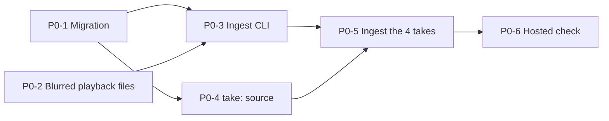

# Implementation roadmap: recruiter review

Status: 2026-10-29, evening. The migration is **applied**. `golden-broken-api` is ingested, blurred, and visible. `t3-take-3` is visible (events and analysis, no video). `fullstack-take-2` and `t3-video-take` are blurred and OCR-scanned but **not uploaded** until Uma watches them. Nothing is committed or pushed, so the hosted site shows no takes yet. P0-1 to P0-3 are done and independently reviewed.

Sources: `docs/SESSION_ASSET_INVENTORY.md`, `plans/recruiter-review-handoff.md`, `plans/take-ingest-contract.md`. Related: `docs/SUPABASE_MIGRATION_PLAN.md`, `docs/RECRUITER_REVIEW_ARCHITECTURE.md`, `docs/RECRUITER_DEMO_PLAN.md`.

## Result

- **P0** is the smallest path to a hosted demo: migration, ingest CLI, `take:` source, blurred playback files, 4 takes ingested, hosted check.
- **P1** makes it safe for outside recruiters: library page, Supabase Auth with review grants and RLS, URL refresh, delete command, T3 sync calibration, recorder fixes.
- **P2** adds scale: incremental ingest, versioned analysis, search, pagination, re-run on a rebuilt tree, Supabase Pro for originals.
- Complexity: S = under half a day, M = about a day, L = several days. These are relative estimates (assumption), not measured.
- Build order followed the tracer-bullet loop, with one change: golden went first (its blurred video was ready first and it is already the strongest take), then `t3-take-3`. Full-Stack and T3 named wait for blurred videos and Uma's watch-through.
- Push, deploy, and Pro upgrade need Uma's approval. Local commits are authorized.

File paths are from the sources where named. Paths marked (assumed) were not read.

## P0: hosted demo of 4 takes



### P0-1 Migration

| Field | Detail |
|---|---|
| Files | `supabase/migrations/20261030000000_takes_recordings.sql` |
| Depends on | Uma's approval (given). Backup export first |
| Risk | Rows with `checkpoint` or `t3_code` block rollback of the CHECK constraints. `replace_session` drift. Wrong project |
| Acceptance | Two tables, two CHECK changes, three indexes, RPC `replace_take`, bucket MIME list incl. `video/mp4`. Advisor shows only the intended `sprintboard_issues` finding |
| Validate | Export the 36 events and 33 edges. Apply on project `devlens` only. `list_tables`, `get_advisors`. Call `replace_take` with a bad payload and check each refusal rule |
| Complexity | S |

### P0-2 Blurred playback files

| Field | Detail |
|---|---|
| Files | `.devlens/ingest/<take>/playback.mp4` (Git-ignored). Originals untouched |
| Depends on | Peer session's blur for Full-Stack and T3 named. Golden copy exists |
| Risk | A missed span leaves a name visible. Residuals remain (macOS temp folder code, Claude session ids; low risk, known limit) |
| Acceptance | Per file: duration unchanged, ≤ 52,428,800 bytes, 0 audio streams, faststart, 2 s keyframes, OCR re-check by the Tech Lead finds 0 matches, Uma has watched it |
| Validate | `ffprobe` for duration, codec, audio; OCR at 4–6 fps, at an offset from the first scan, with the name pattern; frame count compare with the source (golden: 3,091 frames) |
| Complexity | M (golden done; two videos remain) |

Command shape (from the handoff):

```
ffmpeg -i <original> -map 0:v:0 -an -c:v libx264 -preset medium -crf 30 \
  -g 60 -keyint_min 60 -sc_threshold 0 -pix_fmt yuv420p -movflags +faststart <playback.mp4>
```

### P0-3 Ingest CLI

| Field | Detail |
|---|---|
| Files | `packages/cli/src/ingest.ts`, `ingest/takes.manifest.json`, tests, scripts `ingest` and `test:ingest` in `package.json`. Reuse `packages/cli/src/link.ts`, `packages/core/src/sync.ts`, `packages/t3/src/publish.ts`, `packages/capture/redact.ts` |
| Depends on | P0-1 (live runs only). Dry runs and tests need no network |
| Risk | Seek rule bug writes wrong offsets. Scrub misses a path. Re-run overwrites bytes |
| Acceptance | All tests in contract section 5 pass: plan counts, seek rule (calibrated pass, calibrated fail gives null, uncalibrated gives null), scrub, secret refusal, session mismatch, edge src/dst refusal, idempotent skip, size-mismatch stop, publish refusal |
| Validate | `npm run test:ingest`; `npm run ingest -- --dry-run --all` (refreshes the dry-run counts) |
| Complexity | L |

### P0-4 `take:` source on `/recruiter`

| Field | Detail |
|---|---|
| Files | `apps/web/journey/sources.ts`; `apps/web/api/journey/media/route.ts`; `apps/web/recruiter/journey-section.tsx` for labels (both as built) |
| Depends on | Contract section 6 (types). A live read needs P0-1 |
| Risk | A hidden take readable by URL. Path from the request used for signing. Missing label hides a limit |
| Acceptance | `listSources()` lists only `visible` takes. `loadJourney("take:<id>")` returns events, edges, meta. Media route returns 302 with `no-store`, else 404 "Recording unavailable." Labels match contract section 6 |
| Validate | Unit tests with a fake client (visible and hidden take, no recording, offline rule); `npm run test:journey`, `npm run test:replay`, `npm run check`; manual check on `npm run dev` after P0-5 |
| Complexity | M |

### P0-5 Ingest the 4 takes

| Field | Detail |
|---|---|
| Files | `ingest/takes.manifest.json` values from contract section 7 |
| Depends on | P0-1, P0-2, P0-3, and a different session's review of the CLI diff |
| Risk | `t3-take-3` counts differ (53/30 saved copy vs 37/7 local). Golden `replace_take` replaces live rows |
| Acceptance | Order: `fullstack-take-2` first (tracer), then `golden-broken-api`, `t3-video-take`, `t3-take-3`. Per take: PASS on row counts, object size, and a signed-URL Range probe answering 206. `visible` stays false until Uma has watched the playback and `--publish` runs |
| Validate | `npm run ingest -- --dry-run --take <id>`, then `npm run ingest -- --take <id>`, then `npm run ingest -- --take <id> --publish`. Re-run once to prove idempotence |
| Complexity | M |

### P0-6 Hosted check

| Field | Detail |
|---|---|
| Files | None. Needs a push and deploy |
| Depends on | P0-5 passing locally. **Uma's push approval** |
| Risk | `/api/replay/media` behavior on Vercel is not verified. Hobby runtime logs last 1 h. Vercel Authentication blocks scripted checks (assumption) |
| Acceptance | `/recruiter` on Vercel lists the takes, plays golden, seeks to [0:30.4], switches to Full-Stack and seeks. No video bytes pass through a Function |
| Validate | Manual walk of `docs/RECRUITER_DEMO_PLAN.md` section 3; `npm run demo:smoke`; Vercel runtime errors check |
| Complexity | S |

Separate decision in P0 scope: the public golden video (see migration plan, risk R-1). Recommend (a), a new commit that replaces the file.

## P1: safe for outside recruiters

| ID | Task | Likely files | Depends on | Risk | Acceptance | Validate | Size |
|---|---|---|---|---|---|---|---|
| P1-1 | Library page with status columns (capture, authorship, analysis, verification, sync, redaction) | New page under `apps/web` (assumed); reads `takes` | P0 | Showing a hidden take; clutter | Table lists visible takes; each status maps to a contract label | Component test; manual check | M |
| P1-2 | Supabase Auth + `review_grants` + RLS; signed URLs minted after an RLS-checked read | New migration; `apps/web` auth wiring; `sources.ts` | P0; Uma's review (auth is a material change) | Policy gap exposes a take. URLs last 900 s | A user without a grant reads 0 rows and gets 404 on media; a grant works; expiry works | RLS tests with two users; `get_advisors` | L |
| P1-3 | Refresh the signed URL when the video errors | `apps/web/recruiter/journey-section.tsx` | P0-4 | Retry loop on a real 404 | One refresh on error, resume at the same time, then a clear message | Component test with a failing source; manual run past 900 s | S |
| P1-4 | Delete and retention command (`npm run ingest -- --delete --take <id>` is a proposal) | `packages/cli/src/ingest.ts` | P0-3 | Deleting the wrong take. Issued URLs live up to 900 s | Removes rows and object. Refuses without an explicit id and a confirm flag | Test with fake ports; dry-run output | M |
| P1-5 | T3 named sync calibration | `ingest/takes.manifest.json` (sync block) | P0-5; frame anchors | A wrong anchor gives a wrong seek | 2 or more anchors within the stated uncertainty, or seek stays off. Basis changes to `recorder_clock_calibrated` | Frame checks on the video (the `/recruiter` cutaway at about 3:46–4:10 is a candidate); `npm run ingest -- --dry-run --take t3-video-take` shows offsets | S |
| P1-6 | Full-Stack late anchor near 4:06 | Manifest | P0-5 | Drift found | Third anchor within ±400 ms, or the uncertainty is raised | Frame check; dry run | S |
| P1-7 | Recorder fixes: keep each take's state in its own run folder; write `meta.json` with the measured start time | `devlens-demo-recorder` repo (outside this repo; paths not read) | Separate repo access | Recorder moves `.devlens/*.jsonl` to `/tmp` now, and a later take overwrote one log | Each take has its own folder with events and `meta.json`; no `/tmp` dependency; sync can use `media_recorder`-like exactness (assumption) | Record a short take; check files; ingest without manual anchors | M |
| P1-8 | Optional `take-artifacts` bucket for raw JSONL | Migration; ingest | P0 | Raw JSONL holds home paths and hook payloads | Server-key-only bucket; scrubbed copies only (assumption) | Upload check | S |
| P1-9 | Close `replace_session` drift | New migration with the live definition | Uma's approval | Definition differs from live | Fresh project from repo migrations has the function | Diff against the export | S |

## P2: scale

| ID | Task | Likely files | Depends on | Risk | Acceptance | Validate | Size |
|---|---|---|---|---|---|---|---|
| P2-1 | Incremental ingest from the recorder | Recorder + `ingest.ts` | P1-7 | Partial takes shown as complete | A take can grow; `analysis_status` stays `partial` until the end | Test with a growing log | L |
| P2-2 | Versioned analysis that coexists | New table or column set for analysis versions | P1 | Two versions disagree on screen | Recruiter picks a version; each shows `derived_by` and version | Schema and read-path tests | L |
| P2-3 | Search across takes | Postgres full-text (assumption) | P1-1 | Secrets in search index; slow queries | Query finds events by text; hidden takes excluded | Query tests | M |
| P2-4 | Pagination for long sessions | Read path | P0-4 | Edges cross page borders | Large session loads in pages; chain intact | Synthetic 10,000-event test | M |
| P2-5 | Re-run on a reconstructed tree | Sandbox runner; ingest | P1 | The tree for R2 and R3 was not kept; fidelity is uncertain | A re-run result is labelled with how the tree was rebuilt; `verification` updates | Re-run in sandbox; compare | L |
| P2-6 | Supabase Pro for original videos | Billing; upload path | Uma's decision | Cost; storing unblurred originals centrally | Originals stored privately with the 50 MB cap lifted. Recommendation: no | Decision record | S |

## Decision questions

### 1. How many takes exist?

9 real test-take recordings (R1–R9), each with a linked event log. 7 links are explicit; 2 are probable (R7, R9: renamed files). Beyond those, there are sessions with events but no video: Full-Stack take 3 (Mac locked), four T3 threads, the SprintBoard rehearsal, three local T3 imports, and four dry runs. Four takes are approved for migration: golden, Full-Stack take 2, T3 named, T3 take 3. Three of them have video.

### 2. Where are their files?

| Kind | Location |
|---|---|
| Golden video, events, re-run, diffs | `DevLens/examples/broken-api/fixtures/golden/` (`session.webm`, `session.jsonl`, `rerun.jsonl`, `git-diffs.patch`). Also in Supabase: events, edges, and the blurred video (the old unblurred object was deleted) |
| Recorder videos | `devlens-demo-recorder/out/` and `out/old/` (R2, R3, R4, R6–R9) |
| Recorder event logs | `devlens-demo-recorder/out/rescued-tmp-backups/` (copied from `/tmp`; `SHA256SUMS`, 18 files OK) |
| T3 captures | `DevLens-t3-fullstack/.devlens/t3/mcp:launch:…/` and the saved copy `DevLens-t3-fullstack/examples/t3-captures/t3-fullstack-take-3/` |
| R5 screen recording | `DevLens-t3-fullstack/.devlens/recordings/take-3/screen.mkv` |
| Claude Code transcripts | `~/.claude/projects/…` (at risk: pruned after 30 days by default) |
| Blurred playback | `.devlens/ingest/<take>/playback.mp4` (Git-ignored) |

### 3. Which files are necessary?

Per take: the events JSONL, the edges file for T3 takes, `rerun.jsonl` where it exists, and one blurred `playback.mp4`. The manifest ties them together. Originals are needed only locally, to re-derive or re-blur. Raw hook payloads, transcripts, and `git-diffs.patch` are not needed for P0 (golden's `git-diffs.patch` is not in the contract; use is **not decided**).

### 4. Can evidence migrate directly into Postgres?

Yes. Events and edges are already rows with the same shape as the live tables. The ingest adds media offsets by the seek rule, scrubs home paths to `~`, and refuses secrets. Two live CHECK constraints must widen first, or T3 rows fail.

### 5. Should raw SQLite/JSONL also be stored?

Not in P0. JSONL stays local and in `rescued-tmp-backups/`. The handoff proposed a private `take-artifacts` bucket; the contract leaves it out. It is P1-8 and needs a scrub rule. SQLite: DevLens keeps no evidence in SQLite. The SQLite files found are app data of the demo apps (`tasks.db` per T3 run, `devlens-fullstack-demo/data/helpdesk.db`, `sprintboard-demo/data/sprintboard.db`) and T3 Code's own store (`~/.t3/userdata/statev2.sqlite`), which the T3 adapter reads read-only. T3 evidence reaches Supabase through its normalized capture JSONL, not as a database file. None of these files is uploaded.

### 6. What does the existing schema offer?

`events` and `edges` (36 and 33 rows), the `replace_session` function (missing from migration history), the private `recordings` bucket, and `sprintboard_issues`. It lacks `takes` and `recordings` tables, `checkpoint` and `t3_code` in the CHECKs, `video/mp4` in the bucket, and indexes on `edges(src)` and `edges(dst)`. See the migration plan, section 1.

### 7. How do recordings map to sessions?

Through the take. `takes.session_ids` holds one or more session ids. `recordings.take_id` points to the take. `recordings.object_path` equals `events.recording_ref` on events that have an offset. Links were proved by IDs: `meta`, `summary`, `code`, never filename alone. R2 has 7 independent proofs. R3 follows the same method, but its sync is not checked.

### 8. What does the Vercel app lack?

A `take:` source key, a reader for `takes` and `recordings`, a media route branch for takes, take labels (authorship, re-run, sync, blur), a library page (P1), and per-recruiter auth (P1). It has the picker, video, seek button, evidence panel, `buildJourney`, and the `t3-pub:` pattern to reuse.

### 9. Can analysis load immediately?

Yes, after ingest. Edges are stored. The server builds the journey from about 30–90 events per take and returns it. No model call. Load time is **not measured**.

### 10. What processing must finish before a take is reviewable?

1. Blur and compress the video; OCR check finds 0 matches.
2. Uma watches the playback file and sets `content_reviewed_at`.
3. Ingest passes: counts, object size, Range 206.
4. `--publish` sets `visible = true`.
5. For seek: sync basis and anchors recorded. Without them, seek stays off.

### 11. What is the strongest demo?

Golden first, then Full-Stack take 2 for about 30 seconds. See `docs/RECRUITER_DEMO_PLAN.md`.

### 12. What are the security blockers?

| Blocker | Applies to |
|---|---|
| The unblurred golden video is public on GitHub (commit `2d36a04`). Uma decides (a), (b), or (c). Recommend (a) at minimum | Now |
| Each playback file needs OCR re-check and Uma's watch before `--publish` | P0 |
| Push and deploy approval | P0-6 |
| Vercel Authentication is the only gate; fine for an internal demo only | P0 |
| Supabase Auth + `review_grants` + RLS needed before outside recruiters | P1-2 |
| Signed URLs live up to 900 s and cannot be revoked early | Accepted |
| Residual temp-folder code and Claude session ids in video | Known limit, low risk |

### 13. What is the smallest end-to-end proof?

Ingest only `fullstack-take-2` (the tracer bullet): migration applied, blurred MP4 uploaded, `replace_take` run, a signed-URL Range probe answers 206, and `/recruiter` on `npm run dev` lists the take, plays it, and seeks to 0:21 and 0:51. Then widen to the other takes. The hosted check comes after local success and Uma's push approval.

### 14. What should not be built yet?

Candidates, `analysis_runs`, `verification_runs`, `review_access` tables, queues, HLS or other streaming, AI summaries, any score, rank, or hire verdict (a product limit), T3 as a verified adapter, original-video storage in Supabase, incremental ingest, search, and a UI to upload videos.

## Assumptions marked in this file

| Item | Status |
|---|---|
| Complexity sizes (S/M/L) | Assumption |
| File paths for the library page and auth wiring | Assumed (media route and `journey-section.tsx` verified in slice B) |
| `npm run ingest -- --delete` flag | Proposal |
| Vercel Authentication blocks scripted checks | Assumption |
| Recorder repo layout and fix details | Not read; the repo is outside this one |
| Full-text search method for P2-3 | Assumption |
| Load time of the journey API | Not measured |
| SQLite use for takes | Verified: none for evidence (see question 5) |
