# Recruiter demo plan

Status: 2026-10-29, evening. The migration is **applied**. `golden-broken-api` is ingested, blurred, and visible. `t3-take-3` is visible (events and analysis, no video). `fullstack-take-2` and `t3-video-take` are blurred and OCR-scanned but **not uploaded** until Uma watches them. Nothing is committed or pushed, so the hosted site shows no takes yet. The `take:` source is built. Nothing here is verified in the live hosted view, and the Full-Stack switch (step 2:40) needs that take uploaded first.

Sources: `docs/SESSION_ASSET_INVENTORY.md`, `plans/recruiter-review-handoff.md`, `plans/take-ingest-contract.md`. For the current offline demo, read `docs/PRESENTATION_GUIDE.md`. This file does not repeat it.

## Result

- **Show the golden take first.** It is the only take with a failed fix attempt, observed sync, an independent re-run, and prompts typed by a human.
- **Show Full-Stack take 2 second, for about 30 seconds.** It proves that a second take loads its own evidence. Its labels stay honest: scripted, no re-run, seek ±0.4 s.
- The T3 takes are experimental. Do not lead with them.
- The demo runs about 3 minutes on `/recruiter` once the 4 takes are ingested and published.
- If the hosted view fails, run the offline golden demo: `npm run demo -- --offline`.

## 1. Which take is best

The 7 criteria come from the request. "Not verified" means the source files do not say.

| Criterion | Golden (R1) | Full-Stack take 2 (R2) | T3 named (R3) | T3 take 3 (R5) |
|---|---|---|---|---|
| 1. Real problem | Yes. Broken API example | Yes. Test failure, then feature prompts | Yes. Video shows its own thread, "Build Video Take Task Manager" | Yes. Recorded DevLens demo |
| 2. Agent participation | Yes. Claude Code | Yes. Claude Code | Yes. T3 thread | Yes. T3 coding thread |
| 3. Failed attempt | **Yes.** Fix at 0:52.9 still fails at 0:53.7. Fails again at 2:45.4 | Partial. Fail at 0:25.8, fix, pass. No failed fix attempt | Partial. A new requirement test failed at 21:05:42 UTC and passed at 21:06:07 after the change. No failed fix attempt. Video time not calibrated | Partial. Failed at 20:14:03 UTC, passed at 20:14:18. Video does not show it |
| 4. Meaningful change | Yes. Fix at 2:56.9 | Yes. Fix edit at 0:51.5, then 3 feature prompts | Yes. Built the app (21 file edits) and a status-transition rule | Yes. App build plus a bug fix from a browser check |
| 5. Passing verification | **Yes.** Pass at 2:57.9, then a sandbox re-run passed (outside the recording) | Yes. Pass at 0:54.3 and a last passing test near 4:06. No re-run | No re-run | Sandbox re-run passed. Video does not show the coding thread |
| 6. Inspectable evidence | 31 events, 32 edges | 90 events, 91 edges, 3 Q&A | 66 events, 51 edges, 12 asked and 12 answered | 53 events, 30 edges (saved copy) |
| 7. Accurate sync | **Exact** (browser clock) | ±0.4 s, 2 anchors checked | Not calibrated. Seek off | No video. Coding thread shows only 0:54–1:05 |
| Authorship | Human-typed prompts | Scripted (Claude played the developer) | Scripted | Scripted (prompts by the Tech Lead agent) |
| Adapter status | Verified | Verified | Experimental | Experimental |
| Overall | **1st** | **2nd** | Later, after sync calibration | Events only, no video |

### Why golden first

- It is the only take with a failed fix attempt, so the recruiter sees how the developer reacted to a failure.
- Sync is exact to the recording clock. A click on a step lands on the right moment.
- It has an independent sandbox re-run that passed.
- A human typed the prompts. The scripted label does not apply.
- Limit: no DevLens Q&A in this take (the page says so).

### Why Full-Stack second

- It beats the T3 takes on three points: verified adapter, legible 1080p, calibrated sync ±0.4 s.
- It has 3 asked and 3 answered questions, so it shows the Q&A view.
- Limits: scripted, no independent re-run, no anchor after 52 s.

### Why not T3 first

- Adapter is experimental and read-only.
- R3 sync is not calibrated yet, so seek is off.
- R5 has no video that matches its coding thread (it appears only 0:54–1:05). The take is migrated for events and edges only.

## 2. The exact recruiter journey

```mermaid
flowchart LR
  A[Open /recruiter<br/>Vercel sign-in] --> B[Pick golden-broken-api]
  B --> C[Read labels:<br/>human, verified, re-run passed, seek exact]
  C --> D[Open the failure-to-fix chain]
  D --> E[Click a failing test step<br/>video seeks]
  E --> F[Click the fix, then the still-failing step]
  F --> G[Click the final pass]
  G --> H[Open the evidence panel for one step]
  H --> I[Switch to fullstack-take-2]
  I --> J[Read labels:<br/>scripted, no re-run, seek ±0.4 s]
  J --> K[Click one step, video seeks]
```



## 3. Three-minute script

In the picker, choose the row **"Broken API fix (golden take)"**. The row "Claude Code: golden take…" is the older source: it plays the unblurred local video.

Times are **presenter time** (when to say or do it). Video times in brackets are positions in the recording. Seek jumps there, so the demo does not play the full 275.7 s.

| Presenter time | Action | Say | Expected result |
|---|---|---|---|
| 0:00–0:15 | Open `/recruiter`. Sign in with Vercel if asked | "This is a recorded work session. The evidence is real. No score, rank, or hire verdict is shown." | Picker shows the visible takes |
| 0:15–0:30 | Select `golden-broken-api` | "A developer and Claude Code fix a broken API. A human typed these prompts." | Video loads. Status chip: Verified capture. Labels: "Seek: exact (browser recording clock)" and "Personal details blurred in the video (48 areas, checked by OCR)". There is no authorship label for a human take |
| 0:30–0:50 | Click the failing test step | "The first test run fails." | Video seeks to [0:30.4]. Evidence panel shows the test event |
| 0:50–1:15 | Click the fix step, then the next test step | "The agent edits the code. The test still fails." | Seeks to [0:52.9], then [0:53.7]. Chain shows fix then fail |
| 1:15–1:45 | Skip ahead: click the second failure | "A second failure. The developer does not give up." | Seeks to [2:45.4] |
| 1:45–2:10 | Click the fix, then the pass | "This fix works. The test passes." | Seeks to [2:56.9], then [2:57.9] |
| 2:10–2:25 | Say it aloud and show the re-run station on the line (it sits off the line as a branch) | "An independent sandbox re-run also passed. It happened outside the recording." | No label says this: a take with a passed re-run shows no re-run line. The branch station and the chain's last step carry it |
| 2:25–2:40 | Open the evidence panel on one step | "Every claim links to a raw event. The model does not write this view." | Panel shows the raw event. Whether it also shows the linking rule (`derived_by`) is **not verified** |
| 2:40–3:00 | Switch to `fullstack-take-2` | "A second take loads its own evidence. It is scripted and has no re-run. The page says so." | Labels: "Scripted demo: …", "Independent re-run: not run for this take.", "Partial evidence: …" (the take lists no re-run and a derived video clock as unknowns), "Seek: ±0.4 s (checked against 2 on-screen moments)". Click the first test failure; video seeks to about [0:25.8] |

Full-Stack moments if time allows (t0 = recording stamp + 3.4 s): fail [0:25.8], fix edit [0:51.5], pass [0:54.3], feature prompts [1:32], [2:39], [3:32], and 3 Q&A.

## 4. Critical interactions

These must work, or the demo fails.

| # | Interaction | Pass condition | If it fails |
|---|---|---|---|
| 1 | Take picker lists `golden-broken-api` and `fullstack-take-2` | Both appear, labelled | Check `visible` and the server key. Use the fallback |
| 2 | Video starts from the signed URL | Plays in under a few seconds (not measured) | Use the fallback |
| 3 | Seek button on a step | Video jumps to the step time | Check `recordings.sync.basis` and media offsets |
| 4 | Evidence panel | Shows the raw event | Check the edge and event ids |
| 5 | Switching takes | Labels, chain, and video change together | Reload the page |
| 6 | Labels | Authorship, re-run, seek, and blur text match the take | Fix data, not copy |
| 7 | Signed URL lifetime | Video keeps playing for the whole demo | URL lasts 900 s. If the video errors, reload. Auto-refresh on error is P1 |

## 5. Fallback: offline golden demo

If sign-in, Vercel, or Supabase fails, run the offline golden demo:

```
npm run demo -- --offline
```

It shows the golden take from local fixtures with no network. For its steps, wording, and screenshots, use `docs/PRESENTATION_GUIDE.md`. That guide is the source for the current demo.

| What the fallback loses | Effect |
|---|---|
| Take library and the Full-Stack switch | Not shown |
| Supabase and Vercel path | Not exercised |
| Blurred playback copy | **Not used.** The offline demo and the `golden` picker row play the local `session.webm`, which is unblurred and shows the user and machine name. Do not use the fallback in front of outside viewers until the public golden video is replaced (migration plan R-1) |

## 6. Expected results (when P0 passes)

| Check | Expected |
|---|---|
| Takes visible | `golden-broken-api`, `fullstack-take-2`, and the T3 takes only if Uma publishes them |
| Golden | 31 events, 32 edges, seek exact, video 17.9 MB |
| Full-Stack | 90 events, 91 edges, seek ±0.4 s, 3 Q&A |
| No-video take (`t3-take-3`) | Events and edges, no player. Page shows its labels |
| No names or home paths | Paths show as `~`. OCR re-check finds 0 matches |
| `npm run demo:smoke` | All 5 checks PASS |

Counts are from the 2026-10-29 `npm run ingest -- --dry-run --all` output.

## 7. Known limitations

- **Scripted takes:** Full-Stack and T3 prompts and answers came from a script. The page says so. A recruiter must not read them as a developer's own skill.
- **Golden has no DevLens Q&A.**
- **No independent re-run** for Full-Stack and T3 named.
- **Full-Stack sync** has 2 anchors (21 s and 51.5 s). No anchor after 52 s. A check near 4:06 is open.
- **T3 named sync** is not calibrated. Seek stays off until 2 anchors are checked. The cutaway to `/recruiter` at about 3:46–4:10 may serve as an anchor (assumption).
- **T3 take 3** has no matching video. Only events and edges migrate.
- **T3 adapter** is experimental and read-only.
- **Blur is not "sanitized".** The UI states "blurred in N areas, checked by OCR". OCR leaves the macOS temp folder code (`/private/var/folders/c4/zd_gcgn…/T/`) and Claude session ids. Low risk, but they are a known limit.
- **Public repo:** the unblurred golden video is on GitHub (commit `2d36a04`). The demo does not fix that. Options are in `docs/SUPABASE_MIGRATION_PLAN.md`, risk R-1. Recommendation: at least replace the file in a new commit.
- **Vercel Authentication** gates the site. It is fine for an internal demo, not for external recruiters.
- **Signed URLs** last 900 s and cannot be revoked early.
- **Video egress:** 10 GB per month on the Free plan.
- **Not verified:** the live recruiter view with the `take:` source, the hosted behavior on Vercel, and playback time on the hosted site.
