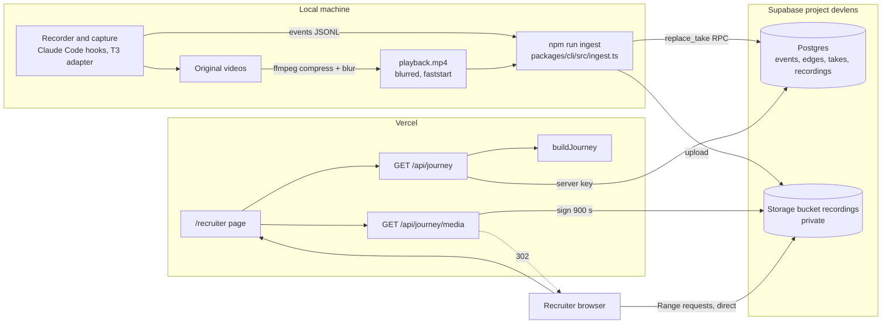
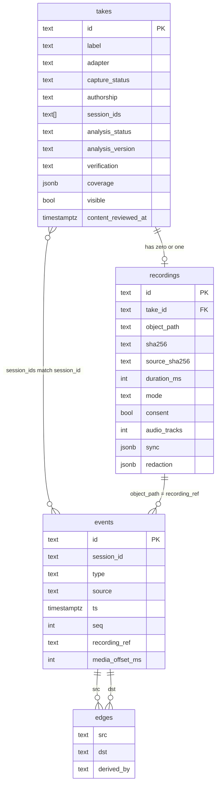

# Recruiter review architecture

Status: 2026-10-29, evening. The migration is **applied**. `golden-broken-api` is ingested, blurred, and visible. `t3-take-3` is visible (events and analysis, no video). `fullstack-take-2` and `t3-video-take` are blurred and OCR-scanned but **not uploaded** until Uma watches them. Nothing is committed or pushed, so the hosted site shows no takes yet. The `take:` source is built and reviewed.

Sources: `docs/SESSION_ASSET_INVENTORY.md`, `plans/recruiter-review-handoff.md`, `plans/take-ingest-contract.md`. Schema and SQL: `docs/SUPABASE_MIGRATION_PLAN.md`.

## Result

- A recruiter picks a **take** on `/recruiter`. The page loads that take's events and rule-derived edges from Supabase and plays its blurred video from a signed URL.
- Analysis is **deterministic and already stored**. Edges are computed at ingest. The journey layout is built per request. No model runs at view time.
- Video never passes through a Vercel Function. The browser fetches it from Supabase with Range requests.
- Reuse what exists: `/recruiter`, `journey-section.tsx`, `EvidencePanel`, `ChainStep`, the picker, the seek button, the `t3-pub:` media pattern.
- The new part is one source key, `take:<id>`, and two tables.

## 1. Components



## 2. Data model

### 2.1 Terms

| Term | Meaning | Where it lives |
|---|---|---|
| **Session** | One agent session (`events.session_id`). Claude Code uses a UUID; T3 uses `t3:mcp:launch:…` | `events.session_id` |
| **Take** | The unit a recruiter selects. One or more sessions plus zero or one recording | `takes` row; `session_ids text[]` |
| **Recording** | One playable video object. `object_path` equals `events.recording_ref` for events with a media offset | `recordings` row; bucket `recordings` |
| **Evidence** | Observed rows: events | `events` |
| **Analysis** | Rule-derived rows: edges. Each names its rule in `derived_by` | `edges`; `takes.analysis_version`, `takes.analysis_status` |
| **Analysis version** | A string naming the rules that produced the edges. One version per take in P0. Versions that coexist are P2 | `takes.analysis_version` |
| **Verification run** | An independent re-run in a sandbox. In P0 it is the `rerun.jsonl` events (null media offset) plus the flag `takes.verification`. A separate table is not in P0 | `events` + `takes.verification` |

A take is **not** a foreign key on events. The link is `events.session_id = any(takes.session_ids)`. The RPC refuses two takes that share a session id.

### 2.2 Entity relationships



Live columns (read 2026-10-29). `events`: `id` (PK), `session_id`, `project_id`, `ts`, `seq`, `actor`, `type`, `source`, `provenance`, `recording_ref`, `media_offset_ms`, `tool_use_id`, `payload`; unique `(session_id, seq)`. `edges`: `id` (PK), `src`, `dst` (FKs to `events.id`), `rel`, `derived_by`, `provenance`, `evidence_event_ids`.

### 2.3 Take state

| Field | Values | Shown to the recruiter as |
|---|---|---|
| `capture_status` | `verified`, `experimental` | Status chip. T3 adapter is `experimental` and read-only |
| `authorship` | `human`, `scripted` | "Scripted demo: the prompts and answers were typed by a script, not a developer." plus the note |
| `analysis_status` | `complete`, `partial`, `missing`, `failed` | "Partial evidence: <unknowns>" or "Analysis not available for this recording." |
| `verification` | `rerun_passed`, `rerun_failed`, `none` | "Independent re-run: not run for this take." when `none` |
| `visible` | true, false | Only visible takes are listed or readable |

## 3. API contracts

Existing routes are extended, not replaced. Current shapes (from `apps/web/api/journey/route.ts` and `apps/web/journey/sources.ts`): `GET /api/journey` returns `{ sources: JourneySourceRow[] }`; `GET /api/journey?source=<key>` returns `{ journey, events, edges }` or 404 `{ error: "unknown source" }`. This section defines only what `take:` adds. Types follow contract section 6.

### 3.1 `GET /api/journey`

Returns the source list. Adds one row per take with `visible = true`.

```json
{ "sources": [ { "key": "take:golden-broken-api", "label": "...", "status": "verified", "adapter": "claude_code_hook" } ] }
```

| Rule | Detail |
|---|---|
| Read | Server key, 5 s timeout |
| Offline | No takes when `DEVLENS_OFFLINE=1` and not `VERCEL` (same rule as `webCaptureBucket`) |
| Failure | List no takes. Keep the other sources |

### 3.2 `GET /api/journey?source=take:<id>`

Returns the journey for one take. `<id>` must match `^[a-z0-9][a-z0-9-]{2,60}$`.

| Step | Detail |
|---|---|
| 1 | Read the take. It must be `visible`. Else 404 |
| 2 | Read events where `session_id = any(session_ids)`, ordered by `ts`, `seq` |
| 3 | Read edges whose `src` is in those event ids |
| 4 | Read the recording row, if any |
| 5 | Run `buildJourney` over events and edges |
| 6 | Add `JourneySourceMeta.take` (below) |

```ts
take?: {
  authorship: 'human' | 'scripted'; authorship_note: string | null;
  analysis_status: 'complete' | 'partial' | 'missing' | 'failed';
  verification: 'rerun_passed' | 'rerun_failed' | 'none';
  sync: { basis: string; uncertainty_ms: number | null; anchors: number } | null; // null when no recording
  redaction: { spans: number; matches: number } | null;
};
media: { url: "/api/journey/media?source=take:<id>", label } | null
```

### 3.3 `GET /api/journey/media?source=take:<id>`

| Case | Response |
|---|---|
| Take visible, recording row exists | `302` to a signed URL, TTL 900 s, `Cache-Control: no-store` |
| Otherwise | `404 "Recording unavailable."` |

The signed path always comes from `recordings.object_path`. Never from the request. The pattern matches `t3-pub:`, which already returns 302 to a signed URL.

## 4. Pages and components

| Piece | Role | Change |
|---|---|---|
| `/recruiter` | Picker, video, journey, evidence | Reuse. Picker gains `take:` rows. Add status labels |
| `journey-section.tsx` | Journey layout, seek wiring | Reuse. Render the new labels from `JourneySourceMeta.take` |
| `EvidencePanel` | Shows the raw event behind a step | Reuse unchanged |
| `ChainStep` | One step in the failure-to-fix chain | Reuse unchanged |
| Video element and seek button | Already disable seek and say why when no offset exists | Reuse unchanged |
| `apps/web/journey/sources.ts` | Source registry | Add `take:<id>`: `listSources()` rows and `loadJourney("take:<id>")` |
| Media route | Signs and redirects | Add the `take:` branch |
| Library page with status columns | Table of all takes | **P1**, not P0 |

Files (as built in P0 slice B): `apps/web/journey/takes.ts` (store port, Supabase store, row-to-journey functions, labels), `apps/web/journey/sources.ts`, `apps/web/journey/build.ts` (`take?` meta), `apps/web/api/journey/media/route.ts`, `apps/web/recruiter/journey-section.tsx`.

Labels on `/recruiter` (contract section 6):

| Condition | Text |
|---|---|
| `media_recorder` | "Seek: exact (browser recording clock)" |
| `recorder_clock_calibrated` | "Seek: ±<uncertainty> s (checked against <n> on-screen moments)". Shown only with at least one event offset and `anchors >= 2` |
| Uncalibrated, or no offsets | "Seek is off for this recording: its clock was not checked." |
| Redaction present | "Personal details blurred in the video (<spans> areas, checked by OCR)." |
| No events (or `analysis_status` missing or failed) | "Analysis not available for this recording." |
| `partial` | "Partial evidence: <unknowns>", or just "Partial evidence." when no unknowns are listed |
| OCR matches above 0 | "The OCR check still found N possible matches in the video." |
| `scripted` authorship | "Scripted demo: …" plus the authorship note. Human takes show no authorship line |
| `verification = none` | "Independent re-run: not run for this take." A take with `rerun_passed` shows no re-run line |

The UI never says "sanitized". It never fills a gap with invented text.

## 5. Analysis retrieval flow

```mermaid
sequenceDiagram
  actor R as Recruiter
  participant B as Browser (/recruiter)
  participant J as GET /api/journey
  participant M as GET /api/journey/media
  participant DB as Supabase Postgres
  participant ST as Supabase Storage

  R->>B: Select take "golden-broken-api"
  B->>J: ?source=take:golden-broken-api
  J->>DB: select take (visible = true)
  J->>DB: select events where session_id = any(session_ids)
  J->>DB: select edges where src in event ids
  J->>DB: select recordings where take_id
  DB-->>J: rows
  J->>J: buildJourney(events, edges), attach take meta
  J-->>B: journey + media url + take meta
  B->>B: render chain, evidence; takeLabels builds the labels in the browser
  B->>M: video src (media url)
  M->>DB: read recordings.object_path (take visible)
  M->>ST: sign object_path, 900 s
  M-->>B: 302 to signed URL, no-store
  B->>ST: GET with Range (direct)
  ST-->>B: 206 partial content
  R->>B: Click a step with a media offset
  B->>B: video.currentTime = media_offset_ms / 1000
```

Four reads and one pure function. No model call. The reads can run in parallel (**assumption**: not measured).

## 6. Sync and the seek rule

Offsets are written at ingest. The page only reads them.

| Basis | Offsets | Seek in UI | Takes |
|---|---|---|---|
| `media_recorder` | Written by `attachMedia` from `wall_start_ms` and duration | On, "exact (browser recording clock)" | golden |
| `recorder_clock_calibrated` | Written only with 2 or more anchors and every `abs(observed − expected) * 1000 <= uncertainty_ms` | On, "±0.4 s" | Full-Stack take 2 (anchors 20.9 vs 21.0 s, 51.6 vs 51.5 s) |
| `recorder_timeline_uncalibrated` | Never | Off, with a reason | T3 named take, until 2 anchors are checked |
| No recording | n/a | No video | T3 take 3 |

Rules that keep sync honest:

- Never trim (`-ss`) or shift the video. Offsets depend on media time 0.
- Blur and compress run in one ffmpeg pass. Frame timing stays identical. Golden: 3,091 frames in source and blurred copy.
- Full-Stack has no anchor after 52 s. Add one near 4:06 (last passing test) to rule out drift. This is open.
- T3 named: the video shows a cutaway to `/recruiter` at about 3:46–4:10. Use it as an anchor candidate (**assumption**: not yet used).

## 7. Authentication and authorization

| Layer | P0 | P1 |
|---|---|---|
| Site | Vercel Authentication on all deployments | Same |
| Identity | None beyond Vercel SSO | Supabase Auth |
| Data access | Server key reads `takes`, `recordings`, `events`, `edges`. No anon or authenticated policy | `review_grants` table + RLS on all four |
| Video | Signed URL, 900 s | Signed URL minted only after an RLS-checked read, 900 s |
| Revoke | `visible = false` stops new URLs. Issued URLs live up to 900 s (no early revoke in Supabase) | Remove the grant. Same URL limit |
| Fit | Internal demo | External recruiter links |

Server key stays in Vercel as a sensitive env var. It never reaches the browser.

## 8. Performance decisions

| Decision | Reason |
|---|---|
| Play from signed URLs, directly from Supabase | Vercel Function request and response bodies are limited to 4.5 MB. The golden WebM is 16 MB. Hobby max duration is 300 s |
| `302` redirect, not a proxy | Keeps video out of Functions. The hosted `/api/replay/media` path sends the whole file for `bytes=0-`; failure on Vercel is **not verified** |
| Faststart MP4 (`-movflags +faststart`) | Metadata first, so playback starts without the whole file |
| Keyframe every 2 s (`-g 60 -keyint_min 60 -sc_threshold 0`) | Seek lands within 2 s of the target frame without long decode. The earlier low-bitrate renditions had a keyframe every ~7.5 s |
| CRF 30, H.264, no audio | R3: 259.2 MB to 26.1 MB, PSNR 42–49 dB |
| Cap each file at 50 MB | Supabase Free plan file limit. A CHECK enforces it |
| Count egress | 10 GB per month on Free. At 17–26 MB per full play, the cap is reached after roughly 380–560 full plays (arithmetic, not measured) |
| Range support | Verified live on a private signed URL: `npm run demo:smoke`, all 5 checks PASS |
| Indexes on `edges(src)`, `edges(dst)` | The edge read filters by `src` |
| Build the journey per request | Cheap: one function over under 100 events and under 100 edges per take |

## 9. When analysis runs

| Option | Pros | Cons |
|---|---|---|
| Ingest-time | Fast view. Reproducible. Reviewable before publish | A rule change needs a re-ingest |
| On-select | Always the latest rules | Slow first load. Risk of different results over time. Needs compute on Vercel |
| Hybrid | Edges at ingest, layout at request | Two stages to reason about |

**Choose hybrid in its deterministic form:** edges at ingest (rule linker for Claude Code takes; the capture's own edges for T3 takes), and `buildJourney` per request. No LLM at view time.

Why T3 keeps its own edges: the generic linker rebuilds only 16 of R3's 51 edges. The T3 adapter and its question detectors use rules `rule-1-prompted-v1`, `M1`–`M6`, `devlens-agent-cites-v1`, `answer-question-id-v1`.

If AI-written text is added later (not in P0):

- It must cite event ids.
- It must be labelled as generated.
- It runs at ingest, is stored with an analysis version, and is reviewed before publish.
- The product limit still holds: no score, rank, or hire verdict.

## 10. Documented facts versus assumptions

| Fact (source) | Status |
|---|---|
| Supabase org is on Free: 50 MB file cap, 10 GB per month egress | Verified (`get_organization`, docs) |
| Signed URLs cannot be revoked early | Verified (docs) |
| Range request on a private signed URL works | Verified (`demo:smoke`, 5 of 5 PASS) |
| Vercel Function body limit 4.5 MB; Hobby max 300 s | Verified (docs) |
| Full-Stack sync ±0.4 s | Verified by 2 frame anchors |
| Golden sync exact to the browser clock | Verified (`fixture:verify` passes) |
| Blurred golden: 48 spans, 0 OCR matches over 1,660 frames at 6 fps, same frame timing | Verified. Uma watched and approved it. It is uploaded and visible |
| `/api/replay/media` fails on Vercel for a 16 MB file | **Not verified** |
| Current `/api/journey` response shape | Verified (route and `sources.ts`) |
| Column names `events.id`, `media_offset_ms` | Verified live |
| Component file paths | Verified (slice B) |
| Parallel reads are fast enough | **Assumption** |
| Egress arithmetic (380–560 full plays) | Arithmetic from sizes, not measured |
| Full-Stack sync has no drift late in the video | **Not verified** (no anchor after 52 s) |
| T3 named sync | **Not verified** |
| Blurred Full-Stack and T3 named videos are clean | Verified by an independent OCR re-scan (0 matches over 1,216 and 1,978 frames at 4 fps, same frame counts). Uma's watch-through pending |
| OCR leaves the macOS temp folder code and Claude session ids | Known limit, low risk |
