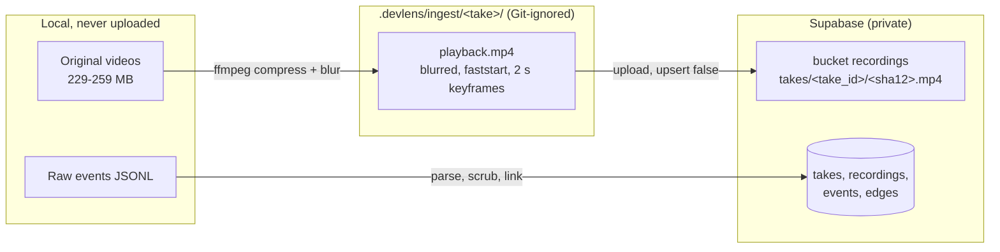
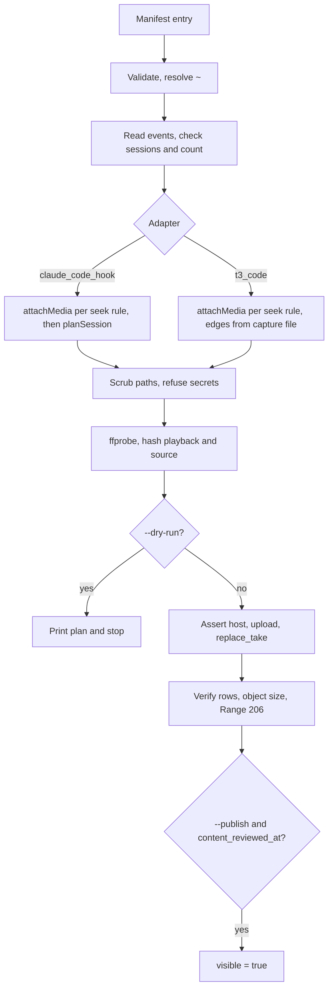

# Supabase migration plan: takes and recordings

Status: 2026-10-29, evening. The migration is **applied** on project `devlens`. `golden-broken-api` is ingested, blurred, and visible. `t3-take-3` is ingested and visible (events and analysis, no video). `fullstack-take-2` and `t3-video-take` are blurred and OCR-scanned but **not uploaded** until Uma watches them. Nothing is committed or pushed, so the hosted site shows no takes yet. Uma approved the schema change and the 4 takes in `plans/take-ingest-contract.md` section 7.

Sources: `docs/SESSION_ASSET_INVENTORY.md`, `plans/recruiter-review-handoff.md`, `plans/take-ingest-contract.md`. The contract holds the exact SQL. This file does not copy it.

## Result

- Choose **Option C (hybrid)**: keep `events` and `edges`, add `takes` and `recordings`, store only a blurred playback MP4 per take.
- The change is small and reversible. Rollback SQL is in [section 9](#9-rollback-and-recovery).
- Project: `devlens`, ref `hivfaqlabtbrhrviwrrm`. No other project is touched.
- Free plan: 50 MB per file, 10 GB per month egress. Originals stay local (the recorder takes are 229–259 MB; golden's is 16 MB and is already in the repo).
- P0 security: Vercel Authentication, server key, no anon policies. Acceptable for an internal demo only.
- Open item for Uma: the unblurred golden video is public on GitHub ([section 8](#8-risks), R-1).

## 1. Live schema before the migration (read 2026-10-29)

The migration is now applied: `takes` and `recordings`, the two wider CHECKs, the two `edges` indexes, `replace_take`, and the MIME list now also allow `video/mp4`. The table below is the state it started from. Today's changes to it: golden's events now point at `takes/golden-broken-api/a26ca301978d.mp4`, the take rows for golden and `t3-take-3` exist, and the old object `d4ce73f0-…/take.webm` was deleted.

Read live, read-only, by the Tech Lead session on 2026-10-29 (`list_tables`, `list_migrations`, `execute_sql` on `pg_proc`, `pg_policies`, `pg_constraint`, `storage.buckets`, `storage.objects`, and `get_advisors`). Project `devlens`, ref `hivfaqlabtbrhrviwrrm`, Postgres 17, us-east-1.

| Object | Live state |
|---|---|
| Public tables | Exactly 4: `events`, `entities`, `edges`, `sprintboard_issues`. RLS is on for all 4 |
| `events` | 36 rows: golden `ec6f600a-…` (17) + `44a60462-…` (14, includes the sandbox re-run) + `tracer-fixture-1` (5). Columns: `id` (PK), `session_id`, `project_id`, `ts`, `seq`, `actor`, `type`, `source`, `provenance`, `recording_ref`, `media_offset_ms`, `tool_use_id`, `payload`. Unique `(session_id, seq)`. 30 golden rows carry `recording_ref d4ce73f0-…/take.webm` and a media offset; the re-run row has none |
| `edges` | 33 rows: golden 17 + 15 = 32 (matches today's linker), tracer 1. Columns: `id` (PK), `src`, `dst` (FKs to `events.id`), `rel`, `derived_by`, `provenance`, `evidence_event_ids` |
| `entities` | 1 row (`broken-api`, tracer label) |
| `sprintboard_issues` | 12 rows. SprintBoard demo app, not evidence. RLS on, no policy (intended; the only advisor finding) |
| Constraints | `events_type_check` = prompt, tool_call, file_edit, test, question, answer, recording_start, pause, resume, stop. `events_source_check` = claude_code_hook, git, sandbox, devlens_question, media_recorder. `edges_rel_check` = prompted, called, edited, ran_test, failed, supersedes, verifies, cites. Plus `events_actor_check`, `events_provenance_check`, `events_media_offset_ms_check`, `edges_provenance_check` |
| Function `replace_session` | Exists live, `security definer` off. **Missing from the live migration list** (drift). Live migrations: `devlens_evidence`, `edges_rel_check`, `recordings_bucket_limits`, `sprintboard_issues`, `t3_captures_bucket` |
| Policies | 3, all `SELECT` for `anon, authenticated`, all limited to the tracer fixture: `fixture_events_read` (`session_id = 'tracer-fixture-1'`), `fixture_entities_read` (`id = 'broken-api'`), `fixture_edges_read`. No Storage policies. Golden rows are readable only with the server key |
| Bucket `recordings` | Private. 50 MB cap. MIME `video/webm`, `application/json`. Objects before: `tracer-fixture-1/session.webm` (43,704 B), `d4ce73f0-…/take.webm` (16,047,324 B, golden, unblurred; **deleted 2026-10-29**), `d4ce73f0-…/meta.json` (kept) |
| Bucket `t3-captures` | Private. 50 MB cap. MIME `application/json`, `application/x-ndjson`, `video/webm`. Objects: `rehearsal-2-sprintboard/` `events.jsonl`, `edges.jsonl`, `rerun.jsonl`, `capture.json` (no video) |
| Indexes on `edges(src)`, `edges(dst)` | Do not exist |
| Plan | Free. 50 MB file cap, 10 GB per month egress (`get_organization`; Supabase docs) |

### Migration-history drift

`replace_session` works live, but `list_migrations` does not show it. A fresh project built from the repo migrations would lack it. Two ways to close the gap:

| Way | Effect |
|---|---|
| Leave it | Smallest change. The drift stays. `replace_take` is new and is in the migration list, so it does not add drift. |
| Add a small migration that holds the live `replace_session` definition | Closes the drift. **Proposal, not in the approved scope.** Needs Uma's approval. |

Recommendation: leave it for P0. Record the live definition in the backup export ([section 9](#9-rollback-and-recovery)). Decide the second way in P1.

## 2. Options

| | A. Minimal | B. Full normalized | C. Hybrid (recommended) |
|---|---|---|---|
| Idea | Only add `video/mp4` and the two CHECK values. Map recordings by `recording_ref` | New tables for candidates, takes, recordings, analysis runs, verification runs, review access | Keep `events`/`edges`. Add `takes` and `recordings`. Add RPC `replace_take` |
| New tables | 0 | 6 or more | 2 |
| Take label, authorship, analysis status | Nowhere. Would live in code | Yes | Yes |
| Library page with status columns | Needs hard-coded lists | Yes | Yes |
| Idempotent ingest | `replace_session` per session only | Yes | Yes, one transaction per take |
| Cost to build | Lowest | Highest. Needs queues and roles that nothing uses yet | Low |
| Risk | The app cannot say "partial", "scripted", or "sync ±0.4 s" without code constants | Speculative. Builds P2 features first | Small. Reversible |
| Reversible | Yes | Hard | Yes |

**Choose C.** A cannot carry the labels that make a take honest to a recruiter (authorship, analysis status, verification, sync basis). B builds features no one uses yet (`candidates`, `analysis_runs`, `verification_runs`, `review_access`). The handoff lists them under "Not in P0".

## 3. Proposed changes

The exact SQL is in `plans/take-ingest-contract.md` section 1. File: `supabase/migrations/20261030000000_takes_recordings.sql`.

| Change | Why |
|---|---|
| `events_type_check` adds `checkpoint` | T3 rows fail today without it |
| `events_source_check` adds `t3_code` | Same |
| New table `takes` | The reviewable unit: label, adapter, `capture_status`, `authorship`, `session_ids text[]`, `analysis_status`, `analysis_version`, `verification`, `coverage`, `visible` (default false), `content_reviewed_at` |
| New table `recordings` | One playable object per take: `object_path` (equals `events.recording_ref`), `sha256`, `source_sha256`, size, duration, `mode`, `consent`, `audio_tracks = 0`, `sync`, `redaction`. Size is capped at 52,428,800 bytes by a CHECK |
| Indexes on `edges(src)`, `edges(dst)`, `recordings(take_id)` | The read path fetches edges by event id |
| RLS on both new tables; `revoke all` from `anon`, `authenticated`; grant to `service_role` | No anon policy in P0 |
| RPC `replace_take(p_take, p_recording, p_events, p_edges)` | One transaction per take. The refusal rules and the return value are in the contract and the migration |
| Bucket `recordings` MIME list adds `video/mp4` | MP4 playback files |

Not in P0: `candidates`, `analysis_runs`, `verification_runs`, `review_access`, queues, HLS, AI summaries.

Note on `replace_take` for golden: its 31 events already exist. The RPC deletes and re-inserts them for the take's sessions. Their `recording_ref` then points to the new blurred path. The handoff calls this a "backfill row only" for golden.

## 4. Storage structure



| Rule | Detail |
|---|---|
| Bucket | `recordings`, private, 50 MB cap |
| Object path | `takes/<take_id>/<first 12 hex of sha256>.mp4`. Content-addressed, so a re-run never overwrites different bytes |
| Upload | `upsert: false`. Object exists with the same size: skip. Different size: stop with an error |
| Originals | Stay local. `recordings.source_sha256` records the original |
| Raw JSONL | Stays local and in `devlens-demo-recorder/out/rescued-tmp-backups/`. The handoff proposed a private `take-artifacts` bucket; the contract does not create it. **Deferred to P1 and not approved** |
| Encode | `ffmpeg -c:v libx264 -preset medium -crf 30 -g 60 -keyint_min 60 -sc_threshold 0 -pix_fmt yuv420p -movflags +faststart -an`, no trim. Blur runs in the same pass |
| Test encode | R3: 259.2 MB to 26.1 MB, duration 494.80 s vs 494.77 s, PSNR 42–49 dB, 42 s encode |

## 5. Source-to-destination mapping

All four takes are approved. Values are from contract section 7.

| Take id | Sessions | Events source | Edges | Recording | Sync | Authorship |
|---|---|---|---|---|---|---|
| `golden-broken-api` | `ec6f600a-…`, `44a60462-…` | `examples/broken-api/fixtures/golden/session.jsonl` (30) + `rerun.jsonl` (1) | Rule linker, 32 | Blurred `playback.mp4` (17.9 MB, 48 spans, OCR re-check 0 matches over 1,660 frames at 6 fps, frame timing identical, 3,091 frames) | `media_recorder`, uncertainty 0 | human |
| `fullstack-take-2` | `a04c678d-a85d-4fa6-bcae-bb35723fac7e` | `…/rescued-tmp-backups/devlens-demo-backup-1793245064520/events.jsonl` (90) | Rule linker, 91 planned | Peer session's blurred file; Tech Lead re-checks it with OCR before use | `recorder_clock_calibrated`, ±400 ms, 2 anchors (20.9 vs 21.0 s; 51.6 vs 51.5 s) | scripted |
| `t3-video-take` (R3) | `t3:mcp:launch:2b44bbad…` | `…/t3/mcp:launch:2b44bbad…/events.jsonl` (66) | That folder's `edges.jsonl` (51). The generic linker rebuilds only 16 | Peer session's blurred file; Tech Lead re-checks it. The video shows its own coding thread ("Build Video Take Task Manager"), with a cutaway to `/recruiter` at about 3:46–4:10 | `recorder_timeline_uncalibrated` until 2 anchors are checked. Seek off | scripted |
| `t3-take-3` (R5) | `t3:mcp:launch:a4832502…` | Saved copy `examples/t3-captures/t3-fullstack-take-3/events.jsonl` (53) | That folder's `edges.jsonl` (30) | **None.** OCR shows the coding thread on screen only from 0:54 to 1:05; the rest shows the Tech Lead thread | n/a | scripted |

Not migrated: R4 (aborted), R6–R9 (superseded; R7 and R9 links are uncertain). Also not migrated: the 6-second placeholder `session.webm`, which stays in the bucket as a test fixture.

The `t3-take-3` events (53) and edges (30) in the contract differ from the earlier dry run (37 events, 7 edges, local import). The contract uses the saved copy. The inventory flags this as "pick one before ingest". The pick is recorded in the contract; the dry-run refresh will confirm the counts.

## 6. Idempotent ingestion design

The command and the per-take order are in contract section 5. Summary:



| Guarantee | How |
|---|---|
| Same input gives same rows | `replace_take` deletes the take's events, edges, and recordings row, then re-inserts, in one transaction |
| No silent overwrite of media | Content-addressed path; size mismatch stops the run |
| No accidental publish | `visible` is always written false by the RPC. `--publish` is a separate step and needs `content_reviewed_at` |
| Wrong project | The CLI asserts the host `hivfaqlabtbrhrviwrrm.supabase.co` |
| Take overlap | The RPC refuses when another take lists the same session id |
| Bad edges | The RPC refuses an edge whose `src` or `dst` is not in the payload |
| Secrets and paths | Home paths become `~`. The run refuses text with `sb_secret_` or a value from `secretValuesFromEnv` |
| Output hygiene | The CLI never prints keys or signed URLs |

Seek rule enforced at ingest:

| Sync basis | Offsets written |
|---|---|
| `media_recorder` | Yes, by `attachMedia` from `wall_start_ms` and duration |
| `recorder_clock_calibrated` | Only with 2 or more anchors and every `abs(observed − expected) * 1000 <= uncertainty_ms`. Otherwise null |
| `recorder_timeline_uncalibrated` | Never. Playback works; seek is off |

## 7. Security and RLS model

| | P0 (now) | P1 |
|---|---|---|
| Who may open the site | Vercel Authentication (SSO on all deployments) | Same, plus Supabase Auth for recruiters |
| Who reads the database | The web server, with the server key (`SUPABASE_SECRET_KEY`, a sensitive Vercel env var) | The recruiter's own session, through RLS |
| Anon/authenticated policies | None. `takes` and `recordings` are revoked from `anon` and `authenticated` | A `review_grants` table (recruiter id, take id, expiry) and policies that check it |
| Video access | Server signs a URL after reading the take, TTL 900 s, returns 302 | Same, but the signing step runs only after an RLS-checked read |
| Early revoke | Not possible. A signed URL works until it expires (Supabase docs "Serving assets") | Same limit. Setting `visible = false` or removing a grant stops new URLs. URLs already issued last up to 900 s |
| Fit | Internal demo only | Needed before any external recruiter link |

Other controls:

- `visible` defaults to false and only `--publish` sets it. Publish needs `content_reviewed_at`, which Uma sets after watching the playback file.
- The path to sign always comes from `recordings.object_path`, never from the request.
- The advisor currently reports one finding, `sprintboard_issues` with RLS on and no policy. That is intended. Re-run `get_advisors` after the migration.
- Vercel env has `SUPABASE_SECRET_KEY`, `NEXT_PUBLIC_SUPABASE_URL`, `DEVLENS_OFFLINE=1`. Names only were read; values were not.

## 7a. Dry-run results

Output of `npm run ingest -- --dry-run --all` on 2026-10-29 (no network). All four takes report "ready for upload: yes".

| Take | Events | Edges | Events with offset | Playback |
|---|---|---|---|---|
| `golden-broken-api` | 31 | 32 | 30/31 | 17,915,689 B |
| `fullstack-take-2` | 90 | 91 | 90/90 | 20,787,285 B |
| `t3-video-take` | 66 | 51 (the capture's own; the linker rebuilds only 16) | 0/66 (seek off) | 31,229,681 B |
| `t3-take-3` | 53 | 30 (saved copy) | 0/53 | none |

## 8. Risks

| ID | Risk | Effect | Mitigation |
|---|---|---|---|
| R-1 | The golden video is public on GitHub, unblurred (repo `yeruvamaheswar/DevLens`, commit `2d36a04`, on main). OCR found "<user>@<machine>" (shell prompt and window title) 461 times. The private-bucket copy was deleted on 2026-10-29. GitHub is the only remaining copy | The macOS user name and computer name are public | Uma decides: see below |
| R-2 | Residual text OCR does not remove: the macOS temp folder code (`/private/var/folders/c4/zd_gcgn…/T/`) and Claude session ids | Low. Not names | Known limit. Listed in `recordings.redaction.residual_note` |
| R-3 | Blur of the Full-Stack and T3 named videos comes from another session | A missed span stays visible | The Tech Lead re-checks each with OCR. Uma watches each before `--publish` |
| R-4 | `replace_session` is not in migration history | A rebuild from the repo lacks it | Back up its definition; decide in P1 |
| R-5 | Free plan: 50 MB per file, 10 GB per month egress | A big or popular video can stop playback | Compress to about 17–26 MB. Count views. Pro plan only if originals must live in Supabase (recommendation: no) |
| R-6 | Hosted `/api/replay/media` sends the whole 16 MB WebM for `bytes=0-` | Failure on Vercel **not verified** | The new route returns 302 to a signed URL; no video passes through Vercel |
| R-7 | Signed URLs cannot be revoked | Up to 900 s of access after revoke | Short TTL. Accepted |
| R-8 | `t3-take-3` has 53/30 (saved copy) vs 37/7 (local import) | Wrong counts in `expected` | Resolved: the dry run confirms 53 events / 30 edges from the saved copy |
| R-9 | Old unblurred golden object `recordings/d4ce73f0-…/take.webm` | Unblurred copy in the private bucket | Closed: Uma approved, and it was deleted on 2026-10-29 after checking that no event or recording row referenced it. `meta.json` stays. `demo:smoke` still passes |
| R-10 | The Supabase connector in this client declines every statement with `DROP` or `DELETE` (seen twice on 2026-10-29, also after Uma chose to run it) | The migration cannot be applied through the agent | Done: Uma ran `.devlens/ingest/rollback-test.sql` (passed: 2 identical saves, 3 refusals, golden 31 and tracer 5 events unchanged, anon cannot execute), then the migration file, in the dashboard SQL editor. Ingest itself uses supabase-js and is not affected |
| R-11 | A re-ingest that removes a session from a take's `session_ids` leaves that session's old events and edges in place, owned by no take (review A, nit 2) | Stale rows that no take lists | None in P0: no take changes its sessions. P1 delete command removes them |
| R-12 | A rerun event already present in a capture, for a take whose recording has seek on, fails the dedupe: the captured copy has an offset and the rerun copy does not (review A, nit 5) | Ingest refuses that take | None of the 4 takes hits it. Fix in `mergeRerun` before such a take exists |

### R-1 options for the public golden video

| Option | What it does | What it fixes | What it does not fix |
|---|---|---|---|
| (a) Replace the file in a new commit | The blurred copy becomes the file on main | Anyone who opens main later sees the blurred video | Commit `2d36a04` and all history keep the old file. Anyone who cloned or forked already has it. If the fixture format stays `.webm`, the blurred MP4 needs a matching re-encode or reference update (**not verified**) |
| (b) Rewrite history and force-push | Removes the old file from the branch history | Removes it from the repo's own history | Destructive. Breaks other clones. Existing clones, forks, and any cached copies by commit id may remain (**assumption**: GitHub cache behavior not verified). Needs explicit approval |
| (c) Accept | No change | Nothing | The name stays public |

**Recommend (a) at minimum.** Add (b) only if Uma wants the old blob gone from history and accepts the cost. Push needs Uma's approval in either case.

## 9. Rollback and recovery

### 9.1 Export first (before applying the migration)

**Status:** this export was not made before the migration ran on 2026-10-29. The golden rows are fully rebuildable from the repo (`npm run ingest -- --take golden-broken-api`, or `npx tsx packages/cli/src/link.ts` with the golden files). The tracer rows (5 events, 1 edge) are not backed up anywhere. Make the export before any further destructive change.

Run read-only. Write files under `.devlens/ingest/backup/` (Git-ignored: `.gitignore` lists `.devlens/`).

| Export | Why |
|---|---|
| All 36 `events` rows | Restore after `replace_take` replaces golden's rows |
| All 33 `edges` rows | Same |
| `pg_get_constraintdef` for `events_type_check` and `events_source_check` | Exact original constraint text |
| `select allowed_mime_types, file_size_limit from storage.buckets where id = 'recordings'` | Exact original MIME list |
| `pg_get_functiondef` for `replace_session` | Closes the drift if the live definition is lost |
| `list_migrations` output | Proof of history |
| `storage.objects` listing for `recordings` | Know what existed |

### 9.2 Rollback SQL

Order matters. Rows that use the new CHECK values must go before the old constraints return.

```sql
begin;

-- 1. Remove the new function and tables.
drop function if exists public.replace_take(jsonb, jsonb, jsonb, jsonb);
drop table if exists public.recordings;
drop table if exists public.takes;

-- 2. Remove the new indexes.
drop index if exists public.edges_src_idx;
drop index if exists public.edges_dst_idx;

-- 3. Remove rows that only the new CHECK values allow (edges first).
--    Golden and tracer rows use neither value (checked live), so they stay.
delete from public.edges
 where src in (select id from public.events where type = 'checkpoint' or source = 't3_code')
    or dst in (select id from public.events where type = 'checkpoint' or source = 't3_code');
delete from public.events where type = 'checkpoint' or source = 't3_code';

-- 4. Restore the two CHECK constraints.
--    Values below are the live definitions read on 2026-10-29.
alter table public.events drop constraint events_type_check;
alter table public.events add constraint events_type_check check (type in
  ('prompt','tool_call','file_edit','test','question','answer','recording_start','pause','resume','stop'));
alter table public.events drop constraint events_source_check;
alter table public.events add constraint events_source_check check (source in
  ('claude_code_hook','git','sandbox','devlens_question','media_recorder'));

-- 5. Restore the bucket MIME list.
--    Live value read on 2026-10-29: webm + json.
update storage.buckets
   set allowed_mime_types = array['video/webm','application/json']
 where id = 'recordings' and public = false;

commit;
```

Then:

1. Delete the uploaded objects under `recordings/takes/` with the Storage API, **except** `takes/golden-broken-api/a26ca301978d.mp4`: it is now the only golden video in storage, and the live replay signs it. Do not delete it unless golden's events are repointed first. Do not delete `storage.objects` rows in SQL; that can leave files behind (general Supabase practice, not verified here).
2. If golden's events were replaced, re-insert them from the export. Their exported `recording_ref` is the deleted `d4ce73f0-…/take.webm`, so repoint them to `takes/golden-broken-api/a26ca301978d.mp4` (paths are bucket-relative, with no `recordings/` prefix) or upload the blurred file back to the old path. Otherwise the `demo:smoke` check "signed private media" fails.
3. Run `get_advisors` and the 5 checks of `npm run demo:smoke`.

### 9.3 Recovery cases

| Case | Action |
|---|---|
| `replace_take` fails mid-run | Nothing to do. One function body is one transaction |
| Upload ok, RPC fails | Re-run. The same-size object is skipped |
| Wrong bytes at an object path | The run stops. Delete that object by hand, then re-run |
| Take published by mistake | `update takes set visible = false`. New signed URLs stop. Issued URLs live up to 900 s |
| Bad blur found after publish | Set `visible = false`, replace the file, re-run ingest (new hash gives a new path), delete the old object, review again |
| Local files lost | Videos: re-derive from originals (kept local). Events: `rescued-tmp-backups/` has `SHA256SUMS` (18 files OK at 2026-10-29). Claude Code transcripts in `~/.claude/projects/` can be pruned (30-day default) |

## 10. Assumptions and unknowns

| Item | Status |
|---|---|
| GitHub behavior for old commits and forks after (a) or (b) | Assumption |
| Whether the repo fixture can switch from `.webm` to the blurred `.mp4` without code changes | Not verified |
| Blurred Full-Stack and T3 named videos | Re-scanned independently by the Tech Lead session (0 matches over 1,216 and 1,978 frames at 4 fps). Uma's watch-through is pending |
