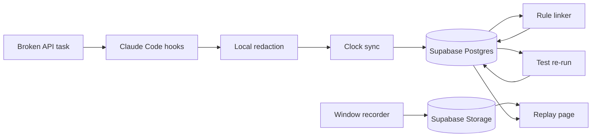

# DevLens — what we implement

Share this page with the team. It is the build spec for the AITX hackathon.

- Track: Antler Agents
- Submit by: Thursday, 29 October 2026, 5:00 PM Central
- Hack Fair: Friday, 30 October 2026, 1:00 PM Central
- Repo: https://github.com/yeruvamaheswar/DevLens
- Decision list: [plans/devlens.contract.md](../plans/devlens.contract.md)
- How this differs: [docs/competitors.md](competitors.md)

The finished code shows what was built. DevLens shows which check failed, what the person answered, what changed, and which later test passed. A judge clicks that claim and sees the screen recording, the event, the diff, and the test. Events and the recording live in Supabase. The page does not score anyone.

## Scope layers

| Layer | What | When |
|---|---|---|
| Thursday demo | One golden scenario, `examples/broken-api`. Window recording. Click from the failed test to the later pass. | Must ship |
| If time permits | Six more scenarios. Desktop capture as a second opt-in. More recordings only after the golden click works. | Before Thursday noon |
| After the fair | A virtual desktop the developer downloads and can install tools on. The same evidence model over a week-long project. | Not this submission |

The seven scenario names are in [plans/devlens.contract.md](../plans/devlens.contract.md). Only the first is recorded for the demo.

## Done

Thursday, 29 October 2026, 3:00 PM Central, all of these are true:

- `npm run demo` shows the chain from Supabase, including the screen recording.
- `npm run demo --offline` shows the same chain from local files with the network off.
- One click opens a real event from the fixture.
- The sandbox result is on the page, or the page says the re-run is not in this build.
- The page has no score, rank, or hire recommendation.
- A second teammate can follow the README on a clean machine.
- The Loom is uploaded.
- The Airtable form is submitted before 5:00 PM Central.

If the sandbox is broken and the click still works, ship without the sandbox. Do not add a score to compensate.

## Stop rule

Tuesday, 27 October 2026, noon Central: the fixture must contain a failed test and a later pass, linked by event ids. If it does not, stop feature work. Fix capture, or pick another hackathon idea. Do not start a second agent adapter to escape that checkpoint.

Thursday noon: freeze. Revert anything that breaks `npm run demo`. Use 1:00–4:00 PM for the Loom, the README, and the form.

## What the judge must be able to do

1. See a small project whose API client is broken. The starter test already fails.
2. Watch a consented screen recording of the code window. Claude Code tries a fix. That fix fails a second assertion. The recording is the file in Supabase Storage.
3. See DevLens ask what failed. The question names the test. The developer types an answer in their own words.
4. See the developer change approach. The test passes.
5. Open Replay. Click "the later test verifies the second patch."
6. See, on one screen, the window at that time, the question, the answer, the diff, the session test output, and the sandbox re-run.
7. Read three questions that cite event ids, plus a panel of what DevLens does not know.
8. Hear that DevLens does not hire, rank, or score.

The live model is optional theater. The committed fixture is the demo. If the model or the window picker fails at the table, play the fixture and say it is the recorded take.

## Owners

One person can hold two roles. Do not edit another role's files on the critical path.

| Role | Owns | Does not touch |
|---|---|---|
| Demo | `examples/broken-api`, README, Loom, Airtable form | Core packages, except the task repo |
| Capture | `packages/capture`, hook scripts, redaction, the WebM | The reviewer page |
| Evidence | `packages/core`, `packages/link`, `supabase/migrations`, rules, sandbox worker | Hook scripts and the reviewer page |
| Dashboard | `apps/web` | Linker rules |

Agree `packages/core/event.ts` before splitting. That file is the shared contract.

## Repo layout

```text
apps/web/record/page.tsx          consent, window picker, pause, stop, review
apps/web/replay/page.tsx          player and evidence pane
apps/web/questions.ts             three templates, event ids filled in
packages/core/event.ts            event and edge types
packages/core/src/sync.ts         media offset math
packages/capture/                 devlens init, hook writer, redact.ts
packages/link/                    rules, supabase.ts, rerun.ts
supabase/migrations/              tables, RLS, storage bucket
examples/broken-api/              the task
examples/broken-api/fixtures/session.jsonl
examples/broken-api/fixtures/session.webm
```

Stack: TypeScript CLI, Supabase Postgres, Supabase Storage, one Next.js page. No graph database. No login. No second database.

## The task

`examples/broken-api` is the golden scenario: a tiny service with one bug a person can see. Use a wrong base URL. Keep it small enough to finish in one sitting.

If time permits after that scenario replays, add six more folders. Suggested bugs: swapped JSON field, missing bearer token, stale cache, off-by-one page, wrong time zone, and a missing array treated as success. Each starter test fails. Do not record those six until the golden replay works.

The history must contain both commits:

| Commit | Test result | Why it exists |
|---|---|---|
| Starter | Fails the first assertion | This is what the candidate receives |
| First fix | Still fails a second assertion | The plausible agent fix was wrong |
| Final fix | Passes | The approach changed |

The sandbox re-run passes on the final commit and fails on the first fix. Do not squash. A squash drops the git trailer.

`npm test` on the starter commit must fail on purpose. Say the intended bug in a one-line README inside the example.

## Commands

| Command | What it does | Passes when |
|---|---|---|
| `devlens init` | Writes project-local Claude settings and a hook that appends JSONL. Prints the notice. Installs a git trailer hook. | A throwaway `claude -p` prompt appends one redacted line |
| `devlens link` | Runs the rules and writes edges to Supabase | `devlens link --fixture` upserts the fixture session |
| `devlens rerun` | Re-runs the test command in a sandbox | The result is stored and labeled observed |
| `devlens serve` | Serves the reviewer page from Supabase | The timeline renders and the recording plays |
| `npm run demo` | The README command | A second teammate completes it after `npm install` and a filled `.env` |
| `npm run demo --offline` | Same page from the committed JSONL and WebM | Works with the network off |

`.env.example` names the keys and does not contain them.

| Name | Where it is used |
|---|---|
| `NEXT_PUBLIC_SUPABASE_URL` | Browser and server |
| `NEXT_PUBLIC_SUPABASE_PUBLISHABLE_KEY` | Browser read only |
| `SUPABASE_SECRET_KEY` | CLI ingest and signed upload URLs. Never `NEXT_PUBLIC_`. |

If the project still shows the legacy anon key, that key may be the publishable key for this demo. The secret key and the service-role key stay on the machine that runs the CLI.

## Notice the candidate sees

`devlens init` prints this before capture starts. The record page shows the same facts. Recording does not start on page load.

Captured:

- The window the developer picks
- Prompts, tool calls, diffs, and command output
- Test results
- The typed answer to a DevLens question

Not captured:

- Camera
- Microphone
- The whole desktop
- A score

The developer can pause, stop, play the file, delete it, and hide a line before export. Declining capture is allowed. This demo records a teammate only. Do not record anyone else.

## Capture

### Claude Code hooks

Write hooks in `.claude/settings.local.json`. Append redacted events to `.devlens/events.jsonl`.

Subscribe to:

- `SessionStart`
- `UserPromptSubmit`
- `PreToolUse`
- `PostToolUse`
- `PostToolUseFailure`
- `Stop`
- `SessionEnd`

Join keys from the probe are `session_id` and `tool_use_id`. Bash hooks do not include an exit code. Read pass or fail from `PostToolUseFailure` or from the command output. The sandbox result is the observed pass or fail.

A `prepare-commit-msg` or `post-commit` hook adds:

```text
DevLens-Session: <session_id>
```

A link made only by overlapping timestamps is inferred. Say so.

### Redaction

Run redaction before the event is appended. A unit test puts a fake `sk-` string in a payload and asserts that the file does not contain it. A denylist is enough if gitleaks is not installed. Do not send secrets to an online scanner. A human reads the fixture before it is committed. Redaction does not blur video. The developer reviews the recording and can delete it.

### Screen recording

Screen recording is required. The judge must see the code window move, then click a claim and land on that moment.

Use `getDisplayMedia` and `MediaRecorder`. Audio off. Record one window, not the whole desktop. Upload the WebM to the private Storage bucket `recordings` after the developer reviews it. `recording_ref` is the object path. Replay loads a short-lived signed URL created on the server. Do not make the bucket public.

| Rule | Behavior |
|---|---|
| Opt-in | The developer clicks. A page load does not call `getDisplayMedia`. |
| Window | Window mode reads `getSettings().displaySurface`. If it is `monitor`, stop and ask again. |
| Desktop | Desktop mode is a second click. A monitor take is kept and labeled desktop. Camera and microphone stay off. The developer reviews the file before upload. |
| Pause | `MediaRecorder.pause`. Store `[wall_pause, wall_resume]`. |
| Stop | `MediaRecorder.stop`, or the browser sharing indicator stops. Later hook events have a null `recording_ref`. |
| Review | The developer can play the file before a reviewer sees it. |
| Fallback | If the picker fails, commit a WebM of the code window and label it a fixture. Do not call that file a live take. |

Do not build ScreenCaptureKit, Screenpipe, OBS, rrweb, on-device OCR, or a video-model pass this week.

### Clock

1. When `MediaRecorder.start()` is called, store `wall_start` from `Date.now()`. Media time 0 is that call, not the button click. The picker sits between the click and the start.
2. Media time does not advance while paused.
3. `media_offset_ms = event_ts - wall_start - paused_overlap`.
4. Seek with `currentTime = media_offset_ms / 1000`.
5. Give every event a monotonic `seq`. Sort by `event_ts`, then `seq`.
6. If the hook clock and the media offset disagree by more than two seconds, show the offset. Do not hide it.

Unit test: a 5 second pause does not add 5 seconds to `media_offset_ms`.

## Event

One JSON object per line. Keep the raw payload. Missing replay fields mean the link is absent. Do not guess them.

```json
{
  "id": "evt_01",
  "session_id": "ses_01",
  "project_id": "broken-api",
  "ts": "2026-10-27T15:00:00Z",
  "seq": 1,
  "actor": "agent",
  "type": "tool_call",
  "source": "claude_code_hook",
  "provenance": "observed",
  "recording_ref": "session.webm",
  "media_offset_ms": 12000,
  "payload": {}
}
```

| Field | Allowed values |
|---|---|
| `actor` | `developer`, `agent`, `tool`, `ci`, `unknown` |
| `type` | `prompt`, `tool_call`, `file_edit`, `test`, `question`, `answer`, `recording_start`, `pause`, `resume`, `stop` |
| `source` | `claude_code_hook`, `git`, `sandbox`, `devlens_question`, `media_recorder` |
| `provenance` | `observed` or `inferred` |

Work outside the hooked agent is `unattributed`. Never label it human. The page may say "the developer wrote this answer" only for an `answer` event. It may not say they understood the bug.

## Store

Supabase Postgres. Three tables in `public`. Enable RLS on each table before any policy.

```text
events(id, session_id, ts, seq, actor, type, source, provenance, recording_ref, media_offset_ms, payload jsonb)
entities(id, kind, attrs jsonb)
edges(id, src, dst, rel, derived_by, provenance, evidence_event_ids jsonb)
```

`entities.kind` is `task`, `file`, `commit`, `test`, or `competency`.

The model never inserts an edge. `derived_by` is a rule id.

Create the migration with `supabase migration new devlens_evidence`. Do not invent the filename. Policies:

| Role | events, entities, edges | `recordings` bucket |
|---|---|---|
| Publishable key | `SELECT` the fixture session only | No direct upload |
| Secret key, CLI only | Insert and update the demo session | Upload the WebM. Server creates the signed read URL |

The browser bundle must not contain the secret key. A unit or build check fails if `SUPABASE_SECRET_KEY` appears in client code.

`devlens link` writes with the secret key. The reviewer page reads with the publishable key. If Supabase is unreachable, the page loads `examples/broken-api/fixtures/session.jsonl` and `session.webm` and shows the label "local fixture".

## Rules

| # | Rule | Edge | Label |
|---|---|---|---|
| 1 | A `UserPromptSubmit` opens a span until the next prompt or `Stop`. A tool call inside the span belongs to that prompt. | `prompted` | observed |
| 2 | An edit tool names a path. | `edited` | observed |
| 3 | A test command after that edit names the same files, or runs in the same tool span. | `ran_test` | inferred, unless it is in the same span |
| 4 | Failure comes from `PostToolUseFailure` or parsed output. | `failed` | inferred until the sandbox runs |
| 5 | A later passing test on the same files, after a failing test, links the pass to the second patch and marks the first patch replaced. | `verifies`, `supersedes` | inferred, unless the sandbox observed the pass |
| 6 | The worker re-runs the same test command. | sandbox result | observed |
| 7 | A competency row appears only when its rule matches. The row is a count of events. | `cites` | rule id |

Classify test commands by name: `npm test`, `vitest`, `pytest`.

The first unit test is a hand-written two-event JSONL. It must emit a `verifies` edge whose `derived_by` is set.

Competency names, count only, no met or unmet:

1. Decomposition
2. Directing the agent
3. Verification
4. Response to a wrong suggestion
5. Recovery after a failed check

## The question during the task

When a test fails, ask one question. Cite the test name and the error line. Example: "Test `rejects a bad base URL` failed with `expected 200, received 404`. What do you think failed?"

Store the typed answer as an `answer` event. Quote those words on the reviewer page. Do not paraphrase them into a trait. If the question service is down, use this template. Do not block recording on a model.

A follow-up is allowed only when the answer names something that is also in the diff. If the name is not in the answer or the diff, do not ask it. Do not build a free-form interrogator this week.

## Reviewer page

`apps/web/replay/page.tsx` reads Supabase. The player source is the signed Storage URL. If that read fails, the page uses the local fixture and says so.

One click sets `video.currentTime` and shows:

- Event ids
- Observed or inferred
- Diff or test output
- Question and answer
- Sandbox result, separate from the session test line

The filter for the demo claim returns only these records:

- A `test` event whose output is a failure
- An `answer` event after it
- A `file_edit` after that answer
- A later passing test, plus the sandbox result if it exists

Until clip files exist, seek into the one WebM. Say that if a judge asks. FFmpeg cuts are later.

### Questions on the page

Show three questions. Each one includes event ids. Use templates if no model is available:

- The test failed and the next prompt did not mention the error.
- An agent edit was kept with no test until the end.
- A file changed with no hooked event. Call it unattributed and ask who changed it.

Generate at most five. Do not block the demo on generation.

### Unknowns the page always shows

- Changes with no hooked event
- Inferred edges
- That a passing test may not be a meaningful test
- Model and token data, only if a transcript was actually read. Do not grade tokens.
- That nothing here predicts job performance
- Footage with no matching event. The picture is not a claim.
- A question the developer did not answer

Search the page source for `score`, `rank`, and `hire`. Those strings must not appear as a verdict.

## Day by day

### Monday 26 October

| Task | Owner | Acceptance | If blocked |
|---|---|---|---|
| Create `examples/broken-api` | Demo | `npm test` fails on the starter commit | A hand-written fixture JSON |
| Write `packages/core/event.ts` | Evidence | Typecheck passes | A JSON schema file |
| `devlens init` appends one JSONL line | Capture | The line has `session_id` and `tool_use_id` | Parse the Claude transcript file |

### Tuesday 27 October

| Task | Owner | Acceptance | If blocked |
|---|---|---|---|
| Record the golden session and commit the trailer | Demo and Capture | JSONL has a failed test and a later pass | Hand-trim a probe log and label it |
| Redact before append | Capture | EVAL: fake `sk-` is absent | Denylist regex |
| Rule linker | Evidence | Unit test emits `verifies` with `derived_by` | Hand-built edges in the fixture |
| Supabase load | Evidence | `devlens link --fixture` upserts the session. RLS blocks a browser insert. | The page reads the local JSONL |
| Consent page and screen recording | Capture | A click records one window, a monitor choice is discarded, and the WebM is in Storage | A labeled local WebM, played as the fixture |
| Pause math and offsets | Evidence | The 5 second pause test passes | Document that the take is continuous |
| One failure question and the typed answer | Dashboard | The answer text is on the event | A static question in the fixture |

Noon checkpoint: no linked failure and pass means stop feature work and fix capture.

### Wednesday 28 October

| Task | Owner | Acceptance | If blocked |
|---|---|---|---|
| Player, markers, diff, test, question, answer | Dashboard | Click seeks the Storage recording. Offline fallback still seeks. | Static HTML plus the local WebM |
| Sandbox re-run | Evidence | Worker result is labeled observed | Show the session test line and say the re-run is manual |
| Three questions | Dashboard | Each has an event id. No score. | Static questions in the fixture |
| Unknowns panel | Dashboard | Unattributed and inferred counts are visible | A written limitations box |
| Second teammate runs the quick start | Demo | Clean clone, `npm install`, `npm run demo` | Pair on one laptop |

Do not start a Cursor or Codex adapter on Wednesday.

### Thursday 29 October

| Task | Owner | Acceptance |
|---|---|---|
| Freeze at noon | All | `npm run demo` still passes |
| Loom, 2–5 minutes | Demo | Uploaded. A phone recording is allowed if Loom fails. |
| README diagram, provenance, limitations, env example | Demo | Checklist rows below are present |
| Airtable form | Demo | Submitted before 5:00 PM Central |
| Optional live rehearsal | Capture | One live hook event appears, or switch to the fixture on the first error |

## README checklist

| Required | Where |
|---|---|
| Title and Antler Agents | README and the form. The form has no separate title field. |
| Loom, 2–5 minutes | Thursday, after the noon freeze |
| Public repository | This repo |
| Quick start, stack, architecture diagram, reproducible demo | README |
| Env and API setup | `.env.example`. State that the fixture needs no key. |
| Dataset provenance | The events are the team's own Claude Code session on this task, with the date, captured by hooks in this repo. No third-party candidate. |
| Limitations and next steps | README |
| Deployed URL or a working capture | Localhost is enough if the Loom shows it |
| Team roster | The form |
| 150–300 word write-up | The form description |

Limitations to write down:

- Window mode is one window. Desktop mode is a separate opt-in and is labeled desktop.
- No camera and no microphone
- A monitor share is rejected
- Pauses are removed from the seek time
- A fixture recording is labeled
- Unhooked work is unattributed
- The product does not score and does not predict job performance
- Cursor and Codex are not in this build

## Architecture



## Demo script

| Time | Do this | Say this |
|---|---|---|
| 0:00 | Show the failing test | "The candidate had to fix a broken API client. The first test already failed." |
| 0:20 | Play the recorded take | "They used Claude Code. Hooks on this repo recorded the prompt, the tool calls, and the edits. We redact on the laptop." |
| 1:00 | Show the failed patch, then the new approach | "The first patch still failed. The next change used a different approach. Those are two test events in the log." |
| 1:30 | Click the verifies claim | "This edge says the later test verifies the second patch. That is the raw tool result. This line is our sandbox re-run." |
| 2:10 | Show the questions and the unknowns | "The reviewer gets questions, not a score. This file change has no hooked event. We call it unattributed." |
| 2:40 | Stop | "We cannot see reasoning, other terminals, or whether this predicts job performance." |

### If something breaks at the table

| Failure | What to do |
|---|---|
| Claude quota or a live prompt error | Open the fixture. Say "quota." Do not debug on the table. |
| Window picker fails | Play the committed WebM. Call it the recorded take. |
| Dashboard crash | Open the static export committed beside the fixture. |
| Sandbox fails | Hide that panel. The click still stands. |
| Wi-Fi down | `npm run demo` is local. |
| A judge asks for Cursor | "Not in this build." Do not improvise an adapter. |

### Do not say

- "No one else does this."
- "We predict who to hire."
- "Fewer tokens means a better engineer."
- "This is seven days of observation."
- "The graph database."
- A market size.
- That the video proves what the developer understood.

When asked "is it an agent?": the capture is hooks. The agent is the worker that re-runs the tests and drops a claim the re-run does not support. The language model does not decide the links.

## Must ship, and what waits

| Must ship | Only after the Tuesday noon fixture |
|---|---|
| Fixture timeline and one clickable edge | Live capture at the judging table |
| Screen recording in Supabase Storage, or a labeled local WebM | FFmpeg clips |
| Supabase Postgres for events and edges | Cursor or Codex adapters |
| Offline fallback if Supabase is unreachable | Recordings of the other six scenarios |
| — | Desktop mode, after window mode works |
| — | A downloadable virtual desktop, after the fair |
| — | A week-long project, after the fair. An early strip must say it is not in this build. |
| Sandbox re-run, or an honest omission | An LLM narrative |
| Three cited questions and the unknowns panel | — |
| No score | — |
| README and Loom | — |

## Do not build

Scores, ranks, competency met or unmet, cheating verdicts, camera, microphone, keystroke timing, a graph database, login, an ATS, billing, multi-tenant hosting, a second agent adapter, a video model, OCR blur, or a candidate marketplace. Desktop capture is allowed only as the labeled desktop mode. A week-long project is after the fair, not this demo.

## Checks

| Check | How | When |
|---|---|---|
| Starter test fails | `npm test` in `examples/broken-api` on the first commit | Monday |
| Hook writes an event | Throwaway `claude -p` | Monday |
| Secret stripped | Unit test with a fake key | Tuesday |
| Pause excluded | Unit test with a 5 second pause | Tuesday |
| Edges exist | Unit test on the fixture | Tuesday |
| Window mode rejects a monitor | Browser check | Tuesday |
| Desktop mode keeps a monitor and labels it | Browser check, only if desktop mode is in the build | After the window path works |
| Re-run result | Worker test against the two commits | Wednesday |
| Supabase demo | `npm run demo` plays the Storage recording | Wednesday |
| Secret key stays server-side | Client bundle does not contain `SUPABASE_SECRET_KEY` | Wednesday |
| Offline demo | `npm run demo --offline` with the network off | Wednesday |
| No verdict language | Search the page source | Wednesday |
| Second machine | A teammate follows the README | Wednesday |
