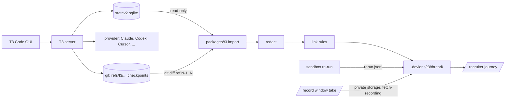

# T3 Code adapter (experimental)

Reads one T3 Code thread, read-only, and writes DevLens events in the same contract as the Claude Code hooks. The recruiter journey on `/recruiter` reads the result. Checked against T3 Code 0.1.3 (database migration 69) on 2026-10-29.

## Why this boundary

| Option | Verdict |
|---|---|
| T3 RPC subscriptions (`packages/contracts/src/rpc.ts` in T3) | Supported, but needs a paired, authenticated socket. Not built for the demo. The best long-term route. |
| Read the T3 server's local store, read-only | **Chosen.** No change to T3, no auth tokens, works for every provider T3 runs. The schema is internal to T3, so the reader checks it and fails closed. |
| Fork or patch T3 | Not needed. |
| Screen scraping | Rejected. A screen shows what happened, not who did it. |

T3 Code is event-sourced. Its server commits events and projections in one SQLite transaction (`~/.t3/userdata/statev2.sqlite`). The adapter opens that file with `readOnly: true` and reads these projections for one thread:

```
orchestration_v2_projection_threads      thread, project, branch, worktree
orchestration_v2_projection_runs         one run per prompt: provider + model selection + status
orchestration_v2_projection_turn_items   prompts, commands, file changes, tool calls, with provider-native ids
orchestration_v2_projection_checkpoints  hidden git refs T3 writes after each run, with changed files
orchestration_events                     project roots, model-selection and provider-switch events
```



## Commands

Run from the DevLens repo root. Output goes to `.devlens/t3/<thread>/` (git-ignored).

| Command | What it does |
|---|---|
| `npm run t3 -- list --workspace <dir>` | Lists T3 threads for one project folder |
| `npm run t3 -- import --thread <id>` | Maps the thread to `events.jsonl`, `edges.jsonl`, `capture.json` |
| `npm run t3 -- watch --thread <id>` (or `--workspace <dir>`) | Live capture. Checks T3 every 2 s and re-imports the thread when it changes. Ctrl+C stops it |
| `npm run t3 -- verify --thread <id>` | Sandbox re-run of the last passing test on a copy of the checkout, then re-import |
| `npx tsx packages/t3/src/fetch-recording.ts --latest --thread <id>` | Copies the newest uploaded window take and its meta into the capture folder |
| `npm run t3 -- save --thread <id> --as <name>` | Copies a capture into `examples/t3-captures/<name>/` with home paths as `~`, so it can be committed and shown by a hosted build. Add `--with-recording` only if the video may be public |
| `npm run test:t3` | Mapper, diff shapes, test detection, and the read-only store on a temp database |

Flags for `import`: `--recording <meta.json>` attaches media offsets (a `recording-meta.json` in the folder is used automatically), `--rerun <file>`, `--no-git` (skip checkpoint diffs), `--root <dir>` (paths relative to another folder), `--no-checkpoints`, `--db <path>`.

## Live capture

Run `watch` in a second terminal while a T3 session runs. Open `/recruiter` and pick the capture. It shows a "Live" chip and refreshes every 5 s.

- `--thread <id>` watches one thread. `--workspace <dir>` watches the newest thread in that project and switches if a newer one starts. `--interval <ms>` changes the 2 s check.
- Each check reads a cheap change marker (counts and newest times of the thread's rows) from the read-only database. When it changes, `watch` runs the same code as `import`. So a finished watch equals a one-shot `import`.
- Each re-import and each read error goes to stderr with the time. A read error does not stop the watch.
- Each check stamps `watch.updated_at` in `capture.json`, even with no change. The capture counts as live for 15 s after the last stamp.
- A run that is still running at import is incomplete. The next change re-imports it.

## Event mapping

| T3 item | DevLens event | Actor | Notes |
|---|---|---|---|
| `user_message`, `createdBy=user` | `prompt` | developer | Text kept word for word, then redacted |
| `user_message`, `createdBy=agent` | `prompt` | agent | `attribution: agent_authored`. Never shown as the developer's words |
| `command_execution` that is one test runner call (`npm test`, `npm run test:*`, `vitest`, `pytest`, `node --test`, `cargo test`), after `cd` steps and an output tail | `test` | tool | Status from the output. If the output is unclear and the provider flags a failure: `failed`. If the output reads as a pass but the provider flags a failure: `unknown`. Both use `signal: provider_status` |
| other `command_execution` | `tool_call` | agent | Command and the first 1500 characters of output |
| `file_change`, completed | `file_edit` | agent | Diff in the provider's shape: `old_new`, `written_content`, `unified`, or `not_exposed` |
| `file_change`, failed | `tool_call` | agent | `applied: false`. Not counted as an edit |
| `dynamic_tool`, `web_search`, `file_search`, `subagent` | `tool_call` | agent | Tool name and title only |
| checkpoint | `checkpoint` | tool | Hidden git ref, changed files, and `git diff` between consecutive refs |
| checkpoint file with no provider edit in that run | `file_edit` | unknown | `attribution: unattributed`, `provenance: inferred` |
| `assistant_message`, `reasoning` | not imported | | Counted in `capture.json` |
| items with no native id (T3 bookkeeping) | not imported | | Counted as `internal` |

Every event keeps the T3 thread, run, and turn-item ids, and the provider's own tool id (`tool_use_id`). The event id is `t3:<thread>:<turn item id>`, so a re-import replaces events instead of adding copies. Each event carries `payload.agent`: the provider instance, the model, and the options T3 recorded for that run.

## Rust (`cargo test`)

- `t3 verify` re-runs a `cargo test` in the sandbox. Run `cargo fetch` in the app first. The re-run works offline and never downloads crates.
- For a `cargo test` command only, the sandbox may read `~/.rustup`, `~/.cargo/bin`, `~/.cargo/registry/index`, `~/.cargo/registry/cache`, and `~/.cargo/git/db`. It cannot write to them.
- It cannot read the rest of `~/.cargo`, such as `credentials.toml` or `config.toml`. Network stays blocked, loopback included.
- Cargo state and build output stay in the temp folder. The app's `target/` is not copied, so the first re-run compiles from scratch.
- A cargo re-run times out after 5 minutes. Other re-runs time out after 30 seconds.
- Not supported: custom `RUSTUP_HOME` or `CARGO_HOME`, source replacement in `~/.cargo/config.toml`. Git dependencies are untested.

## What this does not know

- Which model the provider actually served. DevLens shows the selection T3 recorded for the run.
- Token usage, cost, and reasoning. Not imported.
- Edits made outside the agent (an editor, another terminal). The git checkpoint shows them as unattributed; it cannot say who made them.
- Edits made by a subagent in another thread. They show as unattributed in this thread's checkpoint.
- A rolled-back run: its edits were reverted in the checkout but stay on the line, and `capture.json` says so.
- Work in a run that was still running at import. Import again after it ends.
- A test status is what the session output said. Only `verify` adds an independent result.

Worktrees: when a thread runs in a T3 worktree, paths are relative to that worktree and checkpoint diffs are read there. Branch and worktree are recorded in `capture.json`.

## Privacy

- Read-only. The adapter never writes to T3's database or git refs.
- Redaction runs before anything is written, with the same rules as the Claude Code hook. Home paths are removed from free text on display.
- Text redaction does not remove secrets that appear in video frames.
- The recording stays in the private `recordings` bucket until you copy it with the service key. The copy stays in the git-ignored `.devlens/` folder.
