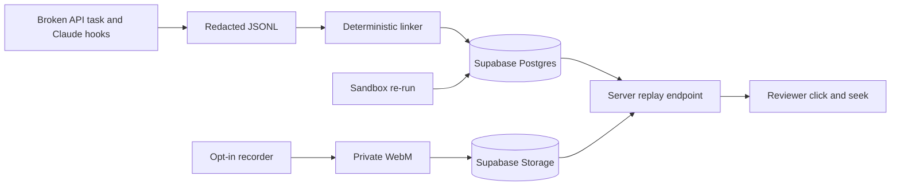
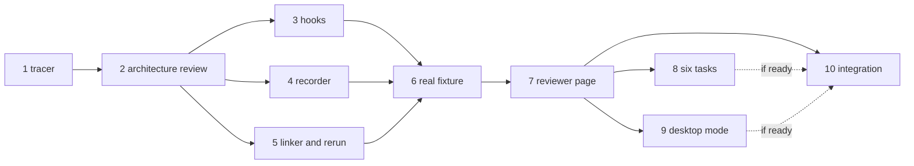

Summary: Build one cited, consented replay first; expand only after its real failure-to-pass chain works.
Goal: Submit a working Antler Agents demo by 2026-10-29 17:00 America/Chicago, then decide the later product from evidence.
Rules: contract first · parallel agents only for justified independent work · choose each model when dispatched · no self-review · no commit or push without authorization · Thursday noon freeze
Contract: [DevLens scope](devlens.contract.md)
Status: plan only; every slice is PLANNED

## Loop
1. Approve the existing contract and provide a Supabase project · user
2. Select the Slice 1 worker and model when ready, then arrange independent review · Claude
3. Lead the architecture review and shared interfaces · Claude
4. Release each later wave only after its dependencies are VERIFIED · Claude
5. Smoke-test the demo and submit it · user

## Goal
- **First-principles test:** The useful unit is a reviewer-verifiable claim, not a long recording. If a reviewer cannot reach the failed test, later patch, and passing check in one click, extra capture adds no demo value.
- **Scope reduction:** Prove one claim on one short task. Add more scenarios, desktop mode, and week-long capture only after that path has evidence.
- **Feedback loop:** Run each slice's acceptance check before releasing a dependent slice. The Tuesday noon linked-fixture gate decides whether to continue this idea.
- **Outcome:** A reviewer clicks a rule-derived claim and sees the consented recording, cited events, diff, failed test, later pass, question, answer, and separate re-run result.
- **Tracer bullet:** A deliberately small, labeled fixture travels from JSONL and WebM through the rule linker and Supabase to a seekable Replay page. It proves the interfaces before live capture expands.
- **Hackathon scope:** One recorded `broken-api` scenario is required. Six more failing starter tasks and desktop mode are conditional on the golden replay passing before Thursday noon.
- **After the fair:** A downloadable virtual desktop and week-long evidence view need a new approved contract after the demo. The current contract names the outcomes but leaves the image format and review layout unknown.
- **Out of scope:** scores, ranks, hire recommendations, camera, microphone, keystroke timing, a second agent adapter, login, graph database, and an invented week of activity.
- **Stop gates:** By Tuesday 27 October at noon Central, the fixture must link a failed test to a later pass by event IDs. Freeze features Thursday 29 October at noon Central; use the afternoon for README, Loom, and submission.
- **Post-fair gates:** Interview five potential buyers or reviewers about whether cited evidence beats a transcript. Decide the virtual desktop format, installation permissions, retention, week-view layout, and legal review before implementing that phase. These are open decisions, not completed design.

## Existing state
| Kind | Finding |
|---|---|
| Fact | The repository has README, implementation guidance, a product contract, and plans. It has no application code or tests. `git status --short` was clean when inspected on 2026-10-26. |
| Fact | The contract records user decisions for Supabase Postgres and Storage, consented window and desktop capture, seven scenario tasks, and a later virtual desktop and week view. Its approval task is still open. |
| Fact | `docs/implementation.md` is the detailed hackathon build spec. The older research roadmap mentions SQLite; the later public contract and implementation spec select Supabase. Follow the later decision. |
| Fact | This planning turn started no worker, branch, worktree, database migration, or application code. |
| Observed host | This session is Codex, not T3. The local Codex config default is `gpt-6.1-sol`; the plan still routes Codex as `auto`. |
| Observed host | `cursor-agent --list-models` required authentication. T3 `orchestrator_capabilities` is unavailable in this session. Claude model IDs, T3 child support, and current usage are unknown. |
| Assumption | A single teammate can record the consented golden take. Confirm the owner before recording. |
| Unknown | Supabase project ref and keys; T3 provider/model capabilities and remaining usage; browser/OS used at the fair; local commit approval; team roster. |
| Unknown | Whether the seven tasks must all ship by Thursday if the golden replay consumes the remaining time. The current contract says “if time permits” after the golden replay. |

## Requirements
The authoritative wording, sources, and full NOT list are in [the approved-scope contract](devlens.contract.md). These IDs are the build map; any requirement change needs a contract change row and user approval.

| ID | Requirement | Source |
|---|---|---|
| REQ-1, REQ-2, REQ-3, REQ-18 | Explicit opt-in; window and optional desktop modes; pause, stop, and review; audio off. | contract, user/agent as marked there |
| REQ-4, REQ-12 | Claude hooks append redacted events before export. | contract, user/agent as marked there |
| REQ-5, REQ-6, REQ-7 | Broken API task, deterministic cited edges, and a separate observed re-run. | contract, agent |
| REQ-8, REQ-9, REQ-10, REQ-14 | Seekable reviewer page, three cited questions, unknowns, and capture limits. | contract, user/agent as marked there |
| REQ-11, REQ-15, REQ-16 | Supabase data and private recording; local offline fallback; no browser secret. | contract, user/agent as marked there |
| REQ-13, REQ-17, REQ-21 | Submission artifacts and seven starter scenarios, with extras gated by the golden replay. | contract, user |
| REQ-19, REQ-20 | Downloadable virtual desktop and week-long review after the fair. | contract, user |
| NOT-1 through NOT-6 | No person-level verdicts, unwanted capture, extra adapter, fabricated week, live-model demo dependency, or browser secret. | contract |

## Decisions
| ID | Decision | By |
|---|---|---|
| DEC-1 | Use the existing contract and `docs/implementation.md` as the build source. Resolve its open approval before implementation. | agent |
| DEC-2 | Use a labeled, hand-authored fixture only in the tracer. Replace it with a reviewed, real Claude session and real recording before calling the golden replay complete. | agent |
| DEC-3 | Define event, edge, fixture, and media-offset shapes in Slice 1. All concurrent workers consume them without editing their owner files. | agent |
| DEC-4 | Keep the recorder upload and signed playback on server endpoints. Keep `SUPABASE_SECRET_KEY` server-only. | agent, pending architecture review |
| DEC-5 | There is no fixed subagent count limit. Start parallel agents only for independent work with a clear speed or risk benefit, while respecting actual T3 capacity. Select each model when dispatching. Begin with the lowest capable model and effort; do not default to a high model. This user direction supersedes the earlier three-agent skill cap. | user |
| DEC-6 | Run the separate architecture/security review before parallel implementation. | user skill |
| DEC-7 | Treat the virtual desktop and week view as a post-fair contract gate. Do not invent their architecture for the Thursday demo. | agent, from contract timing |
| DEC-9 | Provider routing and usage-limit rules live in the root `CLAUDE.md` (pointer in `AGENTS.md`). They apply to every agent. | user |
| DEC-8 | Claude is always the Tech Lead. Claude owns slice release, model choice, interface decisions, review assignment, and integration oversight even when Codex or Cursor builds a slice. | user |

## Evals
All results are `not run`. EVAL IDs refer to the detailed checks in [the scope contract](devlens.contract.md).

| ID | REQ | Check | Method | Result |
|---|---|---|---|---|
| EVAL-4, EVAL-12 | REQ-4, REQ-12 | Real hook appends IDs; fake secret is absent from disk. | integration and unit | not run |
| EVAL-5, EVAL-6 | REQ-5, REQ-6 | Starter and wrong fix fail; final fix passes; `verifies` cites events and `derived_by`. | integration and unit | not run |
| EVAL-1, EVAL-2, EVAL-3, EVAL-18 | REQ-1, REQ-2, REQ-3, REQ-18 | Opt-in, window/desktop behavior, audio off, and pause math work. | browser and unit | not run |
| EVAL-7, EVAL-8, EVAL-9, EVAL-10 | REQ-7 through REQ-10, REQ-14, NOT-1 | Replay separates evidence and re-run, seeks, cites questions, and shows unknowns. | browser and verifier diff | not run |
| EVAL-11, EVAL-15, EVAL-16 | REQ-11, REQ-15, REQ-16, NOT-5, NOT-6 | Supabase and offline demo work; RLS and private signed playback are checked. | integration and browser | not run |
| EVAL-13, EVAL-14, EVAL-17 | REQ-13, REQ-17, NOT-3, NOT-4 | Submission proof, one agent adapter, and seven failing starters. | human and integration | not run |
| EVAL-19, EVAL-20 | REQ-19, REQ-20, REQ-21 | Later outcomes stay outside the Thursday demo. | human | not run |

## Design
- Reuse the repo's stated TypeScript CLI, Next.js app, Supabase Postgres, and private Supabase Storage. Add only packages required by the tracer.
- Shared `Event` fields: `id`, `session_id`, `project_id`, `ts`, `seq`, `actor`, `type`, `source`, `provenance`, `recording_ref`, `media_offset_ms`, and `payload`. Keep a `tool_use_id` when supplied.
- Shared `Edge` fields: `id`, `src`, `dst`, `rel`, `derived_by`, `provenance`, and `evidence_event_ids`. A rule, never a model, creates an edge.
- Shared media rule: offset starts when `MediaRecorder.start()` is called; subtract the overlap of all completed pauses; missing sync data means no seek and an explicit unknown.
- Shared API contract: server loads a fixture session and creates a short-lived read URL for its private `recording_ref`; client receives event, edge, and signed media data, never the secret key. Define response and failure states in Slice 1.
- Start with one fixture session. Do not add generic user accounts, queueing, OCR, clips, token scoring, or a second event source.

### Post-fair implementation route
These milestones complete the project's stated direction without pretending that the open product decisions are settled. Each becomes a new verified slice only after its contract is approved.

| Gate | Smallest result | Acceptance before expansion | Likely owner |
|---|---|---|---|
| P1 — demand | Five discovery interviews using the clickable replay. | Record whether each reviewer finds the cited link more useful than the transcript alone; stop if the evidence does not support the product. | user, with Claude as Tech Lead |
| P2 — environment contract | Choose OS/image format, trust boundary, offline behavior, install permissions, cost, and deletion policy. | A fresh reviewer approves the threat model and a download/install smoke test. | Claude Tech Lead and a fresh independent reviewer |
| P3 — one-day environment tracer | Download one isolated environment, install a tool, fix one task, export the same evidence schema. | A clean machine completes install, tool installation, test run, export, and deletion without unsupported claims. | Codex (auto), Cursor (auto) UI |
| P4 — week evidence | Group daily sessions under one project while preserving event IDs, gaps, consent, and provenance. | A seven-day fixture opens by day, cites raw events, marks missing periods, and never represents synthetic data as real. | Codex (auto) data, Cursor (auto) UI |
| P5 — pilot gate | Review retention, access, fairness, and legal classification before real hiring use. | Human review and a limited pilot protocol exist; no person-level verdict appears. | user and independent specialists |

## Model assignment
The entries below are routing candidates, not model reservations. When a slice becomes READY, Claude Tech Lead checks its actual risk, available providers, and usage, then records the chosen child model and effort with a reason. Start at the lowest capable setting; higher effort needs a slice-specific reason.

| Slice | Goal | Agent | Candidate model | Candidate effort | Reviewer | Fallback |
|---|---|---|---|---|---|---|
| 1 | End-to-end tracer | Codex | Codex (auto) | auto | Claude (sonnet/medium, fresh session) | Cursor (auto) |
| 2 | Architecture and security review | Claude | Claude (sonnet/medium) | medium | Claude (sonnet/medium, fresh session) | Cursor (auto) |
| 3 | Live hook and redaction | Codex | Codex (auto) | auto | Claude (sonnet/medium, fresh session) | Cursor (auto) |
| 4 | Opt-in recording | Cursor | Cursor (auto) | auto | Claude (sonnet/medium, fresh session) | Codex (auto) |
| 5 | Rule links and re-run | Codex | Codex (auto) | auto | Claude (sonnet/medium, fresh session) | Cursor (auto) |
| 6 | Real golden fixture | Cursor | Cursor (auto) | auto | Claude (sonnet/medium, fresh session) | Codex (auto) |
| 7 | Reviewer experience | Cursor | Cursor (auto) | auto | Claude (sonnet/medium, fresh session) | Codex (auto) |
| 8 | Six more starter scenarios | Codex | Codex (auto) | auto | CI | Cursor (auto) |
| 9 | Desktop mode | Cursor | Cursor (auto) | auto | Claude (sonnet/medium, fresh session) | Codex (auto) |
| 10 | Integration and submission prep | Claude | Claude (sonnet/medium) | medium | Claude (sonnet/medium, fresh session) | Cursor (auto) |

Routing reasons: Slice 1 and rule work need bounded code and tests, fitting Codex. Recorder and reviewer UI fit Cursor. Claude remains Tech Lead and owns architecture, independent review assignment, and integration oversight. The scenario catalog is mechanical enough for CI review. T3 must discover actual available providers and usage before launching; an unavailable route is not silently replaced.

## Slices
### Slice 1: End-to-end tracer
- Goal: A labeled sample failure-to-pass claim loads from Supabase and seeks a reviewed sample WebM in Replay.
- Covers: REQ-5, REQ-6, REQ-8, REQ-11, REQ-15, REQ-16, NOT-1, NOT-5, NOT-6
- Model: Codex (auto)
- Review: Claude (sonnet/medium, fresh session)
- Fallback: Cursor (auto)
- Wave: 1 sequential
- Depends on: none
- Files: package.json, package-lock.json, packages/core/, packages/link/src/tracer.ts, supabase/migrations/, apps/web/replay/page.tsx, apps/web/api/replay/, examples/broken-api/, .env.example, .gitignore
- Out of scope: live hooks, recording controls, other scenarios, public deployment
- Accept: The `broken-api` starter fails for a named reason. A clearly labeled hand-authored JSONL plus reviewed sample WebM yields a `verifies` edge with event IDs; one click seeks the private Storage file; offline mode shows the same claim with a “local fixture” label; browser insert is denied by RLS.
- Verify: `npm run check && npm run test:tracer && npm run demo:smoke && npm run demo:smoke -- --offline`; reviewer also checks the click, media source, RLS denial, and browser bundle on a fresh session.
- State: PLANNED
- Evidence: none
- [ ] Build the smallest typed event-to-click path and its smoke commands · Codex (auto) · Verify commands and fresh browser check pass · revert only Slice 1 files
- [ ] Review the diff and run the exact checks from a fresh session · Claude (sonnet/medium, fresh session) · record output and any findings · leave slice PLANNED until fixed

### Slice 2: Architecture and security review
- Goal: A reviewer accepts or corrects the tracer's shared types, access policy, and media path before parallel work starts.
- Covers: REQ-6, REQ-11, REQ-15, REQ-16, NOT-6
- Model: Claude (sonnet/medium)
- Review: Claude (sonnet/medium, fresh session)
- Fallback: Cursor (auto)
- Wave: 2 sequential
- Depends on: slice 1
- Files: plans/devlens-architecture-review.md, packages/core/event.ts, supabase/migrations/, apps/web/api/replay/
- Out of scope: adding features, changing the product contract
- Accept: The review traces a publishable-key read, denied insert, private upload, signed playback, offline fallback, and event provenance; each finding has a file, consequence, and fix or an explicit pass.
- Verify: `npm run check && npm run test:tracer && npm run demo:smoke`; independent reviewer reads the diff and the review file and repeats the RLS and secret checks.
- State: PLANNED
- Evidence: none
- [ ] Review and repair only material tracer contracts or access faults · Claude (sonnet/medium) · independent review and Verify pass · revert review changes if they break the tracer

### Slice 3: Live Claude hook and redaction
- Goal: `devlens init` installs project-local hooks and one real Claude session appends redacted, attributable JSONL.
- Covers: REQ-4, REQ-12
- Model: Codex (auto)
- Review: Claude (sonnet/medium, fresh session)
- Fallback: Cursor (auto)
- Wave: 3 parallel
- Depends on: slice 2
- Files: packages/capture/, packages/cli/src/init.ts
- Out of scope: packages/core/, apps/web/, fixture media
- Accept: A throwaway `claude -p` run emits session and tool-use IDs when supplied; fake `sk-` content is absent from the written file; missing fields stay unknown; no user-global Claude settings change.
- Verify: `npm run test:capture && npm run probe:claude-hook`; reviewer inspects generated `.claude/settings.local.json` and exported JSONL.
- State: PLANNED
- Evidence: none
- [ ] Implement and probe hook append and redaction before write · Codex (auto) · exact probe and fake-secret check pass · remove only generated project-local hook files

### Slice 4: Consented window recorder
- Goal: One explicit click records a chosen window, supports pause and stop, and allows review before private upload.
- Covers: REQ-1, REQ-2, REQ-3, REQ-16, NOT-2
- Model: Cursor (auto)
- Review: Claude (sonnet/medium, fresh session)
- Fallback: Codex (auto)
- Wave: 3 parallel
- Depends on: slice 2
- Files: apps/web/record/, apps/web/api/recordings/, packages/core/src/sync.ts, apps/web/app/record/page.tsx, apps/web/app/api/recordings/ (one-line wrappers only)
- Out of scope: apps/web/replay/, packages/capture/, desktop mode
- Accept: Page load captures nothing; window mode rejects a monitor; audio and camera tracks are absent; pause math excludes a five-second pause; stop or sharing-end closes the take; developer can play or delete before upload.
- Verify: `npm run test:sync && npm run test:record`; reviewer runs a real supported browser check with a chosen window and inspects the private Storage object.
- State: PLANNED
- Evidence: none
- [ ] Implement consent, recorder, review, and offset math · Cursor (auto) · unit and browser acceptance pass · remove Slice 4 routes and component

### Slice 5: Deterministic linker and observed re-run
- Goal: The real event stream yields cited failure, supersedes, and verifies links, plus a separate sandbox test result.
- Covers: REQ-6, REQ-7
- Model: Codex (auto)
- Review: Claude (sonnet/medium, fresh session)
- Fallback: Cursor (auto)
- Wave: 3 parallel
- Depends on: slice 2
- Files: packages/link/src/rules.ts, packages/link/src/rerun.ts, packages/link/tests/, packages/cli/src/link.ts, packages/cli/src/rerun.ts
- Out of scope: packages/core/, supabase/migrations/, apps/web/
- Accept: Fixed rules use event IDs and `derived_by`; an unhooked edit is unattributed; the same test command is re-run in a bounded sandbox; session output and re-run output are both `observed` but differ by `source` (`claude_code_hook` vs `sandbox`) and stay visibly separate.
- Verify: `npm run test:link && npm run test:rerun`; reviewer checks fixture edges and both first-fix failure and final-fix pass.
- State: PLANNED
- Evidence: none
- [ ] Implement link rules and bounded test re-run · Codex (auto) · two edge tests and both re-runs pass · revert Slice 5 files

### Slice 6: Real golden session and recording
- Goal: A consented Claude take replaces the tracer sample and retains starter, wrong-fix, and final-fix evidence.
- Covers: REQ-4, REQ-5, REQ-8, REQ-12, REQ-16
- Model: Cursor (auto)
- Review: Claude (sonnet/medium, fresh session)
- Fallback: Codex (auto)
- Wave: 4 sequential
- Depends on: slices 3, 4 and 5
- Files: examples/broken-api/fixtures/, examples/broken-api/src/, examples/broken-api/tests/, examples/broken-api/README.md, packages/cli/src/link.ts (wire `attachMedia` only; Slice 5 is VERIFIED before this slice starts), examples/broken-api/scripts/, examples/broken-api/RECORDING.md
- Out of scope: packages/, apps/web/, other examples
- Accept: Starter test fails; plausible first fix fails a second assertion; final fix passes; reviewed JSONL contains linked IDs; reviewed WebM shows the chosen code window; a local commit trailer ties the session if local commits are authorized.
- Verify: `npm run scenario:verify -- broken-api && npm run fixture:verify -- broken-api`; reviewer manually plays the full take at normal speed and checks redaction before any public commit.
- State: PLANNED
- Evidence: none
- [ ] Record and review the real golden fixture with the teammate's consent · Cursor (auto) · starter/wrong/final checks and playback pass · keep the tracer sample clearly labeled if capture fails

### Slice 7: Reviewer claim, questions, and unknowns
- Goal: One click on the real golden claim opens the matching footage and all cited evidence on one screen.
- Covers: REQ-7, REQ-8, REQ-9, REQ-10, REQ-11, REQ-14, NOT-1
- Model: Cursor (auto)
- Review: Claude (sonnet/medium, fresh session)
- Fallback: Codex (auto)
- Wave: 5 sequential
- Depends on: slice 6
- Files: apps/web/replay/, apps/web/questions.ts, apps/web/api/replay/
- Out of scope: recorder controls, linker rules, schema
- Accept: Click seeks the real WebM and shows failure, answer, later edit, pass, and separate re-run; three questions cite IDs; unknowns and not-captured limits are visible; Supabase and offline modes show the same chain with correct labels.
- Verify: `npm run test:replay && npm run demo:smoke && npm run demo:smoke -- --offline`; fresh reviewer checks a claim click and searches visible verdict copy for forbidden person-level judgments.
- State: PLANNED
- Evidence: none
- [ ] Complete the reviewer flow and fixture fallback · Cursor (auto) · both demo modes and fresh click check pass · restore tracer Replay if the change breaks it

### Slice 8: Six more failing starter tasks
- Goal: Seven distinct scenarios can be opened, and each starter test fails for its documented reason.
- Covers: REQ-17, REQ-21
- Model: Codex (auto)
- Review: CI
- Fallback: Cursor (auto)
- Wave: 6 parallel
- Depends on: slice 7
- Files: examples/swapped-field/, examples/missing-auth/, examples/stale-cache/, examples/wrong-page/, examples/bad-date/, examples/empty-list/
- Out of scope: golden fixture, recording the six tasks, core packages
- Accept: Six new folders have a short task README and deterministic failing starter test; together with `broken-api` the count is seven; no task claims to be recorded.
- Verify: `npm run scenario:verify -- --all-starters`; CI or a fresh reviewer checks that each failure is intentional and named.
- State: PLANNED
- Evidence: none
- [ ] Add six isolated starter tasks only after the golden replay passes · Codex (auto) · all-starters check passes · remove extra task folders

### Slice 9: Desktop recording mode
- Goal: A second explicit mode records a monitor and labels the take desktop without weakening window mode.
- Covers: REQ-18, REQ-2, REQ-21, NOT-2
- Model: Cursor (auto)
- Review: Claude (sonnet/medium, fresh session)
- Fallback: Codex (auto)
- Wave: 6 parallel
- Depends on: slice 7
- Files: apps/web/record/, apps/web/api/recordings/
- Out of scope: apps/web/replay/, packages/, scenario tasks
- Accept: Desktop requires its own click; a monitor take is kept and labeled desktop; window mode still discards a monitor; neither mode records audio or camera.
- Verify: `npm run test:record`; reviewer performs both picker paths in a supported browser and inspects saved labels and tracks.
- State: PLANNED
- Evidence: none
- [ ] Add only the explicit desktop choice and label · Cursor (auto) · both browser picker paths pass · remove desktop mode and retain window mode

### Slice 10: Integration and submission prep
- Goal: A second teammate can run the frozen demo, and the user has a verified Loom and submission checklist.
- Covers: REQ-11, REQ-13, REQ-15, NOT-1, NOT-3, NOT-4, NOT-5, NOT-6
- Model: Claude (sonnet/medium)
- Review: Claude (sonnet/medium, fresh session)
- Fallback: Cursor (auto)
- Wave: 7 integration
- Depends on: slice 7; slices 8 and 9 only if they finish before Thursday noon
- Files: README.md, .env.example, package.json, plans/devlens-implementation.md
- Out of scope: new product features after the freeze, automatic form submission
- Accept: Clean-machine quick start works online and offline; README has architecture, provenance, limits, and environment setup; 2–5 minute Loom is uploaded; user submits the Airtable form before 17:00 Central.
- Verify: `npm run check && npm run demo:smoke && npm run demo:smoke -- --offline`; a different teammate follows README, and the user confirms Loom URL and form receipt.
- State: PLANNED
- Evidence: none
- [ ] Integrate verified slices and freeze at Thursday noon · Claude (sonnet/medium) · clean-machine and offline checks pass · restore last verified demo state
- [ ] Review the Loom and submit the form · user · 2–5 minute video and submission receipt · disclose any known gap before submission

## Waves
| Wave | Release rule | Concurrency |
|---|---|---|
| 1 | Contract approved and Supabase details available; run tracer alone. | 1 |
| 2 | Slice 1 VERIFIED; architecture/security review alone. | 1 |
| 3 | Slice 2 VERIFIED; Slices 3, 4, and 5 own disjoint files. | Up to three useful independent slices exist; Claude launches only those worth parallelizing. |
| 4 | Slices 3–5 VERIFIED; record the real golden fixture. | 1 |
| 5 | Slice 6 VERIFIED; finish the real reviewer click. | 1 |
| 6 | Slice 7 VERIFIED and time remains before Thursday noon; scenario and desktop files are disjoint. | Two independent slices are available; Claude decides whether both should run. |
| 7 | Integrator did not build the combined slices; finish submission artifacts. | 1 |

- **Critical path:** 1 → 2 → 3/4/5 (slowest) → 6 → 7 → 10. Slices 8 and 9 must not delay the frozen golden demo.
- **T3 handoff rule:** Claude Tech Lead chooses each worker's actual model and effort at dispatch and records why. For every released slice, paste the exact slice fields plus this note into a new child task: “Read `/Users/UmaYeruva/Code-Git-Repos/DevLens/plans/devlens-implementation.md` first. Do only your slice. Own only its Files. Do not launch workers. Read the contract and repository policy. No commit, push, merge, deploy, or package install without approval. Report changed files, exact Verify output, and anything unverified. Do not mark yourself VERIFIED. On a true blocker, write `BLOCKED.md` in your worktree or `BLOCKED-slice-N.md` in the shared checkout.” Add current VERIFIED dependency evidence and the chosen model and effort before dispatch.
- **Worktree rule:** A concurrent worktree starts from a commit containing VERIFIED dependencies. Without authorized commits, apply the reviewed dependency diff to the shared checkout and release one dependent slice at a time. Do not pretend an isolated worktree contains uncommitted work.
- **Review rule:** A different session reads the actual diff, runs `Verify:`, and records evidence. `AGENT_FINISHED` and a worker summary are not verification.

## Usage
| Resource | Allocation |
|---|---|
| Concurrent children | No fixed count limit. Claude Tech Lead launches parallel children only for independent work with a stated speed or risk benefit, subject to actual T3 capacity and non-overlapping files. |
| Codex | `auto`; local default observed, current usage unknown. Do not force a model ID in T3. |
| Cursor | `auto`; local model discovery blocked by authentication, T3 usage unknown. |
| Claude | Always Tech Lead. `sonnet/medium` in the table is a low-cost candidate, not a default for every child. Actual T3 model IDs and availability are unknown. |
| Higher effort | Do not default a child to high. Choose any higher setting only when that slice's reasoning risk warrants it and record why. No separately billed API is assumed. |
| T3 discovery | Before each launch, inspect provider capabilities and current usage, then set that child's model and effort explicitly. If this tool is absent, use manual handoffs rather than claiming a child launched. |

## Risks
| Risk | Mitigation |
|---|---|
| Tuesday noon fixture has no linked failed test and later pass. | Stop feature work. Fix capture and linkage; do not start another adapter. The tracer sample is labeled and does not count as the real golden take. |
| Supabase or private media access blocks the tracer. | Confirm project, migration permissions, private bucket, signed read, and RLS before parallel work. Offline fallback stays visibly labeled. |
| Public fixture leaks a prompt, key, or private screen content. | Redact before append, scan exported data, review the entire recording at normal speed, and require the consenting teammate's review before upload or commit. |
| Browser picker differs on the fair machine. | Test the actual browser and OS. `getDisplayMedia` needs a secure context and has browser differences; retain the reviewed, labeled fixture. See [MDN](https://developer.mozilla.org/en-US/docs/Web/API/MediaDevices/getDisplayMedia). |
| Hook input or trust behavior differs from the spec. | Probe real Claude hooks before relying on IDs. Preserve absent fields as unknown. See [Claude Code hooks reference](https://code.claude.com/docs/en/hooks). |
| Signed URL is mistaken for permanent privacy. | Keep the bucket private and create short-lived URLs server-side; deletion is the revocation path to verify. See [Supabase private downloads](https://supabase.com/docs/guides/storage/serving/downloads). |
| Thursday scope exceeds the remaining time. | Freeze the verified golden click at noon. Extra scenarios and desktop mode are gated; disclose missing items instead of representing them as complete. |
| Local commits needed for the three-stage task history are unauthorized. | Ask for local commit permission before Slice 6. Do not squash or invent commit evidence. |
| Post-fair virtual desktop and week view are underspecified. | After the fair, approve image format, trust boundary, install policy, retention, and review layout in a separate contract; then slice and route that build. |

## First action
- [ ] Approve [the existing DevLens contract](devlens.contract.md), authorize local commits for the staged `broken-api` history, and provide a Supabase project through local environment setup · user · Claude Tech Lead can see a project ref and contract approval without exposing keys · no build starts
- [ ] Discover T3 providers and usage, select the lowest capable Slice 1 model, and release only that slice · Claude · record the chosen model, reason, capability output, and task ID · cancel that task if its workspace must change
- **Slice 1 candidate builder:** Codex (auto). Claude Tech Lead makes the dispatch choice and assigns a fresh independent reviewer. The next wave remains withheld until the tracer has observed checks and review evidence.

## Execution state
| PLANNED | READY | IN_PROGRESS | BLOCKED | REVIEWED | VERIFIED | INTEGRATED |
|---:|---:|---:|---:|---:|---:|---:|
| 10 | 0 | 0 | 0 | 0 | 0 | 0 |

- Nothing was launched. No worker tracking rows exist yet.
- After the fair, invoke `grill-me` for the virtual desktop and week-long view, then amend the contract and create executable slices. Invoke `verify` only when asking for fresh-session product acceptance.
