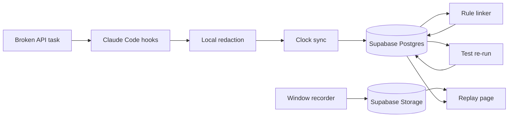

Summary: Ship one clickable replay, a catalog of at least seven scenarios, and an opt-in desktop recording. A virtual desktop and a week-long project wait until after that demo.
Goal: A working Antler Agents demo submitted before Thursday 29 October 2026, 5:00 PM Central.
Rules: Supabase is the store · Window and desktop are both opt-in · One golden replay must ship · Seven scenarios are tasks · Virtual desktop and the week view are later · No score · Thursday noon freeze
Intent: At least seven scenarios, desktop capture as well as the window, and later a downloadable virtual desktop and a week-long project. Extend only if time permits.
Not wanted: scores · ranks · hire recommendations · camera · microphone · keystroke timing · graph database · a second coding agent on the critical path · calling this week's demo a full week

Track: Antler Agents
Deadline: 2026-10-29 17:00 America/Chicago
Fair: 2026-10-30 13:00 America/Chicago
Repo: https://github.com/yeruvamaheswar/DevLens

## Loop
1. Write the winning scope · Cursor (auto)
2. Approve this contract · user
3. Build slice 1 · Cursor (auto)

## Work
### Always loaded
- This contract
- `examples/broken-api` once slice 1 exists
- The recorded fixture once slice 2 exists
### On demand
- Research notes in the private AITX research folder
- Claude Code hook docs
- MDN `getDisplayMedia` and `displaySurface`
### Steps
- [x] Publish the empty public repo · Cursor · https://github.com/yeruvamaheswar/DevLens is public on main · delete the GitHub repo
- [x] Approve this contract · user (approved 2026-10-26 in the T3 Tech Lead thread) · Reply that the requirements and the not-wanted list stand · revert the contract commit
### Open
- Team roster: unknown
- Interactive Claude hook trust before the folder is trusted: unknown
- `PostToolUseFailure` on a real failing test: unknown
- Supabase project ref: unknown
- Deployed replay URL: unknown
- Thursday depth for the seven scenarios: recommended seven tasks and one recorded replay. User has not confirmed this split.
- Virtual desktop image format: unknown
- Week-long review layout: unknown

## Requirements
| ID | Requirement | Source |
|---|---|---|
| REQ-1 | Recording starts only after an explicit opt-in click. A page load does not record. | user |
| REQ-2 | Window mode records one window. If `displaySurface` is `monitor` in window mode, discard that take and ask again. Audio stays off. | agent |
| REQ-17 | The repo offers at least seven scenarios a developer can work. Each has a starter test that fails on purpose. | user |
| REQ-18 | Desktop capture is a second opt-in. The developer chooses desktop mode, the take may be a monitor, and the page labels it desktop. | user |
| REQ-19 | Later, a developer can download a virtual desktop and install the tools they need to implement a fix. | user |
| REQ-20 | Later, the same evidence model covers a week-long project. This week's demo is not that week. | user |
| REQ-21 | Extra scenarios, extra recordings, the virtual desktop, and the week view are built only after the golden replay works, and only if time remains before Thursday noon. | user |
| REQ-3 | Start, pause, and stop work. The developer can play the file before anyone else sees it. Pause time is excluded from `media_offset_ms`. | agent |
| REQ-4 | `devlens init` installs Claude Code hooks that append redacted JSONL. Each event has `session_id` and `tool_use_id` when the hook provides them. | agent |
| REQ-5 | One task repo has a broken API client. The starter test fails. A plausible first fix fails a second assertion. A later change passes. Both commits stay. | agent |
| REQ-6 | Fixed rules write a `verifies` edge from the later passing test to the second patch. Each edge stores `derived_by` and event ids. The model does not insert edges. | agent |
| REQ-7 | A worker re-runs the tests. That result is stored and labeled separately from the session's own test line. | agent |
| REQ-8 | A reviewer click seeks the screen recording to that event and shows the diff, the test output, the question, and the answer on one screen. | user |
| REQ-9 | The reviewer sees at least three questions. Each question cites event ids. | user |
| REQ-10 | The page lists unknowns: unattributed changes, inferred edges, and no claim that the session predicts job performance. | agent |
| REQ-11 | `npm run demo` reads the fixture from Supabase. `npm run demo --offline` renders the same chain from local files with the network off. | agent |
| REQ-12 | A secret in the capture stream is absent from the exported JSON. Redaction runs before the event is appended. | user |
| REQ-13 | The public README has a quick start, the stack, an architecture diagram, env setup, data provenance, limitations, and next steps. A 2–5 minute Loom exists. The Airtable form is submitted before the deadline. | user |
| REQ-14 | The page states what was not captured: reasoning, the editor, other terminals, camera, and microphone. | user |
| NOT-1 | The product must not score, rank, mark a competency met or unmet, recommend a hire, or give a cheating verdict. | user |
| NOT-2 | The product must not record the camera, the microphone, or keystroke timing. Desktop video is allowed only in desktop mode, after the same opt-in. | user |
| NOT-3 | The Thursday critical path must not add Cursor, Codex, a graph database, login, an ATS, or billing. The week-long project is later. It is not this submission. | user |
| NOT-4 | A synthetic multi-day strip, if shown, must be labeled synthetic. It must not be described as a real week. | agent |
| REQ-15 | Events, entities, and edges are rows in Supabase Postgres. RLS is enabled. The browser never receives the secret key. | user |
| REQ-16 | The screen recording of the chosen window is stored in Supabase Storage. Replay plays that file. | user |
| NOT-5 | The judging-table demo must not depend on a live model call. | agent |
| NOT-6 | The Supabase secret key must not be in a `NEXT_PUBLIC_` variable or in the browser bundle. | agent |
| REQ-22 | The replay may show the coding agent's model and token usage, read from consented local data, labeled as context with the price-table date and billing route. It is never a ratio, rank, or comparison. | user |
| REQ-23 | A developer answer is stored verbatim, linked to its question id, and labeled `live` or `post_session` with its real time. | user |
| REQ-24 | Superseded by REQ-25 (CR-7). Was: questions come from fixed trigger rules that cite event ids; a model may only rephrase. | user |
| REQ-25 | The DevLens Agent decides when and what to ask, from what the developer is building. It runs as a separate process at each Claude Code `Stop`, reads the session's redacted events and the repo's files read-only, and may ask nothing. Questions are about the project the developer is building, not about how the coding assistant worked. Every question cites the event ids it rests on, including at least one of the developer's own prompts. Off by default; on only with the developer's opt-in on `/record`. Post-fair. | user, 2026-10-27 |
| REQ-26 | A new question shows as a small pop-up for 10 seconds, then moves to the question queue. It never blocks work. The developer answers from the queue at any time, or skips. Answers are labeled with their time and delivery. | user, 2026-10-27 |
| NOT-7 | No model call without an explicit opt-in flag, a budget guard, a ledger entry, zero retries, and no automatic fallback to another or larger model. | user |
| NOT-8 | DevLens never injects questions or hints into the coding agent's context. In assessment mode, a question never names a fix. | user |
| NOT-9 | No cross-person comparison of usage, cost, time, or retries. | user |
| NOT-10 | The DevLens Agent never reads secret files (`.env*` except `.env.example`, `*.pem`, `*.key`, `~/.ssh`), never edits files, and never runs shell commands. A question never names a score, rank, or hire verdict. | user, 2026-10-27 |

## Decisions
| ID | Decision | By |
|---|---|---|
| DEC-1 | Build the competitive slice: hooks, rule edges, sandbox re-run, clickable replay, questions, and redaction. The fixture is the safety net. | agent |
| DEC-2 | Enter Antler Agents. The form has no Open track. The agent does the re-run. A passive log summary is not the demo. | agent |
| DEC-3 | Store events, entities, and edges in Supabase Postgres. Store the screen recording in Supabase Storage. Traversals stay one to three hops. No graph database. | user |
| DEC-4 | Claude Code is the only agent adapter on the critical path. Record the fixture early. | agent |
| DEC-5 | Screen recording is required. Capture is `getDisplayMedia` plus `MediaRecorder`, then upload to Storage. Window mode rejects a monitor. Desktop mode is DEC-11. ScreenCaptureKit, Screenpipe, OBS, and rrweb are not the recorder. | user |
| DEC-6 | Claims come from hooks, git, and tests. The video is the picture of those claims. A video model does not invent a claim. | agent |
| DEC-7 | Freeze features at Thursday 29 October 2026, noon Central. 1:00–4:00 PM is for submission. | agent |
| DEC-8 | If the fixture has no linked failure and pass by Tuesday 27 October 2026, noon Central, stop this build. | agent |
| DEC-9 | This public repo is the hackathon product. Research notes stay out of it. | user |
| DEC-10 | Thursday replays one golden scenario. The other scenarios are tasks in the repo. Recording all seven is only if time permits after that replay works. | agent |
| DEC-11 | Desktop mode accepts a monitor and labels the file desktop. Window mode still rejects a monitor. | agent |
| DEC-12 | The downloadable virtual desktop and the week-long project are after the hackathon demo. | user |
| DEC-13 | Product framing is "review questions" or "evidence-backed review companion", not "team lead". | user |
| DEC-14 | Live questioning is post-fair. It starts with the technology-choice question (Review Questions C1) and test-failure question (T1), only at a Claude Code `Stop` boundary. Experiments E5 (silence) and E6 (interruptions) must pass before more triggers go live. | user |
| DEC-15 | The DevLens Agent reaches Claude through the machine's Claude Code login (`claude -p`) by default. When `ANTHROPIC_API_KEY` is set, it calls the Anthropic API instead. This is a configured route, not a fallback: a failed call asks nothing and is not retried (NOT-7). | user, 2026-10-27 |

## Evals
| ID | REQ | Check | Method | Result |
|---|---|---|---|---|
| EVAL-1 | REQ-1 | Opening the record page creates no media file until the opt-in click. | browser | not run |
| EVAL-2 | REQ-2, NOT-2 | In window mode, a monitor choice is discarded. The saved file is one window. No camera track. | browser | not run |
| EVAL-3 | REQ-3 | A 5 second pause does not add 5 seconds to `media_offset_ms`. | unit | not run |
| EVAL-4 | REQ-4 | One `claude -p` prompt appends a JSONL line with `session_id` and `tool_use_id`. | integration | not run |
| EVAL-5 | REQ-5 | `npm test` in `examples/broken-api` fails on the starter commit and passes on the final commit. | integration | not run |
| EVAL-6 | REQ-6 | A hand-written two-event JSONL emits a `verifies` edge with `derived_by` set. | unit | not run |
| EVAL-7 | REQ-7 | The page shows the worker pass or fail apart from the session test line. | integration | not run |
| EVAL-8 | REQ-8 | Clicking the failure sets the player time and shows the diff, the test, the question, and the answer. | browser | not run |
| EVAL-9 | REQ-9, NOT-1 | Three questions each show an event id. Page source has no score, rank, or hire recommendation. | verifier diff | not run |
| EVAL-10 | REQ-10, REQ-14 | Unknowns and the not-captured list are visible on the fixture page. | browser | not run |
| EVAL-11 | REQ-11, NOT-5 | `npm run demo` loads the fixture from Supabase. `npm run demo --offline` works with the network disabled. | integration | not run |
| EVAL-12 | REQ-12 | A fake `sk-` string in a hook payload is absent from the JSONL file. | unit | not run |
| EVAL-13 | REQ-13 | README sections exist, the Loom is 2–5 minutes, and the form is in before 5:00 PM Central on 29 October. | human | not run |
| EVAL-14 | NOT-3, NOT-4 | The demo repo has one agent adapter. Any extra day strip is visibly labeled synthetic. | human | not run |
| EVAL-15 | REQ-15, NOT-6 | RLS is on. The publishable key can read the fixture and cannot insert. The secret key is absent from the client bundle. | integration | not run |
| EVAL-16 | REQ-16, REQ-8 | Replay plays the Storage object and seeks it from a claim click. | browser | not run |
| EVAL-17 | REQ-17 | The repo contains at least seven scenario folders. `npm test` fails in each on its starter. | integration | not run |
| EVAL-18 | REQ-18, REQ-2, NOT-2 | Desktop mode keeps a monitor take and labels it desktop. Window mode discards a monitor take. No camera track in either. | browser | not run |
| EVAL-19 | REQ-19, REQ-21 | `npm run demo` does not require a virtual desktop. The README names that download as later. | human | not run |
| EVAL-21 | REQ-22, NOT-1 | A unit test reproduces the golden usage totals. The page has no efficiency, score, or rank words. | unit | not run |
| EVAL-22 | REQ-23 | An answer renders verbatim with its label. The no-answer line shows only when no answer exists. | unit | not run |
| EVAL-23 | REQ-24, NOT-1 | `npm run test:questions`: adding `react` asks one question naming Vue and Angular; `react-dom` after `react` asks nothing; a `devDependencies` test tool asks the test-framework question; no new dependency asks nothing. | unit | pass (2026-10-27, commit 7adfbfb) |
| EVAL-24 | REQ-25, NOT-7, NOT-10, DEC-15 | `npm run test:agent`: with the opt-in off, no model call happens; a fake engine's question is kept only when it cites real event ids, at least one of them a developer prompt; a timeout or error asks nothing and is not retried; a question naming a score, rank, or hire verdict is dropped; the engine command allows only read-only tools and denies secret files. | unit | pass (2026-10-28, 60 tests, developer-prompt citation rule added) |
| EVAL-25 | REQ-26 | `npm run test:record`: a new question shows a pop-up that moves to the queue after 10 seconds; a queued question can be answered or skipped later; with the opt-in off, `/record` renders as before. | unit | pass (2026-10-28, commit a5fd118, test:record 45) |
| EVAL-20 | REQ-20, NOT-4, REQ-21 | The Thursday demo has no week strip, or any strip on screen is labeled "not in this build." | human | not run |

## Infrastructure
| Resource | Defined in | Applied by | Secrets |
|---|---|---|---|
| TypeScript CLI and Next.js app | `package.json` | `npm install` | none |
| Claude Code project hooks | `.claude/settings.local.json` | `devlens init` | none |
| Supabase Postgres | `supabase/migrations` | `supabase db push` | `SUPABASE_SECRET_KEY` |
| Supabase Storage bucket `recordings` | `supabase/migrations` | upload after stop | `SUPABASE_SECRET_KEY` |
| Browser read | `apps/web` | publishable key | `NEXT_PUBLIC_SUPABASE_URL`, `NEXT_PUBLIC_SUPABASE_PUBLISHABLE_KEY` |
| Broken API task and fixture | `examples/broken-api` | `npm test` and `npm run demo` | none |
| Screen recording | `apps/web/record/page.tsx` | browser `getDisplayMedia` | none |
| Desktop recording mode | `apps/web/record/page.tsx` | developer chooses desktop, then the browser | none |
| Scenario catalog | `examples/` | `npm test` in each scenario | none |
| Virtual desktop image | unknown | later, not this demo | unknown |
| Week-long review | unknown | later, not this demo | none |
| Reviewer player | `apps/web/replay/page.tsx` | `npm run demo` | none |
| GitHub repository | manual | `gh` | none |
| Public deploy | unknown | — | none |

## Observability
| Signal | Seen in | Eval |
|---|---|---|
| Hook append succeeded or failed | hook stderr and `.devlens/events.jsonl` | EVAL-4 |
| Secret stripped before write | unit test output | EVAL-12 |
| Sandbox pass or fail | reviewer page, separate from the session line | EVAL-7 |
| Score language absent | page source search | EVAL-9 |
| Supabase read succeeded | reviewer page and browser network log | EVAL-15 |
| Offline fallback started | local server log | EVAL-11 |
| Recording uploaded | Storage object for `recording_ref` | EVAL-16 |
| Scenario count is at least seven | repo listing and starter tests | EVAL-17 |
| Desktop take is labeled desktop | reviewer page | EVAL-18 |

## Architecture

Event fields: `id`, `session_id`, `ts`, `actor`, `type`, `source`, `provenance`, `payload`, `recording_ref`, `media_offset_ms`.

Edge relations used in the demo: `prompted`, `called`, `edited`, `ran_test`, `failed`, `supersedes`, `verifies`, `cites`.

`actor` is `developer`, `agent`, `tool`, `ci`, or `unknown`. Unhooked work is `actor: unknown` with `payload.attribution: unattributed`. `provenance` is `observed` or `inferred`. Unhooked edits are `unattributed`, not human.

## Demo
| Time | Action | Line |
|---|---|---|
| 0:00 | Show the failing test | The finished repo hides the path. |
| 0:20 | Play the recorded Claude Code take | Hooks recorded the prompt, the tool calls, and the edits. |
| 1:00 | Show the failed patch, then the change of approach | The two test events are in the log. |
| 1:30 | Click the verifies claim | The raw event and the sandbox re-run open. |
| 2:10 | Show three questions and the unknowns | Questions, not a score. |
| 2:40 | Stop | We cannot see reasoning, other terminals, or later job performance. |

Recovery: if the live model or the picker fails, play the committed fixture and call it the recorded take. If the sandbox panel fails, hide it and keep the click. If the dashboard crashes, open the static export next to the fixture.

Do not say that nobody else does this, that the product predicts who to hire, that fewer tokens means a better engineer, that the demo is seven days, or that the store is a graph database.

Loom storyboard, recorded after the Thursday noon freeze: failing test, bad patch, second failure, passing test, timeline, citation click, sandbox line, questions and unknowns, diagram, limitations.

## Slices
### Slice 1: Task, types, and init
- Covers: REQ-4, REQ-5, REQ-12
- Model: Cursor (auto)
- Depends on: user approval of this contract
- Files: `packages/core/event.ts`, `packages/capture`, `examples/broken-api`
- [ ] Add the broken API task and confirm the starter test fails · Cursor · EVAL-5 · delete `examples/broken-api`
- [ ] Add the event type and a unit test for one redacted JSONL line · Cursor · EVAL-6 fixture input exists · delete `packages/core`
- [ ] Add `devlens init` and append one real hook event · Cursor · EVAL-4 · remove the generated `.claude` settings

### Slice 2: Fixture and links
- Covers: REQ-6, REQ-12, NOT-5
- Model: Cursor (auto)
- Depends on: Slice 1
- Files: `examples/broken-api/fixtures/session.jsonl`, `packages/capture/redact.ts`, `packages/link`
- [ ] Record the golden session with a failed test and a later pass · Cursor · JSONL contains both test results · label a hand-trimmed probe log
- [ ] Strip a fake key before append · Cursor · EVAL-12 · denylist regex only
- [ ] Load events into Supabase and emit the verifies edge · Cursor · EVAL-6 and EVAL-15 · hand-built edges in the local fixture

### Slice 3: Replay capture
- Covers: REQ-1, REQ-2, REQ-3, REQ-8, REQ-16
- Model: Cursor (auto)
- Depends on: Slice 1
- Files: `apps/web/record/page.tsx`, `packages/core/src/sync.ts`, `examples/broken-api/fixtures/session.webm`
- [ ] Record one chosen window, reject a monitor, and upload the WebM to Storage · Cursor · EVAL-1, EVAL-2, and EVAL-16 · commit a labeled fixture WebM and play that file
- [ ] Store `recording_ref` and `media_offset_ms` on hook events · Cursor · EVAL-3 · show events with no video
- [ ] On test failure, store one typed answer with no trait language · Cursor · answer text is on the event · static question in the fixture

### Slice 4: Reviewer page
- Covers: REQ-7, REQ-8, REQ-9, REQ-10, REQ-11, REQ-14, REQ-15, NOT-1, NOT-6
- Model: Cursor (auto)
- Depends on: Slice 2, Slice 3
- Files: `apps/web/replay/page.tsx`, `apps/web/questions.ts`, `packages/link/rerun.ts`
- [ ] Seek the Storage recording from a claim, and keep an offline fallback · Cursor · EVAL-8, EVAL-11, and EVAL-16 · static HTML plus the local WebM
- [ ] Show the sandbox result · Cursor · EVAL-7 · omit the panel and say the re-run is manual
- [ ] Show three cited questions and the unknowns panel · Cursor · EVAL-9 and EVAL-10 · static questions in the fixture

### Slice 5: Submit
- Covers: REQ-13, NOT-3, NOT-4
- Model: Cursor (auto)
- Depends on: Slice 4
- Files: `README.md`
- [ ] Freeze at Thursday noon and revert anything that breaks `npm run demo` · Cursor · EVAL-11 still passes · restore the noon commit
- [ ] Finish the README, record the Loom, and submit the form · user · EVAL-13 · submit with the known gap written in the description

### Slice 6: Six more scenarios
- Covers: REQ-17, REQ-21
- Model: Cursor (auto)
- Depends on: Slice 1, and the golden replay still passing
- Files: `examples/swapped-field`, `examples/missing-auth`, `examples/stale-cache`, `examples/wrong-page`, `examples/bad-date`, `examples/empty-list`
- [ ] Add six starter tasks whose tests fail · Cursor (auto) · EVAL-17 · delete the extra example folders

### Slice 7: Desktop capture
- Covers: REQ-18, REQ-2, NOT-2, REQ-21
- Model: Cursor (auto)
- Depends on: Slice 3
- Files: `apps/web/record/page.tsx`
- [ ] Add desktop mode and label that take · Cursor (auto) · EVAL-18 · hide desktop mode and keep window mode

### Slice 8: Virtual desktop
- Covers: REQ-19
- Model: Cursor (auto)
- Depends on: Slice 5 submitted
- Files: unknown
- [ ] Offer a downloadable desktop the developer can tool · Cursor (auto) · EVAL-19 passes because the demo does not need it · remove the image from the demo path

### Slice 9: Week-long project
- Covers: REQ-20, NOT-4
- Model: Cursor (auto)
- Depends on: Slice 5 submitted
- Files: unknown
- [ ] Show a week of sessions on the same evidence model · Cursor (auto) · EVAL-20, and any early mock is labeled not in this build · remove the week view

## Scenarios
Names below are a suggestion until the user renames them. Only `broken-api` is the golden replay.

| # | Folder | Bug the starter test shows |
|---|---|---|
| 1 | `examples/broken-api` | Wrong base URL. This is the recorded demo. |
| 2 | `examples/swapped-field` | Response JSON uses the wrong key. |
| 3 | `examples/missing-auth` | The client omits the bearer token. |
| 4 | `examples/stale-cache` | A cached error is returned after the server recovered. |
| 5 | `examples/wrong-page` | Pagination is off by one. |
| 6 | `examples/bad-date` | A timestamp is read in the wrong zone. |
| 7 | `examples/empty-list` | A missing array is treated as success. |

Each scenario keeps the same shape. The starter fails. A plausible first fix fails a second assertion. A later change passes. Both commits stay. Do not record scenarios 2–7 until scenario 1 replays.

## Must ship vs later
| Layer | What | When |
|---|---|---|
| Thursday demo | One clickable replay of `broken-api`, window recording, Supabase, offline fallback, three questions, no score, README, Loom | Must ship |
| If time permits | The other six scenario tasks. Desktop mode on the golden session. Recorded sessions for those six. | Only after the golden replay works, and before Thursday noon |
| After the fair | A virtual desktop the developer downloads and can tool. A week-long project on the same evidence model. | Not this submission |

## Changes
| ID | Date | Change | Affects | Approved |
|---|---|---|---|---|
| CR-1 | 2026-10-26 | Winning scope added to the public repo from the same-day research. | REQ-1 through NOT-5 | user asked to add the scope |
| CR-2 | 2026-10-26 | Database is Supabase Postgres. Screen recording is required and stored in Supabase Storage. The full desktop stays out. Offline fixture remains the table fallback. | DEC-3, DEC-5, REQ-8, REQ-11, REQ-15, REQ-16, NOT-6 | user |
| CR-3 | 2026-10-26 | Add at least seven scenarios and opt-in desktop capture. Virtual desktop and the week-long project are later. Extra scope waits until the golden replay works. | REQ-17, REQ-18, REQ-19, REQ-20, REQ-21, NOT-2, NOT-3, DEC-10, DEC-11, DEC-12 | user |
| CR-4 | 2026-10-26 | Clarify: `actor` also allows `unknown`, as `docs/implementation.md` already says. No requirement changes. | Architecture | pending user note |
| CR-5 | 2026-10-27 | Thursday scope adds the usage-context panel and labeled post-session answers. Post-fair work is drafted in `plans/devlens-review-questions.md`, not approved. | REQ-22, REQ-23, EVAL-21, EVAL-22 | user chose A + H1a + H1b |
| CR-6 | 2026-10-27 | Adds the Review Questions rules, post-fair. DEC-14 adapts the exploration plan's "T1 only" to the user's 2026-10-27 choice of live technology-choice questions. The Thursday scope is unchanged. | REQ-24, NOT-7, NOT-8, NOT-9, DEC-13, DEC-14, EVAL-23 | user approved 2026-10-27 |
| CR-7 | 2026-10-27 | Questions come from the DevLens Agent, not fixed rules. It decides when and what, with a 10-second pop-up and a queue. It reads session events and repo files, read-only. Engine: Claude Code login, or the API when a key is set. Built off by default before the freeze; the Thursday demo is unchanged. The C1/C2 rules stay in the code but are not the question source. | REQ-24, REQ-25, REQ-26, NOT-10, DEC-15 | user approved in chat 2026-10-27 |
| CR-8 | 2026-10-28 | The question pop-up and queue move from `/record` to a native bottom-right widget (`npm run widget`); `/record` is redesigned as a setup page with a session-log row, a screen-video row, and agent and sharing switches. Plan: `plans/agent-widget.md`. | REQ-26, EVAL-25 | user approved in chat 2026-10-28 |
| CR-9 | 2026-10-28 | Opt-in recruiter updates: rule-built, fact-only entries after Stops and on request, on a local `/recruiter` page; each send shows in the widget. No code, score, rank, or verdict. Plan: `plans/agent-widget.md`. | REQ-36 to REQ-39, NOT-12 | user approved in chat 2026-10-28 |
| CR-10 | 2026-10-28 | Recruiter updates show each developer prompt word for word (redacted, up to 2000 characters, at most 20 per entry), labelled as the developer's words. Plan: `plans/agent-widget.md`. | NOT-12 (plan) | user asked in chat 2026-10-28 |
| CR-11 | 2026-10-29 | Adds an experimental T3 Code adapter (`packages/t3`): it reads one T3 thread read-only from the T3 server's local store and maps it to the same event contract (new source `t3_code`, new type `checkpoint`). `/recruiter` gets a provider-neutral development journey (train line, failure-to-fix chain, evidence, recording seek, three rule questions) for the golden Claude Code take and any imported T3 thread. SprintBoard demo app lives outside this repo. The Claude Code golden replay stays the verified demo and the fallback; the T3 path is labelled experimental and the demo does not depend on it. EVAL-14 now reads: one verified adapter on the critical path, and any other adapter is labelled experimental. Plan and report: `plans/t3-integration.md`. | DEC-4, NOT-3, EVAL-14, REQ-9 | user asked in chat 2026-10-29 (authorized as an optional extension) |
