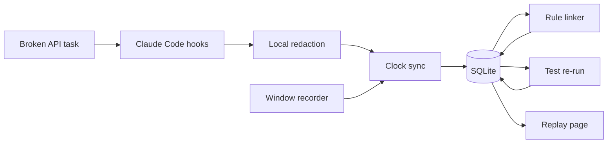

Summary: Ship a consented evidence agent that links one failed API test to the later pass, and lets a judge click that claim.
Goal: A working Antler Agents demo submitted before Thursday 29 October 2026, 5:00 PM Central.
Rules: Fixture is the product · No score · Window only · Thursday noon freeze
Intent: Add the full scope to win this hackathon to the repo.
Not wanted: scores · ranks · hire recommendations · camera · microphone · full desktop · week-long capture · graph database · a second coding agent on the critical path

Track: Antler Agents
Deadline: 2026-10-29 17:00 America/Chicago
Fair: 2026-10-30 13:00 America/Chicago
Repo: https://github.com/yeruvamaheswar/DevLens

## Loop
1. Write the winning scope · Cursor (auto)
2. Approve this contract · user
3. Build slice 1 · Cursor (auto)

## Work
### Always loaded
- This contract
- `examples/broken-api` once slice 1 exists
- The recorded fixture once slice 2 exists
### On demand
- Research notes in the private AITX research folder
- Claude Code hook docs
- MDN `getDisplayMedia` and `displaySurface`
### Steps
- [x] Publish the empty public repo · Cursor · https://github.com/yeruvamaheswar/DevLens is public on main · delete the GitHub repo
- [ ] Approve this contract · user · Reply that the requirements and the not-wanted list stand · revert the contract commit
### Open
- Team roster: unknown
- Interactive Claude hook trust before the folder is trusted: unknown
- `PostToolUseFailure` on a real failing test: unknown
- Deployed URL: unknown

## Requirements
| ID | Requirement | Source |
|---|---|---|
| REQ-1 | Recording starts only after an explicit opt-in click. A page load does not record. | user |
| REQ-2 | The developer picks one window. If `displaySurface` is `monitor`, discard that take and ask again. Audio stays off. | agent |
| REQ-3 | Start, pause, and stop work. The developer can play the file before anyone else sees it. Pause time is excluded from `media_offset_ms`. | agent |
| REQ-4 | `devlens init` installs Claude Code hooks that append redacted JSONL. Each event has `session_id` and `tool_use_id` when the hook provides them. | agent |
| REQ-5 | One task repo has a broken API client. The starter test fails. A plausible first fix fails a second assertion. A later change passes. Both commits stay. | agent |
| REQ-6 | Fixed rules write a `verifies` edge from the later passing test to the second patch. Each edge stores `derived_by` and event ids. The model does not insert edges. | agent |
| REQ-7 | A worker re-runs the tests. That result is stored and labeled separately from the session's own test line. | agent |
| REQ-8 | A reviewer click seeks the window recording to that event and shows the diff, the test output, the question, and the answer on one screen. | agent |
| REQ-9 | The reviewer sees at least three questions. Each question cites event ids. | user |
| REQ-10 | The page lists unknowns: unattributed changes, inferred edges, and no claim that the session predicts job performance. | agent |
| REQ-11 | `npm run demo` renders the fixture chain with the network off. | agent |
| REQ-12 | A secret in the capture stream is absent from the exported JSON. Redaction runs before the event is appended. | user |
| REQ-13 | The public README has a quick start, the stack, an architecture diagram, env setup, data provenance, limitations, and next steps. A 2–5 minute Loom exists. The Airtable form is submitted before the deadline. | user |
| REQ-14 | The page states what was not captured: reasoning, the editor, other terminals, camera, and microphone. | user |
| NOT-1 | The product must not score, rank, mark a competency met or unmet, recommend a hire, or give a cheating verdict. | user |
| NOT-2 | The product must not record the camera, the microphone, the full desktop, or keystroke timing. | user |
| NOT-3 | The critical path must not add Cursor, Codex, a graph database, login, an ATS, billing, or a seven-day capture. | agent |
| NOT-4 | A synthetic multi-day strip, if shown, must be labeled synthetic. It must not be described as a real week. | agent |
| NOT-5 | The judging-table demo must not depend on a live model call. | agent |

## Decisions
| ID | Decision | By |
|---|---|---|
| DEC-1 | Build the competitive slice: hooks, rule edges, sandbox re-run, clickable replay, questions, and redaction. The fixture is the safety net. | agent |
| DEC-2 | Enter Antler Agents. The form has no Open track. The agent does the re-run. A passive log summary is not the demo. | agent |
| DEC-3 | Store events, entities, and edges in SQLite. Traversals are one to three hops. | agent |
| DEC-4 | Claude Code is the only agent adapter on the critical path. Record the fixture early. | agent |
| DEC-5 | Capture is `getDisplayMedia` plus `MediaRecorder` for one window. ScreenCaptureKit, Screenpipe, OBS, and rrweb are not the recorder. | agent |
| DEC-6 | Claims come from hooks, git, and tests. The video is the picture of those claims. A video model does not invent a claim. | agent |
| DEC-7 | Freeze features at Thursday 29 October 2026, noon Central. 1:00–4:00 PM is for submission. | agent |
| DEC-8 | If the fixture has no linked failure and pass by Tuesday 27 October 2026, noon Central, stop this build. | agent |
| DEC-9 | This public repo is the hackathon product. Research notes stay out of it. | user |

## Evals
| ID | REQ | Check | Method | Result |
|---|---|---|---|---|
| EVAL-1 | REQ-1 | Opening the record page creates no media file until the opt-in click. | browser | not run |
| EVAL-2 | REQ-2, NOT-2 | A monitor choice is discarded. The saved file is one window. No camera track. | browser | not run |
| EVAL-3 | REQ-3 | A 5 second pause does not add 5 seconds to `media_offset_ms`. | unit | not run |
| EVAL-4 | REQ-4 | One `claude -p` prompt appends a JSONL line with `session_id` and `tool_use_id`. | integration | not run |
| EVAL-5 | REQ-5 | `npm test` in `examples/broken-api` fails on the starter commit and passes on the final commit. | integration | not run |
| EVAL-6 | REQ-6 | A hand-written two-event JSONL emits a `verifies` edge with `derived_by` set. | unit | not run |
| EVAL-7 | REQ-7 | The page shows the worker pass or fail apart from the session test line. | integration | not run |
| EVAL-8 | REQ-8 | Clicking the failure sets the player time and shows the diff, the test, the question, and the answer. | browser | not run |
| EVAL-9 | REQ-9, NOT-1 | Three questions each show an event id. Page source has no score, rank, or hire recommendation. | verifier diff | not run |
| EVAL-10 | REQ-10, REQ-14 | Unknowns and the not-captured list are visible on the fixture page. | browser | not run |
| EVAL-11 | REQ-11, NOT-5 | `npm run demo` works with the network disabled and with no API key. | integration | not run |
| EVAL-12 | REQ-12 | A fake `sk-` string in a hook payload is absent from the JSONL file. | unit | not run |
| EVAL-13 | REQ-13 | README sections exist, the Loom is 2–5 minutes, and the form is in before 5:00 PM Central on 29 October. | human | not run |
| EVAL-14 | NOT-3, NOT-4 | The demo repo has one agent adapter. Any extra day strip is visibly labeled synthetic. | human | not run |

## Infrastructure
| Resource | Defined in | Applied by | Secrets |
|---|---|---|---|
| TypeScript CLI and Next.js app | `package.json` | `npm install` | none |
| Claude Code project hooks | `.claude/settings.local.json` | `devlens init` | none |
| Event store | `packages/link/db.ts` | `devlens link` | none |
| Broken API task and fixture | `examples/broken-api` | `npm test` and `npm run demo` | none |
| Window recording | `apps/web/record/page.tsx` | browser `getDisplayMedia` | none |
| Reviewer player | `apps/web/replay/page.tsx` | `npm run demo` | none |
| GitHub repository | manual | `gh` | none |
| Public deploy | none | — | none |

## Observability
| Signal | Seen in | Eval |
|---|---|---|
| Hook append succeeded or failed | hook stderr and `.devlens/events.jsonl` | EVAL-4 |
| Secret stripped before write | unit test output | EVAL-12 |
| Sandbox pass or fail | reviewer page, separate from the session line | EVAL-7 |
| Score language absent | page source search | EVAL-9 |
| Fixture demo started with no network | local server log | EVAL-11 |

## Architecture

Event fields: `id`, `session_id`, `ts`, `actor`, `type`, `source`, `provenance`, `payload`, `recording_ref`, `media_offset_ms`.

Edge relations used in the demo: `prompted`, `called`, `edited`, `ran_test`, `failed`, `supersedes`, `verifies`, `cites`.

`actor` is `developer`, `agent`, `tool`, or `ci`. `provenance` is `observed` or `inferred`. Unhooked edits are `unattributed`, not human.

## Demo
| Time | Action | Line |
|---|---|---|
| 0:00 | Show the failing test | The finished repo hides the path. |
| 0:20 | Play the recorded Claude Code take | Hooks recorded the prompt, the tool calls, and the edits. |
| 1:00 | Show the failed patch, then the change of approach | The two test events are in the log. |
| 1:30 | Click the verifies claim | The raw event and the sandbox re-run open. |
| 2:10 | Show three questions and the unknowns | Questions, not a score. |
| 2:40 | Stop | We cannot see reasoning, other terminals, or later job performance. |

Recovery: if the live model or the picker fails, play the committed fixture and call it the recorded take. If the sandbox panel fails, hide it and keep the click. If the dashboard crashes, open the static export next to the fixture.

Do not say that nobody else does this, that the product predicts who to hire, that fewer tokens means a better engineer, that the demo is seven days, or that the store is a graph database.

Loom storyboard, recorded after the Thursday noon freeze: failing test, bad patch, second failure, passing test, timeline, citation click, sandbox line, questions and unknowns, diagram, limitations.

## Slices
### Slice 1: Task, types, and init
- Covers: REQ-4, REQ-5, REQ-12
- Model: Cursor (auto)
- Depends on: user approval of this contract
- Files: `packages/core/event.ts`, `packages/capture`, `examples/broken-api`
- [ ] Add the broken API task and confirm the starter test fails · Cursor · EVAL-5 · delete `examples/broken-api`
- [ ] Add the event type and a unit test for one redacted JSONL line · Cursor · EVAL-6 fixture input exists · delete `packages/core`
- [ ] Add `devlens init` and append one real hook event · Cursor · EVAL-4 · remove the generated `.claude` settings

### Slice 2: Fixture and links
- Covers: REQ-6, REQ-12, NOT-5
- Model: Cursor (auto)
- Depends on: Slice 1
- Files: `examples/broken-api/fixtures/session.jsonl`, `packages/capture/redact.ts`, `packages/link`
- [ ] Record the golden session with a failed test and a later pass · Cursor · JSONL contains both test results · label a hand-trimmed probe log
- [ ] Strip a fake key before append · Cursor · EVAL-12 · denylist regex only
- [ ] Load events to SQLite and emit the verifies edge · Cursor · EVAL-6 · hand-built edges in the fixture

### Slice 3: Replay capture
- Covers: REQ-1, REQ-2, REQ-3, REQ-8
- Model: Cursor (auto)
- Depends on: Slice 1
- Files: `apps/web/record/page.tsx`, `packages/core/src/sync.ts`, `examples/broken-api/fixtures/session.webm`
- [ ] Record one chosen window to a local WebM and reject a monitor · Cursor · EVAL-1 and EVAL-2 · commit a labeled fixture WebM
- [ ] Store `recording_ref` and `media_offset_ms` on hook events · Cursor · EVAL-3 · show events with no video
- [ ] On test failure, store one typed answer with no trait language · Cursor · answer text is on the event · static question in the fixture

### Slice 4: Reviewer page
- Covers: REQ-7, REQ-8, REQ-9, REQ-10, REQ-11, REQ-14, NOT-1
- Model: Cursor (auto)
- Depends on: Slice 2, Slice 3
- Files: `apps/web/replay/page.tsx`, `apps/web/questions.ts`, `packages/link/rerun.ts`
- [ ] Seek the player from a claim with the network off · Cursor · EVAL-8 and EVAL-11 · static HTML plus a video element
- [ ] Show the sandbox result · Cursor · EVAL-7 · omit the panel and say the re-run is manual
- [ ] Show three cited questions and the unknowns panel · Cursor · EVAL-9 and EVAL-10 · static questions in the fixture

### Slice 5: Submit
- Covers: REQ-13, NOT-3, NOT-4
- Model: Cursor (auto)
- Depends on: Slice 4
- Files: `README.md`
- [ ] Freeze at Thursday noon and revert anything that breaks `npm run demo` · Cursor · EVAL-11 still passes · restore the noon commit
- [ ] Finish the README, record the Loom, and submit the form · user · EVAL-13 · submit with the known gap written in the description

## Must ship vs later
| Must ship | Later, only after Tuesday noon fixture |
|---|---|
| Fixture timeline and one clickable edge | Live capture at the judging table |
| Window recording or a labeled fixture WebM | FFmpeg clips |
| Sandbox re-run or an honest omission | Cursor or Codex adapters |
| Three cited questions and the unknowns panel | Synthetic week strip |
| No score | Deployed URL |
| README and Loom | LLM narrative |

## Changes
| ID | Date | Change | Affects | Approved |
|---|---|---|---|---|
| CR-1 | 2026-10-26 | Winning scope added to the public repo from the same-day research. | REQ-1 through NOT-5 | user asked to add the scope |
