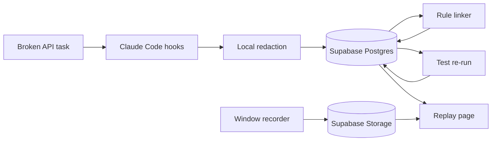

Summary: Thursday ships one clickable replay. Seven scenarios and desktop capture come only if that replay already works. A virtual desktop and a week-long project come after the fair.
Goal: Submit that demo to Antler Agents before Thursday 29 October 2026, 5:00 PM Central.
Rules: One golden replay must ship · Seven scenarios if time permits · Desktop is a second opt-in · Virtual desktop and the week view are later · No score
Track: Antler Agents, AITX and MLOps World
Deadline: Thursday 29 October 2026, 5:00 PM Central
Fair: Friday 30 October 2026, 1:00 PM Central
Repo: https://github.com/yeruvamaheswar/DevLens

## Loop
1. Read this page · user
2. Approve the contract in plans/devlens.contract.md · user
3. Build slice 1 · Cursor (auto)

## Work
### Always loaded
- This page
- plans/devlens.contract.md
- docs/implementation.md
### On demand
- Claude Code hook docs
- MDN getDisplayMedia
### Steps
- [x] Write the scope · Cursor (auto) · README, contract, and this page are on main · revert the docs commit
- [ ] Approve the contract · user · Reply that the requirements and the not-wanted list stand · revert the contract commit
- [ ] Build the five slices below · Cursor (auto) · npm run demo and npm run demo --offline · restore the Thursday noon commit
### Open
- Team roster: unknown
- Supabase project: unknown
- Deployed replay URL: unknown
- Thursday split for the seven scenarios: recommended one recorded replay plus six tasks. User has not confirmed.

## Scope layers

| Layer | What the developer gets | When |
|---|---|---|
| Thursday demo | One broken API task, a window recording, and a click from the failed test to the later pass | Must ship |
| If time permits | Six more tasks. Desktop capture beside window capture. Extra recordings only after the click works. | Before Thursday noon |
| After the fair | A virtual desktop they can download and tool. A week of the same evidence. | Not this submission |

Suggested scenarios, until you rename them:

| # | Task | Starter bug |
|---|---|---|
| 1 | broken-api | Wrong base URL. This is the recording. |
| 2 | swapped-field | The JSON key is wrong. |
| 3 | missing-auth | The bearer token is missing. |
| 4 | stale-cache | A cached error survives the fix on the server. |
| 5 | wrong-page | Pagination is off by one. |
| 6 | bad-date | The timestamp uses the wrong zone. |
| 7 | empty-list | A missing array counts as success. |

## What we are building

One product. One story. No score.

| Piece | What the judge sees |
|---|---|
| The task | A tiny API client that is broken on purpose |
| The session | Claude Code tries a fix. That fix still fails. A later change passes. |
| The recording | The code window the developer chose, with audio off |
| The claim | "The later test verifies the second patch." |
| The click | That moment in the video, plus the question, the answer, the diff, and the test |
| The limit | Three questions that cite event ids, and a panel of what DevLens does not know |

The page does not score, rank, or recommend a hire.

Story the fixture must contain:

| Step | What happens | Test |
|---|---|---|
| 1 | Candidate receives the starter | First assertion fails |
| 2 | Claude Code applies a plausible fix | A second assertion still fails |
| 3 | DevLens asks what failed. The developer types an answer | Answer is stored word for word |
| 4 | The developer changes approach | The test passes |
| 5 | A worker re-runs the same test | Pass on the final commit, fail on the first fix |

Both commits stay. A squash drops the git trailer that ties the commit to the session.

## Stack

| Layer | Tool | Job |
|---|---|---|
| Task | TypeScript in examples/broken-api | The broken client and its tests |
| Capture | Claude Code hooks via devlens init | Append prompts, tool calls, diffs, and test output |
| Redaction | Local denylist in packages/capture | Strip a secret before the line is written |
| Video | Browser getDisplayMedia and MediaRecorder | Window mode rejects a full monitor. Desktop mode keeps a monitor and labels it desktop. No camera. No mic. |
| Clock | packages/core | Turn the event time into a video seek time. Pause time is removed. |
| Links | Fixed rules in packages/link | Write edges. The model does not invent links. |
| Re-run | devlens rerun | Run the same test again and label that result observed |
| Data | Supabase Postgres | events, entities, edges. Row level security on. |
| Video file | Supabase Storage bucket recordings | Private. The page plays a short-lived signed URL. |
| Review | Next.js in apps/web | Replay page. Offline fallback is the committed JSONL and WebM. |

Not in this build: graph database, login, Cursor adapter, Codex adapter, camera, microphone, scores. Desktop mode is extra, after window mode works. The virtual desktop and the week view are after the fair.

## How we build it

Five slices. Stop at Tuesday noon if the fixture has no failed test linked to a later pass.

| Day | Slice | Done when |
|---|---|---|
| Monday 26 Oct | 1. Task, event type, devlens init | npm test fails on the starter. One hook line is written. |
| Tuesday 27 Oct | 2. Golden session, redaction, rule linker, Supabase load | JSONL has a fail and a later pass. verifies edge exists. Noon checkpoint. |
| Tuesday 27 Oct | 3. Consent page, window recording, pause math, one answer | WebM is in Storage, or a labeled local file. A 5 second pause test passes. |
| Wednesday 28 Oct | 4. Replay page, sandbox line, three questions, unknowns | One click seeks the video. Offline mode still seeks. |
| Thursday 29 Oct | 5. Freeze, Loom, README, Airtable | Noon freeze. Form in before 5:00 PM Central. |

| Command | What it does |
|---|---|
| devlens init | Installs the Claude Code hook and prints what is captured |
| devlens link | Runs the rules and writes edges |
| devlens rerun | Re-runs the test and stores that result |
| devlens serve | Opens the reviewer page |
| npm run demo | Plays the chain from Supabase |
| npm run demo --offline | Plays the same chain from local files |

## How we test it

| Check | Command or action | Passes when |
|---|---|---|
| Starter is broken | npm test in examples/broken-api | The first assertion fails |
| Final fix works | npm test on the last commit | The test passes |
| Hook writes a line | Throwaway claude -p | The line has session_id |
| Secret is stripped | Unit test with a fake sk- key | That string is absent from the file |
| Pause math | Unit test | A 5 second pause does not add 5 seconds to the seek time |
| Link exists | Unit test on two events | A verifies edge has derived_by set |
| Monitor rejected | Browser | Choosing the whole screen is discarded |
| Recording is opt-in | Browser | Page load creates no media file |
| Click seeks | Browser | The claim sets the video time and shows diff, test, question, and answer |
| Sandbox is separate | Page | The re-run line is not the same label as the session test |
| Questions | Page source | Three questions, each with an event id |
| No verdict | Search the page | The words score, rank, and hire are not a verdict |
| Secret stays server-side | Client bundle check | SUPABASE_SECRET_KEY is absent |
| Live demo | npm run demo | The Storage recording plays |
| Table fallback | npm run demo --offline | Same chain with the network off |
| Second machine | Teammate follows the README | Clean clone, npm install, npm run demo |
| Submit | Human | Loom is 2 to 5 minutes. Form is in before 5:00 PM Central. |

If the sandbox is broken and the click still works, ship without the sandbox. Do not add a score to fill the gap.

## How we present it

Two shows. The Loom is the submission. The fixture is the judging-table backup.

| When | What | Length |
|---|---|---|
| Thursday after noon | Loom, uploaded | 2 to 5 minutes |
| Thursday before 5:00 PM Central | Airtable form, public repo, 150 to 300 word write-up | — |
| Friday 1:00 PM Central | Hack Fair. Play the fixture if live capture fails. | About 3 minutes |

Loom and table script:

| Time | Show | Say |
|---|---|---|
| 0:00 | The failing starter test | The candidate had to fix a broken API client. The first test already failed. |
| 0:20 | The recorded code window | They used Claude Code. Hooks recorded the prompt, the tool calls, and the edits. We redact on the laptop. |
| 1:00 | Failed patch, then the new approach | The first patch still failed. The next change used a different approach. |
| 1:30 | Click the verifies claim | This edge says the later test verifies the second patch. This other line is our sandbox re-run. |
| 2:10 | Three questions and the unknowns panel | The reviewer gets questions, not a score. A change with no hooked event is unattributed. |
| 2:40 | Stop | We cannot see reasoning, other terminals, or whether this predicts job performance. |

If the table breaks:

| Failure | Do this |
|---|---|
| Claude quota or a live prompt error | Open the fixture. Say quota. Do not debug. |
| Window picker fails | Play the committed WebM. Call it the recorded take. |
| Dashboard crash | Open the static export next to the fixture. |
| Sandbox fails | Hide that panel. Keep the click. |
| Wi-Fi down | npm run demo is local. |
| A judge asks for Cursor | Say it is not in this build. |

Do not say: we predict who to hire. Fewer tokens means a better engineer. This is seven days of observation. The store is a graph database. The video proves what the developer understood.

When asked "is it an agent?": capture is hooks. The agent is the worker that re-runs the test and drops a claim the re-run does not support. The language model does not decide the links.

## Slices
### Slice 1: Task, types, and init
- Covers: the broken client, the event type, one hook line
- Model: Cursor (auto)
- Depends on: user approval of plans/devlens.contract.md
- Files: examples/broken-api, packages/core/event.ts, packages/capture
- [ ] Add the broken API task · Cursor (auto) · npm test fails on the starter commit · delete examples/broken-api
- [ ] Add the event type · Cursor (auto) · typecheck passes · delete packages/core
- [ ] Add devlens init · Cursor (auto) · one JSONL line from claude -p · remove the generated Claude settings

### Slice 2: Fixture and links
- Covers: golden session, redaction, verifies edge, Supabase load
- Model: Cursor (auto)
- Depends on: Slice 1
- Files: examples/broken-api/fixtures/session.jsonl, packages/link, supabase/migrations
- [ ] Record a fail and a later pass · Cursor (auto) · both results are in the JSONL · label a hand-trimmed log
- [ ] Strip a fake key · Cursor (auto) · the key is absent · denylist only
- [ ] Emit the verifies edge in Supabase · Cursor (auto) · devlens link --fixture upserts the session · hand-built local edges

### Slice 3: Replay capture
- Covers: opt-in recording, pause math, one typed answer
- Model: Cursor (auto)
- Depends on: Slice 1
- Files: apps/web/record/page.tsx, packages/core/src/sync.ts
- [ ] Record one window and reject a monitor · Cursor (auto) · WebM is in Storage or labeled local · commit a fixture WebM
- [ ] Exclude pause time from the seek offset · Cursor (auto) · the 5 second pause test passes · document a continuous take
- [ ] Store one typed answer · Cursor (auto) · the answer text is on the event · a static question in the fixture

### Slice 4: Reviewer page
- Covers: click-to-seek, sandbox line, three questions, unknowns, offline fallback
- Model: Cursor (auto)
- Depends on: Slice 2, Slice 3
- Files: apps/web/replay/page.tsx, apps/web/questions.ts, packages/link/rerun.ts
- [ ] Seek the recording from a claim · Cursor (auto) · click sets the video time online and offline · static HTML plus the local WebM
- [ ] Show the sandbox result · Cursor (auto) · the re-run is labeled separately · omit the panel and say the re-run is manual
- [ ] Show three cited questions and the unknowns · Cursor (auto) · each question has an event id and there is no score · static questions

### Slice 5: Submit
- Covers: README, Loom, Airtable
- Model: Cursor (auto)
- Depends on: Slice 4
- Files: README.md
- [ ] Freeze at Thursday noon · Cursor (auto) · npm run demo still passes · restore the noon commit
- [ ] Record the Loom and submit the form · user · form is in before 5:00 PM Central · submit with the known gap written in the description
