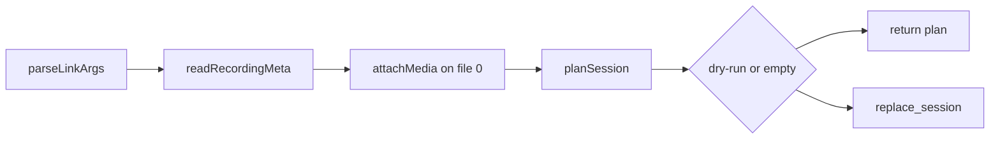

Summary: Commit 96e8db3 attaches recording metadata on the session file only, and the golden dry-run plan matches that clock.
Goal: Independent read-only review of commit 96e8db3
Verdict: PASS WITH FINDINGS
Commit: 96e8db35fffef2dccb2f2669c1170d926ab4eeff
HEAD during tests: ea8d6339360cafad02f3c72765897bffb3d6b6df
Reviewed files match 96e8db3: yes · later commits do not change them
Rules: read-only · no live link · no .env · temp copies only under /tmp

## Loop
1. Review commit 96e8db3 · Grok (review)
2. Read the findings · user

## Findings
| ID | Severity | Location | Observed | Reproduce | Recommendation |
|---|---|---|---|---|---|
| F1 | Medium | `packages/cli/src/link.ts:84` | `readRecordingMeta` accepts a meta file the upload gate would reject. A dry-run plan still sets `recording_ref` and `media_offset_ms`. Null or omitted `wall_end_ms` leaves the window open (`media_offset_ms` 4000 for an event 4s after start). `consent: false` with `audio_tracks: 2` still attaches. `recording_ref` `../other-bucket/take.webm` is copied through. Overlapping pauses `[10000,14000]` and `[12000,16000]` produce offset 2000 for an event at 20000; the union of those pauses is 6000 ms, so the in-range offset is 2000 instead of 4000. An inverted pause, or `wall_end_ms` as a string, sets every media field to null and `runLink` still returns. A pause before the take produced `media_offset_ms` -5000. An open take produced offset 1793117454405. | `/tmp/slice6-probe.mts` and `/tmp/slice6-probe2.mts`, `runLink` with `dryRun: true` and an RPC client that throws. | Reject metadata with the same rules as `parseMetaBody` in `apps/web/api/recordings/gates.ts:68`, and require `recording_ref` to be `{recording_id}/take.webm`. Fail the link before `planSession` when that check fails. |
| F2 | Medium | `examples/broken-api/scripts/fixture-verify.ts:207` | The new checks fail for a window that excludes an event, `bytes` off by 1, `audio_tracks` 1, `video_tracks` 2, `consent` false, and `wall_end_ms` null. A byte-identical copy of the golden folder passes. The same script then passes `recording_ref` `""`, `recording_ref` `wrong-id/take.webm`, `mode` `desktop` with `display_surface` `monitor`, and `bytes` null. `attachMedia` writes `meta.recording_ref` onto every in-window event, so the `recording_ref !== meta.recording_ref` clause does not fail. | Copy under `/tmp/slice6-fv`. Run the copied `fixture-verify.ts` with `tsx`. Restore `meta.json` after each case. `restored true`. | Compare `recording_ref` with `{recording_id}/take.webm` on the parsed meta. Require `mode` `window`, `display_surface` other than `monitor`, and a numeric `bytes` equal to the WebM size. |
| F3 | Low | `examples/broken-api/scripts/fixture-verify.ts:212` | A meta object with no `pauses` field is valid JSON. `attachMedia` throws while iterating `pauses`. The catch reports `meta.json is not valid JSON`. An event inside a pause fails as `1 event(s) fall outside the recording window`. | Same temp copy. Delete `pauses`, then add a pause from `wall_start_ms` for 20000 ms. | Report the thrown message. Say when the null offset is inside a pause. |
| F4 | Low | `packages/cli/src/link.ts:53` | A following flag is a legal path. `link session.jsonl --recording --dry-run` sets `recording` to `--dry-run` and leaves `dryRun` false. The CLI prints `Cannot read recording metadata --dry-run` and exits 1. A repeated `--recording` keeps the last path. `--recording=meta.json` is a usage error. A missing value at the end of the command is a usage error and exits 1. | `parseLinkArgs` in `/tmp/slice6-probe.mts`. CLI: `./node_modules/.bin/tsx packages/cli/src/link.ts examples/broken-api/fixtures/golden/session.jsonl --recording --dry-run`. | If the value starts with `--`, print the usage error. |

## Answers
| Question | Result |
|---|---|
| Empty file, missing file, missing `recording_ref`, `wall_start_ms`, or `pauses` | Throw before a plan. Empty and missing files share `Cannot read recording metadata <basename>`. No RPC. |
| `wall_end_ms: null` | CLI attaches with no end bound (F1). `fixture:verify` fails with `meta.json has no usable recording window` and no outside-window line. |
| Event `ts` before or after the window | The event stays in the plan. `recording_ref` and `media_offset_ms` become null, which clears a previous ref. `ts` equal to `wall_start_ms` gets offset 0. `ts` equal to `wall_end_ms` gets `wall_end_ms - wall_start_ms`. One millisecond outside becomes null. |
| Re-run file | `attachMedia` runs only for file index 0. An in-window re-run event kept `rerun-keep.webm` and offset 42. The golden sandbox row stayed null. The same id in both files throws `Event id "same" appears twice with different content` before RPC. |
| `planSession` order | Sort by `ts`, then file order. `seq` restarts at 1 per session. Offsets stay on the event id. Golden edges with and without `--recording` are the same 32 ids. Session `44a60462-1d30-4fa3-8c72-dbc789421a38` would be written as seq 1..13. The file has seq 18..30. `planSession` already did this. This commit does not change that function. |
| Double attach | One `attachMedia` call. An event that already had `old.webm` and offset 999 became the meta ref and offset 0. |
| `--recording` with `--fixture` | Usage error. Exit 1. `--fixture --dry-run` still prints `events: 5` and `edges: 2`. |
| Flag before the file | `parseLinkArgs(['link','--recording','meta.json','events.jsonl'])` returns that pair. CLI dry-run with the flag first prints `events: 30` and `edges: 32`. |
| Golden clock | 30 events, 0 outside the window. Margins 19024 ms and 12929 ms. Offsets 19024..264918. All equal `Date.parse(ts) - wall_start_ms`. WebM size 16047324 matches `bytes`. `recording_ref` is `{recording_id}/take.webm`. A shift of both bounds by 1000 ms still passes `fixture:verify`. A start shift of 20000 ms fails one event. |



## Supabase
- Dry-run only. In-process RPC count stayed 0. `runLink` returns at `packages/cli/src/link.ts:202` before `loadServerEnv` and `createClient`.
- A non-dry link of the golden JSONL would replace two sessions: `ec6f600a-3902-459e-8769-3c13e7361948` (17 events, seq 1..17) and `44a60462-1d30-4fa3-8c72-dbc789421a38` (13 events, seq 1..13). Every event would get `recording_ref` `d4ce73f0-7d0c-4e05-aa02-a5d1ec359493/take.webm` and the offsets above. Edge count 32, same ids as a link without `--recording`.
- The column in `supabase/migrations/20261026210000_devlens_evidence.sql:10` is `media_offset_ms integer check(media_offset_ms >= 0)`. The overlap offset 2000 fits that column. The plan values -5000 and 1793117454405 do not. This review did not execute SQL.
- `packages/core/server.ts:73` signs the first event `recording_ref` with the service role. A bad ref in the meta would be the signed path. The working tree has other edits in that file from the parallel agent. The signing call is still present.
- `--rerun` on the golden sandbox file adds one event, seq 14, `recording_ref` null. That file comes from commit 10978d9, after the reviewed commit.

## Commands
HEAD `ea8d633`. `npx tsc --noEmit` reported no diagnostics. `tsconfig.json` includes `packages` and `apps` only, so it does not check `fixture-verify.ts`. No `examples/` or `apps/web/` type errors appeared.

### `npx tsc --noEmit` exit 0
```
(node:44178) Warning: The 'NO_COLOR' env is ignored due to the 'FORCE_COLOR' env being set.
(Use `node --trace-warnings ...` to show where the warning was created)
```

### `npm run test:sync` exit 0
```
> test:sync
> vitest run packages/core/src/sync.test.ts

 RUN  v5.0.5 /Users/UmaYeruva/Code-Git-Repos/DevLens

 ✓ packages/core/src/sync.test.ts (8 tests) 5ms

 Test Files  1 passed (1)
      Tests  8 passed (8)
   Start at  12:11:56
   Duration  193ms (transform 65%, import 23%, tests 7%, worker 5%)
```

### `npm run test:link` exit 0
```
> test:link
> vitest run packages/link/tests/rules.test.ts

 RUN  v5.0.5 /Users/UmaYeruva/Code-Git-Repos/DevLens

 ✓ packages/link/tests/rules.test.ts (13 tests) 20ms

 Test Files  1 passed (1)
      Tests  13 passed (13)
   Start at  12:11:56
   Duration  300ms (import 55%, transform 31%, tests 11%, worker 2%)
```

### `npm run test:rerun` exit 0
```
> test:rerun
> vitest run packages/link/tests/rerun.test.ts

 RUN  v5.0.5 /Users/UmaYeruva/Code-Git-Repos/DevLens

 ✓ packages/link/tests/rerun.test.ts (14 tests) 2190ms
   ✓ sandbox re-run (5)
     ✓ fails the first-fix repo and passes the final-fix repo 1079ms
     ✓ kills a hanging command at the wall-clock timeout 492ms

 Test Files  1 passed (1)
      Tests  14 passed (14)
   Start at  12:11:56
   Duration  2.35s (tests 98%, transform 1%, import 1%)
```

### `npm run fixture:verify -- broken-api` exit 0
```
> fixture:verify
> tsx examples/broken-api/scripts/fixture-verify.ts broken-api

PASS
```

### `npm run scenario:verify -- broken-api` exit 0
```
> scenario:verify
> node examples/broken-api/scripts/scenario-verify.mjs broken-api

verifier inputs, not a recorded take
starter: PASS
first-fix: PASS
final-fix: PASS
```

Each npm command also printed Node's `NO_COLOR` / `FORCE_COLOR` warning. The blocks above omit that warning. Exit codes are the process status.

### Temp `fixture:verify` cases
| Case | Exit | Output |
|---|---|---|
| valid copy | 0 | PASS |
| both bounds +1000 ms | 0 | PASS |
| `wall_start_ms` +20000 | 1 | FAIL: 1 event(s) fall outside the recording window in meta.json |
| `wall_end_ms` -13000 | 1 | FAIL: 1 event(s) fall outside the recording window in meta.json |
| `bytes` +1 | 1 | FAIL: session.webm size does not match meta.json bytes |
| `audio_tracks` 1 | 1 | FAIL: meta.json does not show consent, one video track, and no audio |
| `video_tracks` 2 | 1 | FAIL: meta.json does not show consent, one video track, and no audio |
| `consent` false | 1 | FAIL: meta.json does not show consent, one video track, and no audio |
| `wall_end_ms` null | 1 | FAIL: meta.json has no usable recording window |
| `bytes` null | 0 | PASS |
| `recording_ref` empty | 0 | PASS |
| `recording_ref` `wrong-id/take.webm` | 0 | PASS |
| desktop and monitor | 0 | PASS |
| pause covers the first event | 1 | FAIL: 1 event(s) fall outside the recording window in meta.json |
| `{` | 1 | FAIL: meta.json is not valid JSON |
| `pauses` omitted | 1 | FAIL: meta.json is not valid JSON |
| `meta.json` removed | 1 | FAIL: meta.json is missing; copy the recording meta.json from private storage next to session.webm |

### CLI, dry-run only
| Command | Exit | Output |
|---|---|---|
| `--dry-run --recording <golden meta> <golden jsonl>` | 0 | events: 30 / edges: 32 |
| `<golden jsonl> --recording <golden meta> --rerun <golden rerun> --dry-run` | 0 | events: 31 / edges: 32 |
| `--fixture --dry-run` | 0 | events: 5 / edges: 2 |
| `--fixture --recording <golden meta> --dry-run` | 1 | Usage line |
| `<golden jsonl> --dry-run --recording` | 1 | Usage line |
| `<golden jsonl> --recording --dry-run` | 1 | Cannot read recording metadata --dry-run |

## Work
### Always loaded
- `CLAUDE.md`
- `git show 96e8db3`
- `packages/cli/src/link.ts`
- `packages/core/src/sync.ts`
- `examples/broken-api/scripts/fixture-verify.ts`
- `examples/broken-api/fixtures/golden/meta.json`
### On demand
- `apps/web/api/recordings/gates.ts`
- `packages/core/server.ts`
- `supabase/migrations/20261026210000_devlens_evidence.sql`
- `supabase/migrations/20261026240000_replace_session_rpc.sql`
### Steps
- [x] Read the commit and the media writer · Grok (review) · three files match 96e8db3 · no code change
- [x] Probe parse, windows, re-run, and dry-run plans · Grok (review) · RPC count 0 · probes under /tmp
- [x] Mutate a golden copy outside the repo · Grok (review) · requested failures fail and the valid copy passes · copy left under /tmp
- [x] Run the six requested commands · Grok (review) · all exit 0 · no repo edit
### Open
- Live `replace_session` for the negative and oversized offsets: unknown
- Signed URL for a non-storage `recording_ref`: unknown

## Not checked
- A non-dry `devlens link`. No live insert, rollback, RLS, or role check.
- SQL execution of the integer check.
- WebM playback and a visual redaction pass. The fixture secret-pattern scan passed as part of `fixture:verify`.
- Payload contents of `session.jsonl`.
- Files the other agent added under `examples/` and `apps/web/`, beyond the clean `tsc` run.
- HTML page. The review brief allowed only this markdown file.
